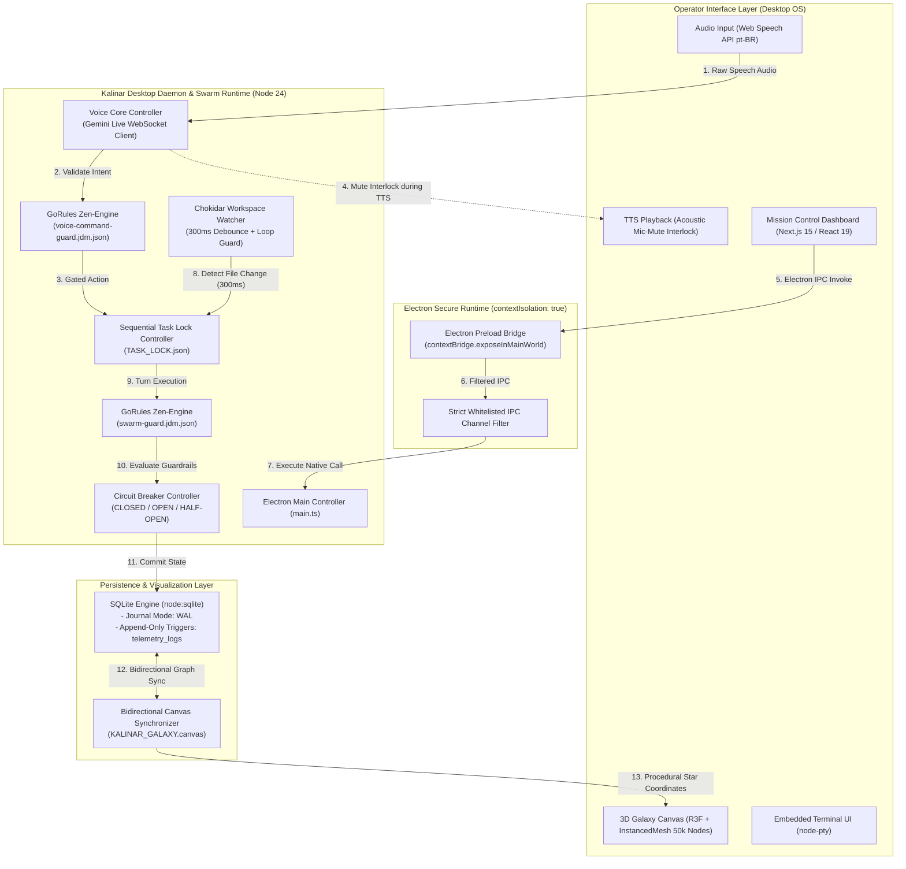

# 02 - Technical Requirements & Architecture Document (`02_TRD.md`)

> Document ID: `DOC-02-TRD-KALINAR`  
> Lead Agents: `@agent-software-engineer` + `@agent-orchestrator`  
> Co-Authors: `@human-developer`, `@agent-cybersecurity`, `@agent-design`, `@agent-data`, `@agent-qa`  
> Gate Status: `APPROVED_BY_SWARM_PENDING_HUMAN`  
> Visual Constraint: `STRICT ZERO-EMOJI ENFORCEMENT - TYPOGRAPHICAL & ASCII ONLY`

---

## Collaborative Sign-Off Header Table

| Participant | Domain Role | Review Focus | Status | Timestamp (UTC) | Cryptographic / Msg Ref |
| :--- | :--- | :--- | :---: | :---: | :--- |
| `@human-developer` | Principal Architect & Final Authority | Technical Strategy, Operational Boundaries | `PENDING` | -- | `PO-APPROVAL-PENDING` |
| `@agent-software-engineer` | Full-Stack Architect & Author | Electron OS, Node 24 Native Engine, SQLite WAL | `APPROVED` | `2026-10-28T10:50:00Z` | `SIG-ENGR-TRD-002` |
| `@agent-orchestrator` | Swarm Facilitator & Technical Lead | Inter-Agent Contracts, Pipeline Latency Budgets | `APPROVED` | `2026-10-28T10:51:00Z` | `SIG-ORCH-TRD-002` |
| `@agent-cybersecurity` | Shift-Left DevSecOps Lead | Electron IPC Isolation, Voice Command Gating | `APPROVED` | `2026-10-28T10:52:00Z` | `SIG-CSEC-TRD-002` |
| `@agent-design` | UI/UX & Design System Architect | 3D Galaxy R3F Shaders, Token Harmonization | `APPROVED` | `2026-10-28T10:53:00Z` | `SIG-DSGN-TRD-002` |
| `@agent-data` | Decision Engine Specialist | Zen-Engine Voice Guard, Canvas Sync Schema | `APPROVED` | `2026-10-28T10:54:00Z` | `SIG-DATA-TRD-002` |
| `@agent-qa` | Test Architect & Quality Lead | Vitest Mocking, E2E Headless Browser Harness | `APPROVED` | `2026-10-28T10:55:00Z` | `SIG-QATE-TRD-002` |

---

## 1. Canonical Technology Stack & Version Lock

| Architectural Layer | Selected Technology | Exact Version / Mode | Rationale & Architectural Decision |
| :--- | :--- | :--- | :--- |
| **Desktop Runtime & OS** | Electron + Node.js 24 | `Electron ^33.x` / `Node.js 24 LTS` | Secure desktop container (`main.ts` + `preload.ts`), `contextIsolation: true`, `nodeIntegration: false`. |
| **Terminal & Native Shell** | `node-pty` | `node-pty ^1.1.0` | High-fidelity pseudo-terminal emulation for interactive shell execution inside the Desktop OS. |
| **Workspace File Watcher** | `chokidar` | `chokidar ^4.0.3` | Multi-workspace change detection with `300ms` debounce and bidirectional state reconciliation. |
| **3D Singularity & Galaxy Engine** | Three.js + R3F + Drei + GPGPU | `three ^0.170.0`, `@react-three/fiber ^8.17.0`, `@react-three/drei ^9.120.0` | Central KALINAR Black Hole Singularity (Event Horizon dark core + GPGPU accretion disk) + `THREE.InstancedMesh` rendering 50,000+ star nodes at 60 FPS. |
| **Voice Core & Live AI** | Web Speech API + Gemini Live WebSocket | `Web Speech API (pt-BR)` + `wss://generativelanguage.googleapis.com` | Sovereign commanding tactical persona (pt-BR); real-time voice streaming with acoustic mic-muting during TTS playback. |
| **Decision Rule Engine** | GoRules Zen-Engine | `@gorules/zen-engine ^2.1.9` | Declarative JDM tables (`swarm-guard.jdm.json` & `voice-command-guard.jdm.json`). |
| **State Storage & Persistence** | SQLite via `node:sqlite` | Native Node 24 `DatabaseSync` (`WAL mode`) | Zero external database dependencies; append-only triggers on `telemetry_logs`; atomic state journals. |
| **Canvas State Sync** | JSON Canvas Protocol | `KALINAR_GALAXY.canvas` | Bidirectional synchronization between SQLite task/agent nodes and Obsidian visual graph canvas. |
| **Validation & Schema Contracts** | Zod | `zod ^4.6.7` | Type-safe runtime parsing of turn outputs, voice command intents, and Electron IPC payloads. |
| **Frontend Framework** | Next.js (App Router) / React 19 | `Next.js 15.x` + `React 19.x` | React Server Components (RSC), Client Islands for 3D Galaxy viewport, zero client bundle bloat. |
| **Styling & Token System** | Tailwind CSS v4 | `v4.x` + 3-tier CSS Custom Properties | Semantic tokens (`--ds-*`), Pure Void base (`#000000`), Event Horizon Lavender (`#AA88FF`), Arc Cyan (`#00F0FF`), zero-runtime CSS. |
| **Testing & Verification** | Vitest + Playwright | `Vitest ^5.0.5` + `Playwright ^1.49.0` | Unit, integration, JDM rule validation, and headless E2E verification of UI and 3D scenes. |

---

## 2. System Topology & Zero-Trust Execution Boundaries



---

## 3. Zero-Trust Invariant Contracts

### 3.1 Electron OS Security & IPC Isolation Contract
* **Context Isolation:** `contextIsolation: true` and `nodeIntegration: false` enforced across all `BrowserWindow` instances.
* **Strict Whitelist Bridge:** The `preload.ts` script exposes only typed, sanitized IPC invoke handlers (`kalinarApi.invokeTaskAction`, `kalinarApi.onTelemetryStream`, `kalinarApi.onVoiceStateChange`). Raw `ipcRenderer.send` or `ipcRenderer.on` are forbidden.
* **Navigation Locking:** Navigation to external web URLs is blocked via `webContents.on('will-navigate', (event) => event.preventDefault())`. External links are dispatched exclusively through `shell.openExternal`.

### 3.2 3D Singularity & Galaxy Engine Performance Contract (`FLOW-GALAXY-LOD-01`)
* **Layer 0 Central Singularity:** Central KALINAR Black Hole Singularity featuring an Event Horizon dark core with `#AA88FF` / `#DDDDDD` GPGPU particle accretion disk stirred by cursor Navier-Stokes fluid simulation and modulated in real time by Kalinar's voice waveform.
* **Mesh Instancing:** All orbital star nodes (agents, memory files, execution steps) are rendered via a single `THREE.InstancedMesh` per archetype to achieve 60 FPS with 50,000+ procedural entities orbiting the central Black Hole.
* **Spatial Octree LOD:** Camera frustum and spatial octree partition the galaxy. Nodes beyond distance $D_{\text{LOD}}$ collapse to point impostors; nodes within focal distance hydrate full metadata badges and graph pointer beams.
* **GPU Memory Ceiling:** VRAM consumption capped at $\le 250\text{MB}$ for the entire 3D canvas context.

### 3.3 Voice Core, Singularity Voice Persona & Acoustic Interlock (`FLOW-VOICE-KALINAR-01`)
* **Sovereign Singularity Persona:** KALINAR is the Black Hole Singularity itself, speaking in `pt-BR` with a deep, sovereign, commanding tactical persona (Tauz-inspired gravity and authority). All legacy references to separate external assistants or top-right voice orbs are completely eliminated. Live voice transcription renders directly inside the right column `[singularity_core]` block in `#AA88FF`, while the voice waveform directly modulates the Layer 0 particle accretion disk.
* **Acoustic Interlock:** During any TTS audio playback, the Web Speech microphone stream is hardware-muted at the audio graph level to prevent acoustic feedback loops where the singularity transcribes its own output.
* **Zen-Engine Voice Guard:** Destructive voice commands (`/pause`, `/halt`, `/trip`, `/rotate`, `/release`) pass through `voice-command-guard.jdm.json`. Unrecognized or ambiguous intents require explicit spoken confirmation (`[CONFIRM_ACTION]`).
* **Gemini Live WebSocket:** Streaming audio packets are transmitted via secure TLS WebSocket (`wss://`) with payload chunking $\le 40\text{ms}$.

### 3.4 Multi-Workspace File Watcher Invariants
* **Debounce Window:** `chokidar` enforces a strict `300ms` sliding-window debounce to collapse rapid IDE saves into a single atomic change event.
* **Loop Prevention Rule:** File writes initiated by Kalinar agents mutate a single-writer token file (`.kalinar-lock`). The watcher ignores events tagged with the active agent token, preventing recursive agent-watcher-agent trigger storms.
* **Ignored Paths:** `.git`, `node_modules`, `.next`, `dist`, `*.db-wal`, and `*.db-shm` are excluded at watcher initialization.

### 3.5 Database Transaction & Canvas Sync Invariants
* **WAL Mode Enforcement:** `PRAGMA journal_mode = WAL;` and `PRAGMA synchronous = NORMAL;` executed unconditionally on startup.
* **Append-Only Telemetry:** SQLite database triggers strictly forbid `UPDATE` and `DELETE` queries on the `telemetry_logs` table.
* **Canvas Bidirectional Sync:** File changes to `KALINAR_GALAXY.canvas` are parsed and reflected in SQLite task node metadata; SQLite state changes update node positions and color tokens in `KALINAR_GALAXY.canvas` within `< 100ms`.

---

## 4. Performance & Core Web Vitals Budgets

| Metric Parameter | Target Budget | Upper Enforcement Limit | Verification Strategy |
| :--- | :--- | :--- | :--- |
| **3D Galaxy Render Frame Rate** | `60 FPS` | `> 55 FPS` | R3F performance monitor stats during 50,000 node rotation. |
| **Spatial Octree LOD Query** | `< 4ms` | `8ms` | Benchmark spatial query on camera frustum change. |
| **Voice STT -> Intent Latency** | `< 250ms` | `350ms` | Web Speech API speech end to Zen-Engine evaluation. |
| **Gemini Live WebSocket p95** | `< 300ms` | `500ms` | WebSocket roundtrip audio chunk latency. |
| **SQLite Turn Write Latency** | `< 5ms` | `15ms` | Vitest benchmark test with 1,000 synthetic turns. |
| **Chokidar Debounce Latency** | `300ms` | `350ms` | Time from file modification to task trigger dispatch. |
| **Electron UI Cold Startup** | `< 1.2s` | `2.0s` | Time from `app.ready` to first window render. |

---

## 5. Security, Headers & Content Security Policy (CSP)

The Electron renderer and Next.js shell enforce strict security headers:

```http
Content-Security-Policy: default-src 'self'; script-src 'self' 'nonce-{RANDOM}'; style-src 'self' 'unsafe-inline'; img-src 'self' data:; connect-src 'self' ws: wss: https://generativelanguage.googleapis.com; font-src 'self'; frame-ancestors 'none'; base-uri 'self'; form-action 'self';
X-Frame-Options: DENY
X-Content-Type-Options: nosniff
Referrer-Policy: strict-origin-when-cross-origin
```

---

## 6. Environmental Configuration & Invariants

```env
# Desktop OS & Core System
NODE_ENV=production
KALINAR_PORT=3000
KALINAR_DB_PATH=c:/Kalinar/kalinar-state.db
KALINAR_JDM_PATH=c:/Kalinar/rules/swarm-guard.jdm.json
KALINAR_VOICE_JDM_PATH=c:/Kalinar/rules/voice-command-guard.jdm.json
KALINAR_CANVAS_PATH=c:/Kalinar/KALINAR_GALAXY.canvas
SECOND_BRAIN_PATH=C:/Users/thiag/.gemini/config/skills/second brain

# Voice Core & Live AI
GEMINI_API_KEY=REDACTED_MANDATORY_SECRET
VOICE_LOCALE=pt-BR
MIC_DEBOUNCE_MS=200

# Swarm Operational Guardrails
TURN_TIMEOUT_MS=600000
MAX_TURNS_PER_TASK=50
MAX_CONSECUTIVE_FAILURES=3
WATCHER_DEBOUNCE_MS=300
```
