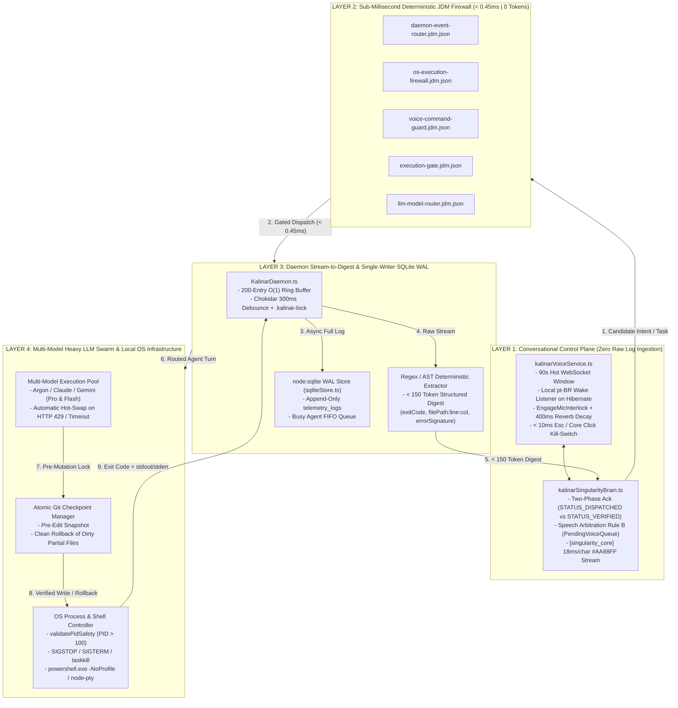

# 02_TRD.md — KALINAR SINGULARITY TECHNICAL REQUIREMENTS & ARCHITECTURE (v1.1.0 LOCK)

> **Document ID:** `DOC-02-TRD-KALINAR-v1.1.0`  
> **Lead Agents:** `@agent-software-engineer` + `@agent-orchestrator`  
> **Co-Authors:** `@human-developer`, `@agent-cybersecurity`, `@agent-design`, `@agent-data`, `@agent-qa`  
> **Gate Status:** `APPROVED_BY_SWARM_LOCKED_V1_1_0`  
> **Visual Constraint:** `STRICT ZERO-EMOJI ENFORCEMENT — ASCII & MONOSPACE TELEMETRY ONLY`

---

## Collaborative Sign-Off Header Table

| Participant | Domain Role | Review Focus | Status | Timestamp (UTC) | Cryptographic / Msg Ref |
| :--- | :--- | :--- | :---: | :---: | :--- |
| `@human-developer` | Sovereign Principal Architect | Technical Strategy, 4-Layer Decoupling, Release v1.1.0 Lock | `APPROVED` | `2026-11-03T19:03:00Z` | `PO-APPROVAL-TRD-110` |
| `@agent-software-engineer` | Full-Stack Architect & Author | Electron 33, Node 24 WAL, Multi-LLM Router, Git Checkpoint | `APPROVED` | `2026-11-03T19:03:10Z` | `SIG-ENGR-TRD-110` |
| `@agent-orchestrator` | Swarm Facilitator & Technical Lead | 4-Layer Decoupling, FIFO Queue, Pipeline Latency Budgets | `APPROVED` | `2026-11-03T19:03:20Z` | `SIG-ORCH-TRD-110` |
| `@agent-cybersecurity` | DevSecOps & PID Gatekeeper | `ELECTRON_IPC_CHANNELS` Whitelist, `PID > 100` OS Gate | `APPROVED` | `2026-11-03T19:03:30Z` | `SIG-CSEC-TRD-110` |
| `@agent-design` | UI/UX & Design System Architect | 262k GPGPU Ping-Pong Targets, 50k InstancedMesh, 60 FPS | `APPROVED` | `2026-11-03T19:03:40Z` | `SIG-DSGN-TRD-110` |
| `@agent-data` | Decision Engine Specialist | 5 GoRules ZEN Graphs (`< 0.45ms`), Stream-to-Digest | `APPROVED` | `2026-11-03T19:03:50Z` | `SIG-DATA-TRD-110` |
| `@agent-qa` | QA & Traceability Auditor | Deterministic Vitest Suite, Headless Electron E2E | `APPROVED` | `2026-11-03T19:04:00Z` | `SIG-QATE-TRD-110` |

---

## 1. Canonical Version Lock & Runtime Topology

| Architectural Layer | Selected Technology | Exact Version / Mode | Rationale & Architectural Invariant |
| :--- | :--- | :--- | :--- |
| **Desktop Runtime & OS Shell** | Electron + Node.js 24 LTS | `Electron ^33.x` / `Node.js 24 LTS` | Native desktop container (`electron/main.ts` + `electron/preload.ts`) with `contextIsolation: true`, `nodeIntegration: false`, `sandbox: true`. |
| **Frontend UI & Build Pipeline** | React 19 + TypeScript + Vite | `React ^19.0.0`, `TS ^5.8.x`, `Vite ^6.x` | Isolated `React.memo` HUD islands over a locked `100vw x 100vh` `#000000` canvas; zero layout thrashing. |
| **Styling & Token System** | Tailwind CSS v4 | `Tailwind v4.x` + 3-Tier CSS Tokens | `--ds-surface-singularity-void: #000000`, `--ds-accent-singularity: #AA88FF`, `--ds-text-secondary: #9A9A9A` (`7.45:1` WCAG AAA). |
| **3D Singularity & Galaxy Engine** | Three.js / `@react-three/fiber` | `three ^0.187.0` + GPGPU Float Ping-Pong | `262,144` GPGPU accretion disk particles (`512x512` float RGBA buffer) + Navier-Stokes 2D cursor fluid (`256x256`) + `50,000` `THREE.InstancedMesh` nodes with Spatial Octree LOD. |
| **Sub-ms Decision Firewall** | GoRules ZEN Engine | `@gorules/zen-engine ^2.1.9` | Pre-warmed in-memory WASM/native evaluation (`< 0.45ms`, zero LLM token cost) across 5 canonical JDM graphs. |
| **State & Telemetry Persistence** | Native `node:sqlite` | `DatabaseSync` (`PRAGMA journal_mode = WAL`) | Zero C++ rebuild friction; `busy_timeout = 5000`; append-only triggers on `telemetry_logs`; historical hydration for Tab 2 charts. |
| **Workspace File Watcher** | `chokidar` | `chokidar ^4.0.3` (`300ms` debounce) | Sliding-window `300ms` debounce + `.kalinar-lock` single-writer token suppressing internal agent write loops. |
| **Native OS Shell & Process Gate** | `node-pty` / `powershell.exe` | `powershell.exe -NoProfile` / `node-pty` | Real OS command execution via `kalinar:execute_shell_command` guarded by `os-execution-firewall.jdm.json` and `PID > 100` zero-trust check. |
| **Multi-Model Heavy LLM Swarm** | Argon / Claude / Gemini Router | `llm-model-router.jdm.json` | Grants KALINAR full access to **Argon**, **Claude**, and **Gemini** (`Pro`/`Flash`) models with Atomic Git Checkpoints and automatic hot-swap failover. |

---

## 2. 4-Layer Voice & Execution Decoupling Architecture



### 2.1 Layer 1 — Conversational Control Plane (`kalinarSingularityBrain.ts` & `kalinarVoiceService.ts`)
* **90-Second Hot WebSocket Window & Zero-Cost Hibernation:** Active voice sessions maintain a `90s` hot connection window for immediate `< 50ms` turn-taking. After `90s` of operator silence, the remote socket hibernates to `[STANDBY]` and hands off to a zero-cost local `pt-BR` wake-word listener.
* **Acoustic Interlock & Hardware Kill-Switch:** `EngageMicInterlock` hardware-mutes microphone capture throughout TTS synthesis and enforces a mandatory `400ms` post-TTS room reverb decay window before re-arming `[LISTENING PT-BR]`. Pressing `Esc` or clicking the central Black Hole Singularity executes a `< 10ms` hardware audio abort and flushes the TTS buffer.
* **Two-Phase Truthful Ack & Speech Arbitration Rule B:**
  - **Phase 1 (`STATUS_DISPATCHED`):** Immediate `< 50ms` acknowledgement when a command passes JDM gating and enters the daemon/FIFO queue.
  - **Phase 2 (`STATUS_VERIFIED`):** Spoken/rendered only after the underlying OS process returns exit code `0` and `node:sqlite` commits the turn.
  - **Speech Arbitration Rule B:** While the operator is actively speaking (`[LISTENING PT-BR]`), non-emergency agent announcements are held in `PendingVoiceQueue`. Only `[HALTED]` circuit trips or `CRITICAL` firewall violations may preempt active operator speech.
* **Strict Token Isolation:** Layer 1 **never** ingests raw compiler dumps, stack traces, or unbounded terminal buffers; it receives exclusively `< 150 token` structured digests from Layer 3.

### 2.2 Layer 2 — Sub-Millisecond Deterministic JDM Firewall (`ZenFirewall.ts`)
All 5 canonical JSON Decision Models are pre-loaded into `jdmBufferCache` at startup and warmed up to guarantee `< 0.45ms` evaluation latency with zero LLM token consumption:
1. [`daemon-event-router.jdm.json`](file:///c:/Kalinar/src/rules/daemon-event-router.jdm.json): Routes Chokidar file events, suppresses `.kalinar-lock` self-writes, enforces audit cycle caps (`auditCycle >= 3` -> `HALT_AUDIT_CYCLE_CAP`), and maps workspace paths to Second Brain domains.
2. [`os-execution-firewall.jdm.json`](file:///c:/Kalinar/src/rules/os-execution-firewall.jdm.json): Screens every CLI/shell command before process creation; blocks destructive patterns (`rm -rf /`, `Format-Volume`, `del /f /s /q`, credential exfiltration) with `riskLevel: CRITICAL`.
3. [`voice-command-guard.jdm.json`](file:///c:/Kalinar/src/rules/voice-command-guard.jdm.json): Validates spoken `pt-BR` intents (`ACTIVATE_SECOND_BRAIN`, `GET_SWARM_STATUS`, `CONTROL_AGENT`, `DISPATCH_ANTIGRAVITY`) and gates destructive actions behind explicit confirmation.
4. [`execution-gate.jdm.json`](file:///c:/Kalinar/src/rules/execution-gate.jdm.json): Governs `AUTO_PILOT`, `STEP_BY_STEP_GATE`, and `SANDBOX_DRY_RUN` modes, requiring single-writer locks and human diff approval in `NodeInspectorDrawer` when configured.
5. `llm-model-router.jdm.json`: Deterministically selects the primary and fallback model tier (**Argon**, **Claude**, or **Gemini Pro/Flash**) based on task domain, complexity, token budget, and provider health status (`HTTP 429` / latency telemetry).

### 2.3 Layer 3 — Daemon `Stream-to-Digest` & Single-Writer SQLite WAL (`KalinarDaemon.ts` & `sqliteStore.ts`)
* **200-Entry Ring Buffer:** Raw `stdout`/`stderr` streams from `node-pty`, `powershell.exe`, and `chokidar` are captured in a fixed-capacity 200-entry circular buffer ($O(1)$ insertion, zero heap bloat).
* **Deterministic Regex/AST Digest (`< 150 tokens`):** Before notifying Layer 1 or waking an agent, the daemon extracts a compact JSON digest containing `{ exitCode, filePath, line, col, errorSignature, summary }` strictly capped below `150 tokens`.
* **Asynchronous SQLite WAL Ledger:** Full execution logs, prompt/completion token metrics, and JDM latencies are written asynchronously to `node:sqlite` (`telemetry_logs`) using `PRAGMA journal_mode = WAL` and `PRAGMA busy_timeout = 5000`.
* **Busy Agent FIFO Queueing:** When a target `@agent-*` is `[RUNNING]`, incoming directives are enqueued in a deterministic FIFO queue backed by SQLite and mirrored to `.antigravity/comms/WAR_ROOM.md` without dropping or colliding with the active turn.

### 2.4 Layer 4 — Multi-Model Heavy LLM Swarm & Local OS Infrastructure
* **Multi-Model Swarm Access (`Argon`, `Claude`, `Gemini`):** KALINAR orchestrates the 7 specialist agents (`@agent-orchestrator`, `@agent-software-engineer`, `@agent-design`, `@agent-content`, `@agent-data`, `@agent-cybersecurity`, `@agent-qa`) with full routing access across **Argon**, **Claude**, and **Gemini** models.
* **Atomic Git Checkpoints & Dirty-File Rollback:** Prior to any agent file mutation, Layer 4 creates an Atomic Git Checkpoint (`git stash create` / working-tree snapshot). If an LLM stream fails mid-write due to network drop, timeout, or `HTTP 429` rate limit:
  1. All dirty or partially written files are immediately rolled back to the clean pre-turn checkpoint.
  2. Exponential backoff with jitter is applied.
  3. `llm-model-router.jdm.json` hot-swaps the task to the next healthy model tier (**Argon** <-> **Claude** <-> **Gemini**) and replays the turn cleanly.
* **Zero-Trust OS Process Controller (`OsProcessController.ts`):** Enforces `validatePidSafety(pid)` (`Number.isInteger(pid) && pid > 100`) before dispatching `SIGSTOP`, `SIGCONT`, `SIGTERM`, or `taskkill /PID <pid> /T /F`.

---

## 3. Strict Electron IPC Channel Whitelist (`ELECTRON_IPC_CHANNELS`)

All communication between the sandboxed React 19 renderer and the Electron 33 main process is restricted to the following canonical whitelist in [`electron/preload.ts`](file:///c:/Kalinar/electron/preload.ts) and [`electron/main.ts`](file:///c:/Kalinar/electron/main.ts). Arbitrary `ipcRenderer.send` or unvalidated channels are rejected at the bridge boundary:

```typescript
export const ELECTRON_IPC_CHANNELS = [
  'daemon:fs-event',                  // Chokidar 300ms debounced workspace file event stream
  'daemon:war-room-pointer',          // WAR_ROOM.md inter-agent handoff pointer stream
  'daemon:pty-telemetry',             // Ring buffer & < 150 token Stream-to-Digest telemetry
  'kalinar:execute_shell_command',    // Real OS shell execution gated by os-execution-firewall.jdm.json (< 0.45ms)
  'kalinar:get_historical_telemetry', // node:sqlite historical telemetry_logs query for Tab 2 charts
  'kalinar:get_evolution_summary',    // Aggregated step/latency/agent distribution from node:sqlite
  'kalinar:control_process_pid',      // Zero-Trust OS process gate (PID > 100: SIGSTOP / SIGTERM / taskkill)
  'kalinar:enqueue_agent_fifo',       // Enqueue directive into SQLite / WAR_ROOM.md FIFO queue when agent is busy
  'kalinar:switch_llm_model',         // Manual or JDM-triggered hot-swap across Argon, Claude, and Gemini models
] as const;

export type AllowedKalinarIpcChannel = (typeof ELECTRON_IPC_CHANNELS)[number];
```

| IPC Channel | Direction | Security Gate / Invariant | Handler Responsibility |
| :--- | :---: | :--- | :--- |
| `daemon:fs-event` | `Main -> Renderer` | `.kalinar-lock` loop filter + `daemon-event-router.jdm.json` | Emits reconciled workspace file modifications to HUD and Galaxy. |
| `daemon:war-room-pointer` | `Main -> Renderer` | Max 2 `[[Wikilinks]]` cap (`WAR_ROOM.md` contract) | Streams inter-agent handoffs to Tab 4 Wiretap and orbital beams. |
| `daemon:pty-telemetry` | `Main -> Renderer` | 200-entry Ring Buffer + `< 150 token` digest cap | Streams structured step digests and token velocity (`TOK/S`). |
| `kalinar:execute_shell_command` | `Renderer -> Main` | `os-execution-firewall.jdm.json` (`< 0.45ms`) | Executes `powershell.exe -NoProfile` / `/bin/sh` and logs to SQLite. |
| `kalinar:get_historical_telemetry` | `Renderer -> Main` | Parameterized SQLite `LIMIT ?` query (WAL mode) | Returns ordered historical rows from `telemetry_logs`. |
| `kalinar:get_evolution_summary` | `Renderer -> Main` | Read-only SQLite aggregation | Hydrates Tab 2 `EvolutionChartsView` with total events and avg latency. |
| `kalinar:control_process_pid` | `Renderer -> Main` | `validatePidSafety(pid)` (`PID > 100` integer check) | Pauses (`SIGSTOP`), resumes (`SIGCONT`), or kills (`SIGTERM`/`taskkill`) agent PID. |
| `kalinar:enqueue_agent_fifo` | `Renderer -> Main` | Single-writer SQLite transaction + `execution-gate.jdm.json` | Enqueues task in FIFO order when target `@agent-*` is `[RUNNING]`. |
| `kalinar:switch_llm_model` | `Renderer -> Main` | `llm-model-router.jdm.json` + Atomic Git Checkpoint check | Hot-swaps active LLM provider between **Argon**, **Claude**, and **Gemini**. |

---

## 4. Performance, Latency & Memory Invariant Budgets

| Subsystem Metric | Canonical Target | Hard Ceiling | Enforcement Mechanism |
| :--- | :--- | :--- | :--- |
| **WebGL Singularity & Galaxy Frame Rate** | `60 FPS` (`16.6ms`) | `>= 55 FPS` | `262,144` GPGPU float buffer + `50,000` `THREE.InstancedMesh` + `React.memo` HUD isolation. |
| **Spatial Octree Frustum Query** | `< 2.5ms` | `< 4.0ms` | Bounding-sphere octree traversal on camera lerp/zoom (`FLOW-GALAXY-LOD-01`). |
| **GoRules ZEN JDM Evaluation (5 Graphs)** | `< 0.38ms` | `< 0.45ms` | Pre-loaded `jdmBufferCache` + startup graph warm-up loops in `ZenFirewall.initialize()`. |
| **Phase 1 Voice Dispatch Ack** | `< 25ms` | `< 50ms` | Immediate local intent classification + `STATUS_DISPATCHED` event emission. |
| **Voice Hardware Kill-Switch (`Esc` / Click)** | `< 5ms` | `< 10ms` | Direct audio graph disconnect + TTS queue flush + `EngageMicInterlock` release. |
| **Post-TTS Acoustic Reverb Decay** | `400ms` exact | `450ms` | Mandatory mute hold timer after `utterance.onend` before `[LISTENING PT-BR]`. |
| **Stream-to-Digest Payload Size** | `< 100 tokens` | `< 150 tokens` | 200-entry Ring Buffer + deterministic regex/AST truncation before Layer 1 handoff. |
| **SQLite WAL Turn Commit** | `< 4ms` | `< 12ms` | Native `node:sqlite` `DatabaseSync` with `PRAGMA journal_mode = WAL; synchronous = NORMAL;`. |

---

## 5. Content Security Policy (CSP) & Desktop Hardening

```http
Content-Security-Policy: default-src 'self'; script-src 'self' 'wasm-unsafe-eval'; style-src 'self' 'unsafe-inline'; img-src 'self' data: blob:; connect-src 'self' ws: wss: https://generativelanguage.googleapis.com https://api.anthropic.com; font-src 'self' data:; object-src 'none'; base-uri 'self'; form-action 'self'; frame-ancestors 'none';
```

* **Zero External Navigation:** `mainWindow.webContents.on('will-navigate')` blocks all non-local origins and routes external links to `shell.openExternal`.
* **Zero Plaintext Credentials in Telemetry:** API keys (`GEMINI_API_KEY`, `ANTHROPIC_API_KEY`, `ARGON_API_KEY`) are read exclusively in the Electron main process and stripped by regex before any SQLite or ring-buffer write.
