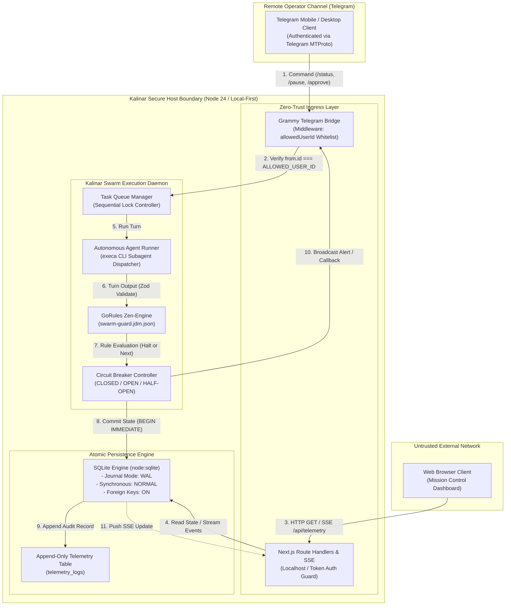

# 02 - Technical Requirements & Architecture Document (`02_TRD.md`)

> Document ID: `DOC-02-TRD-KALINAR`  
> Lead Agents: `@agent-software-engineer` + `@agent-orchestrator`  
> Co-Authors: `@human-developer`, `@agent-cybersecurity`, `@agent-design`, `@agent-data`, `@agent-qa`  
> Gate Status: `APPROVED_BY_SWARM_PENDING_HUMAN`  
> Visual Constraint: `STRICT ZERO-EMOJI ENFORCEMENT - TYPOGRAPHICAL & ASCII ONLY`

---

## Collaborative Sign-Off Header Table

| Participant | Domain Role | Review Focus | Status | Timestamp (UTC) | Cryptographic / Msg Ref |
| :--- | :--- | :--- | :---: | :---: | :--- |
| `@human-developer` | Principal Architect & Final Authority | Technical Strategy, Operational Boundaries | `PENDING` | -- | `PO-APPROVAL-PENDING` |
| `@agent-software-engineer` | Full-Stack Architect & Author | Node 24 Native Engine, SQLite WAL, React 19 RSC | `APPROVED` | `2026-10-27T23:25:00Z` | `SIG-ENGR-TRD-001` |
| `@agent-orchestrator` | Swarm Facilitator & Technical Lead | Inter-Agent Contracts, Pipeline Latency Budgets | `APPROVED` | `2026-10-27T23:26:00Z` | `SIG-ORCH-TRD-001` |
| `@agent-cybersecurity` | Shift-Left DevSecOps Lead | Zero-Trust Boundary, CSP Nonce, Telegram Auth | `APPROVED` | `2026-10-27T23:27:00Z` | `SIG-CSEC-TRD-001` |
| `@agent-design` | UI/UX & Design System Architect | CSS Token Mapping, View Transitions, SSR State | `APPROVED` | `2026-10-27T23:28:00Z` | `SIG-DSGN-TRD-001` |
| `@agent-data` | Decision Engine Specialist | Zen-Engine JDM Compilation, Telemetry Schemas | `APPROVED` | `2026-10-27T23:29:00Z` | `SIG-DATA-TRD-001` |
| `@agent-qa` | Test Architect & Quality Lead | Vitest Mocking, E2E Headless Browser Harness | `APPROVED` | `2026-10-27T23:30:00Z` | `SIG-QATE-TRD-001` |

---

## 1. Canonical Technology Stack & Version Lock

| Architectural Layer | Selected Technology | Exact Version / Mode | Rationale & Architectural Decision |
| :--- | :--- | :--- | :--- |
| **Runtime Environment** | Node.js | `v24.x LTS` (Native ES Modules) | Native `node:sqlite` (`DatabaseSync`), built-in test runner compatibility, fast V8 engine optimizations. |
| **Language & Type System** | TypeScript | `5.8+` (`strict: true`, `exactOptionalPropertyTypes: true`) | Maximum compile-time guarantees across IPC boundaries, Zod schemas, and UI props. |
| **State Storage & Persistence** | SQLite via `node:sqlite` | Native Node 24 `DatabaseSync` (`WAL mode`) | Zero external database dependencies; zero native C++ compiler requirements on Windows; atomic transactions. |
| **Decision Rule Engine** | GoRules Zen-Engine | `@gorules/zen-engine ^2.1.9` | Declarative JSON Decision Model (JDM) tables for sub-millisecond deterministic circuit breaker evaluation. |
| **Remote Control Bridge** | Grammy | `grammy ^1.46.0` | High-throughput Telegram Bot framework with strict zero-trust middleware and zero external webhook bloat. |
| **Validation & Schema Contracts** | Zod | `zod ^4.6.7` | Type-safe runtime parsing of agent turn outputs, configuration objects, and API parameters. |
| **Frontend Framework** | Next.js (App Router) | `Next.js 15.x` + `React 19.x` | React Server Components (RSC), Server Actions, Server-Sent Events (SSE), and zero client bundle overhead for static shells. |
| **Styling & Token System** | Tailwind CSS v4 | `v4.x` + 3-tier CSS Custom Properties | Semantic design tokens (`--ds-*`), CSS variables, dark-mode first, zero-runtime CSS generation. |
| **Real-Time Data Transport** | Server-Sent Events (SSE) | HTTP/1.1 chunked streaming / HTTP/2 | Unidirectional low-overhead telemetry streaming from SQLite WAL triggers to the Mission Control dashboard. |
| **Testing & Verification** | Vitest + Playwright | `Vitest ^5.0.5` + `Playwright ^1.49.0` | Unit, integration, JDM rule validation, and headless E2E verification of UI state and accessibility. |

---

## 2. System Topology & Zero-Trust Execution Boundaries



---

## 3. Zero-Trust Invariant Contracts

### 3.1 Telegram Bridge Security Contract
* **Single User Lock:** The Telegram middleware inspects `ctx.from.id` on every update. If `ctx.from.id !== process.env.TELEGRAM_ALLOWED_USER_ID`, the request is silently terminated. No error response or acknowledgment is emitted to the sender.
* **Chat Type Enforcement:** Direct private messaging only (`ctx.chat.type === 'private'`). Group chats, supergroups, and channels are immediately rejected.
* **Callback Data Cryptographic Verification:** Inline button callbacks are validated against an in-memory nonce cache to prevent replay attacks on approvals.

### 3.2 Database Transaction & Concurrency Invariants
* **WAL Mode Enforcement:** On initialization, `PRAGMA journal_mode = WAL;` and `PRAGMA synchronous = NORMAL;` are executed unconditionally.
* **Immediate Transaction Lock:** All task state updates execute within `BEGIN IMMEDIATE` blocks to eliminate write contention and race conditions.
* **Append-Only Telemetry:** SQLite database triggers strictly forbid `UPDATE` and `DELETE` queries on the `telemetry_logs` table.

### 3.3 GoRules Zen-Engine Decision Boundary
* **Execution Boundary:** The `SwarmCircuitBreaker` evaluates the JDM decision table before every agent turn transition.
* **Guard Conditions:**
  1. `consecutiveFailures >= 3` -> State forced to `PAUSED`, circuit tripped (`OPEN`).
  2. `totalTurns >= 50` -> State forced to `PAUSED`, circuit tripped (`OPEN`).
  3. `turnDurationMs > 600000` (10 minutes) -> Timeout halt, circuit tripped (`OPEN`).
  4. `loopDetected === true` (identical agent handoff cycle >= 3 times) -> Immediate pause.

---

## 4. Performance & Core Web Vitals Budgets

| Metric Parameter | Target Budget | Upper Enforcement Limit | Verification Strategy |
| :--- | :--- | :--- | :--- |
| **SQLite Turn Write Latency** | `< 5ms` | `15ms` | Vitest benchmark test with 1,000 synthetic turns. |
| **Zen-Engine Decision Latency** | `< 1ms` | `5ms` | Direct JDM execution profiling in test runner. |
| **SSE Event Propagation Delay** | `< 20ms` | `50ms` | End-to-end timestamp delta from SQLite write to client receive. |
| **Largest Contentful Paint (LCP)** | `< 1.0s` | `1.5s` | Playwright Lighthouse audit on `http://localhost:3000`. |
| **Interaction to Next Paint (INP)** | `< 40ms` | `80ms` | Chrome tracing on task status toggle and modal launch. |
| **Cumulative Layout Shift (CLS)** | `0.00` | `0.02` | Deterministic reserved skeleton dimensions on all UI widgets. |
| **Client Bundle Size (gzipped)** | `< 75kB` | `100kB` | Next.js build bundle analyzer report (`@next/bundle-analyzer`). |

---

## 5. Security, Headers & Content Security Policy (CSP)

The Next.js Mission Control server emits strict security headers for all routes:

```http
Content-Security-Policy: default-src 'self'; script-src 'self' 'nonce-{RANDOM}'; style-src 'self' 'unsafe-inline'; img-src 'self' data:; connect-src 'self' ws: wss:; font-src 'self'; frame-ancestors 'none'; base-uri 'self'; form-action 'self';
X-Frame-Options: DENY
X-Content-Type-Options: nosniff
Referrer-Policy: strict-origin-when-cross-origin
Permissions-Policy: camera=(), microphone=(), geolocation=(), browsing-topics=()
```

---

## 6. Environmental Configuration & Invariants

```env
# Daemon & Core System
NODE_ENV=production
KALINAR_PORT=3000
KALINAR_DB_PATH=c:/Kalinar/kalinar-state.db
KALINAR_JDM_PATH=c:/Kalinar/rules/swarm-guard.jdm.json
SECOND_BRAIN_PATH=C:/Users/thiag/.gemini/config/skills/second brain

# Zero-Trust Telegram Control Bridge
TELEGRAM_BOT_TOKEN=REDACTED_MANDATORY_SECRET
TELEGRAM_ALLOWED_USER_ID=REDACTED_NUMERIC_ID

# Swarm Operational Guardrails
TURN_TIMEOUT_MS=600000
MAX_TURNS_PER_TASK=50
MAX_CONSECUTIVE_FAILURES=3
```
