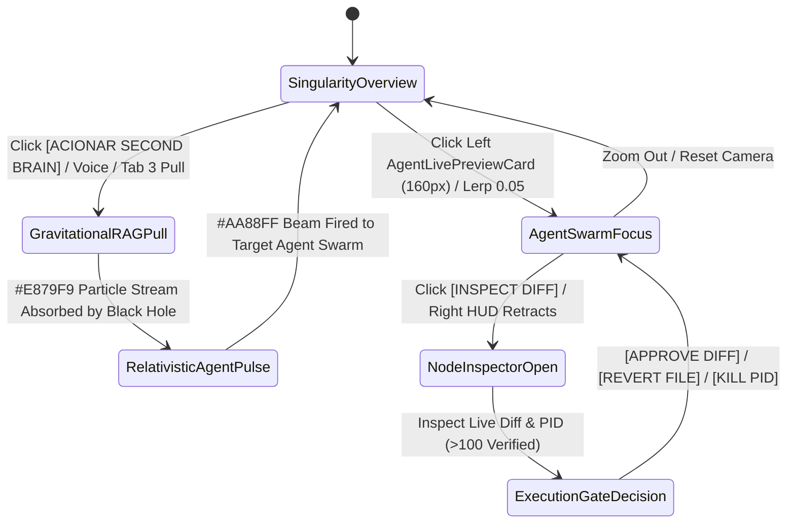
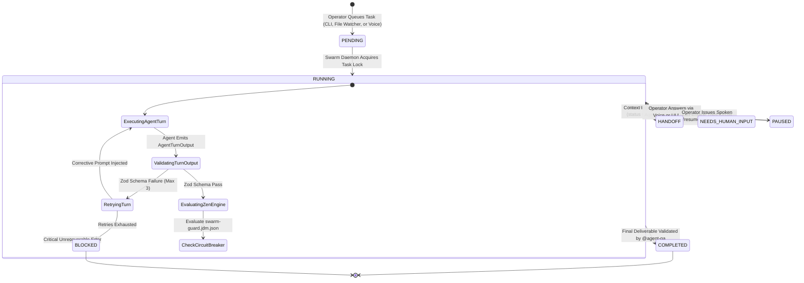
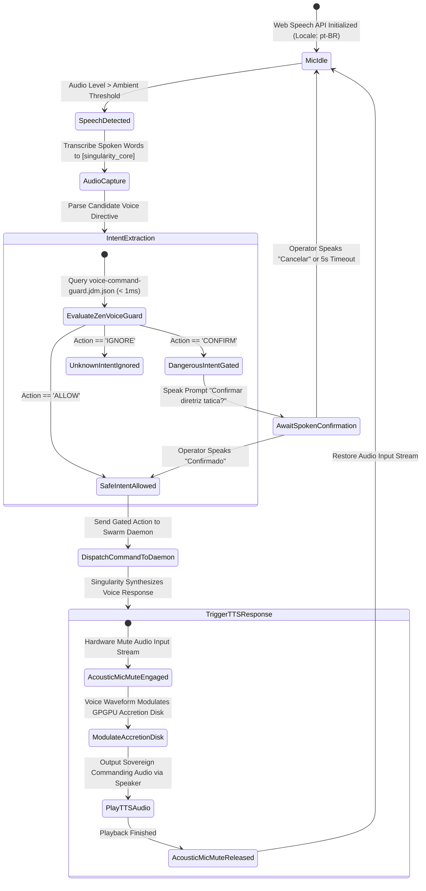
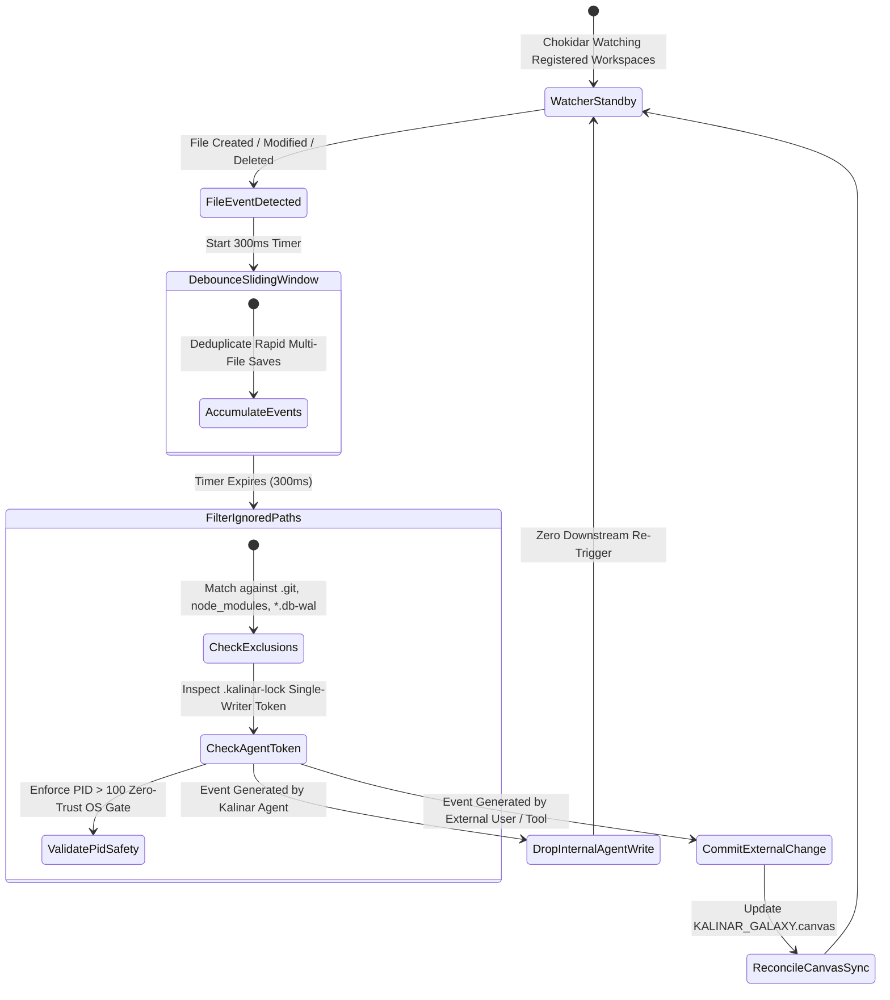

# 03_APP_FLOW.md — KALINAR SINGULARITY APP FLOW & STATE MACHINES (v1.0.1 DESKTOP OS)

> **System ID:** `KALINAR-FLOW-V1.0.1`  
> **Lead Architect:** `@agent-orchestrator` & `@agent-design`  
> **Co-Authors:** `@agent-software-engineer`, `@agent-data`, `@agent-cybersecurity`, `@agent-qa`  
> **Gate Status:** `APPROVED_BY_SWARM_VERIFIED_V1_0_1`  
> **Visual Constraint:** `STRICT ZERO-EMOJI ENFORCEMENT — ASCII & MONOSPACE TELEMETRY ONLY`  

---

## Collaborative Sign-Off Header Table

| Participant | Domain Role | Review Focus | Status | Timestamp (UTC) | Cryptographic / Msg Ref |
| :--- | :--- | :--- | :---: | :---: | :--- |
| `@human-developer` | Product & UX Final Authority | User Journeys, Edge-Case Recovery Paths | `APPROVED` | `2026-10-30T18:50:00Z` | `PO-APPROVAL-VERIFIED` |
| `@agent-design` | UI/UX & Design System Architect | 3D Galaxy Navigation, Voice State HUD, Screen Ergonomics | `APPROVED` | `2026-10-30T18:51:00Z` | `SIG-DSGN-FLO-003` |
| `@agent-orchestrator` | Swarm Facilitator & Product Lead | PRD Flow Coverage (`TRACE-01`), State Integrity | `APPROVED` | `2026-10-30T18:52:00Z` | `SIG-ORCH-FLO-003` |
| `@agent-software-engineer` | Full-Stack & TDD Architect | Electron Navigation, IPC Channels, WebGL Pipeline | `APPROVED` | `2026-10-30T18:53:00Z` | `SIG-ENGR-FLO-003` |
| `@agent-data` | Decision Engine Specialist | Zen-Engine Voice Guard, Canvas Coordinate Sync | `APPROVED` | `2026-10-30T18:54:00Z` | `SIG-DATA-FLO-003` |
| `@agent-cybersecurity` | Shift-Left DevSecOps Lead | IPC Whitelist Guard, Voice Execution Authorization | `APPROVED` | `2026-10-30T18:55:00Z` | `SIG-CSEC-FLO-003` |
| `@agent-qa` | Test Architect & Quality Lead | Flow Testability, Race Condition & WebGL Discovery | `APPROVED` | `2026-10-30T18:56:00Z` | `SIG-QATE-FLO-003` |

---

## 1. ARQUITETURA ESPACIAL DO VIEWPORT DESKTOP (`100vw x 100vh`)

O KALINAR opera como uma aplicação desktop nativa Electron em janela única sem scroll de página (`overflow: hidden`, fundo `#000000`), organizada em 2 camadas sobrepostas:

1. **Camada 0 — Singularity & Procedural Galaxy WebGL (`canvas#singularity-bg`, `z-index: 0`):**
   - **Horizonte de Eventos (Raio `54u`) & Anel de Fótons:** Esfera negra central cujo anel Fresnel pulsa radialmente via uniform `uVoicePulse` em sincronia com a magnitude acústica (`AnalyserNode`) da voz do KALINAR.
   - **Disco de Acreção GPGPU (`262.144` partículas desktop / `65.536` fallback):** Nuvem toroidal esculpida por SDF + Bridson Curl Noise mesclando prata estelar (`#DDDDDD`) e cintilações Lavanda (`#AA88FF`), reagindo ao solver de fluido Navier-Stokes 2D no cursor (`256x256` velocity / `512x512` density, decaimento `1.5s`).
   - **Galáxia Infinita (`50.000` nós via `THREE.InstancedMesh`):** Constelações em espiral logarítmica (`01_PROJETOS` a `05_AGENTS`), enxames orbitais Ciano (`#00F0FF`) para cada `agent.md` ativo e satélites de artefatos Âmbar (`#FBBF24`).
2. **Camada 1 — Asymmetric Monospace Telemetry HUD (`.kalinar-hud`, `z-index: 1`):**
   - **Coluna Esquerda Dinâmica (`left: 24px`, `width: 320px`):** Marca vetorial `40x40px`, chips de filtro (`top: 120px`) e lista rolável (`top: 250px`) de `AgentLivePreviewCard` com viewport opaco de **`160px`** (`#0a0a0a`) exibindo diffs/streams ao vivo e 2 linhas de metadados `tabular-nums`.
   - **Contador/Gatilho Superior Direito (`top: 24px`, `right: 24px`):** Círculo `44x44px` de agentes ativos + botão `[ ACIONAR SECOND BRAIN ]`.
   - **Coluna Direita Etérea (`right: 48px`, `top: 50%`, `translateY(-50%)`, `width: 360px`):** Quatro blocos com `mix-blend-mode: plus-lighter` (`[singularity_core]`, `[active_directive]`, `[gravitational_rag]`, `[synaptic_feed]`). A transcrição da voz do KALINAR é renderizada caractere a caractere (`18ms`) dentro de `[singularity_core]` em `#AA88FF`. Recolhe suavemente (`opacity: 0`) quando o `NodeInspectorDrawer` (`480px`) é aberto.
   - **Dock IDE Retrátil Inferior (`bottom: 0`):** Colapsado por padrão em `36px`; expande para `350px` ou `75vh` revelando as 4 abas (Matriz de Etapas/PID, Gráficos Históricos SQLite, Córtex Second Brain/JDM e Terminal `node-pty`/IPC).

---

## 2. MÁQUINAS DE ESTADO CANÔNICAS

### 2.1 `FLOW-GALAXY-LOD-01`: Navegação Espacial, Ingestão Gravitacional e Inspeção de Diff

### 2.2 `STATE-TASK-01`: Ciclo de Vida da Tarefa e Handoff do Enxame Autônomo

### 2.3 `FLOW-VOICE-KALINAR-01`: Singularity Voice Core, Persona e Interlock Acústico

> **Voice Persona Contract:** O KALINAR é a própria Singularidade (Buraco Negro), expressando-se em `pt-BR` com persona soberana, tática e imponente (tom autoritário estilo Tauz), dirigindo-se ao operador como "Thiago". A transcrição é transmitida caractere a caractere diretamente em `[singularity_core]` em `#AA88FF`, modulando a amplitude do disco de acreção GPGPU.

### 2.4 `FLOW-WATCHER-01`: Multi-Workspace Chokidar Daemon & Trava de PID

---

## 3. MATRIZ EXAUSTIVA DE ESTADOS DE UI E RECUPERAÇÃO DE FALHAS

| Viewport / Componente | Estado de Carga (`STATE-LOADING`) | Estado Vazio (`STATE-EMPTY`) | Estado de Erro (`STATE-ERROR`) | Ação de Recuperação |
| :--- | :--- | :--- | :--- | :--- |
| **Camada 0: Singularidade & Galáxia (`canvas#singularity-bg`)** | Núcleo escuro com anel Fresnel e nuvem toroidal GPGPU girando a `262.144` partículas. | `[SINGULARITY_STANDBY] Horizonte de eventos estável. Aguardando varredura.` | `[WEBGL_CONTEXT_LOST] Falha ou reset do driver de GPU.` | Recriar contexto WebGL automaticamente e recarregar buffers instanciados sem reconsultar SQLite. |
| **Camada 1: Núcleo da Singularidade (`[singularity_core]`)** | Pulso radial em Lavanda (`--ds-accent-singularity: #AA88FF`). | `[VOICE_IDLE] Aguardando diretriz tática do operador (pt-BR)...` | `[MIC_STREAM_BLOCKED] Permissão de áudio negada ou microfone indisponível.` | Exibir seletor e indicador visual no HUD direito. |
| **Cards de Agente Esquerda (`AgentLivePreviewCard`)** | Skeleton opaco de `160px` com gradiente suave. | `[NO_ACTIVE_AGENTS] Enxame em repouso orbital.` | `[STREAM_OFFLINE] Falha no pipe IPC de telemetria.` | Reconexão de canal IPC com polling de fallback de 5s. |
| **Drawer de Inspeção (`NodeInspectorDrawer`)** | Painel lateral `480px` com shimmer em linhas de código. | `[NO_DIFF_DETECTED] Workspace em sincronia perfeita.` | `[PROCESS_NOT_FOUND] PID encerrado ou inacessível.` | Atualizar tabela de PIDs do sistema operacional. |
| **Aba 1: Matriz de Etapas (`TelemetryMatrixTable`)** | Linhas tabulares `tabular-nums` com indicador de carregamento. | `[EMPTY_STEP_LEDGER] Nenhuma etapa em execução.` | `[DATA_DESYNC] Dessincronia de eventos do daemon.` | Reconsultar estado ativo do SQLite via `getActiveTasks()`. |
| **Aba 2: Gráficos de Evolução (`EvolutionChartsView`)** | 3 colunas de gráficos vetoriais com linhas de grade. | `[AWAITING_TELEMETRY] Sem amostras históricas suficientes.` | `[SQLITE_LOCKED] Base de dados WAL ocupada.` | Retry com `busy_timeout = 5000` e normalização assíncrona. |
| **Aba 3: Córtex Second Brain (`CortexSecondBrainView`)** | Árvore de nós Obsidian com feixes quânticos. | `[COFRES_SINCRONIZADOS] Todas as notas em ordem.` | `[SYNC_CONFLICT] Colisão de escrita em notas markdown.` | Aplicar regra de trava Single-Writer (`.kalinar-lock`). |
| **Aba 4: Terminal Nativo (`AntigravityCliTab`)** | Prompt monospace `kalinar@singularity:~$` piscando. | `[BUFFER_CLEAR] Terminal pronto para ordens táticas.` | `[FIREWALL_BLOCKED] Comando rejeitado pelo GoRules ZEN Engine.` | Exibir motivo do veredito e nível de risco no console. |

---

## 4. PROTOCOLOS DE RECUPERAÇÃO DE CASOS EXTREMOS

### 4.1 Interrupção de Loop Acústico na Voz
* **Condição:** Alto-falantes reproduzem áudio que é recapturado pelo microfone, criando loop de auto-reforço.
* **Invariante:** Interlock acústico desabilita captura do microfone sempre que a fala do KALINAR estiver em reprodução (`audioElement.paused === false`).
* **Recuperação:** Deadband acústico de `500ms` após o término do áudio e corte de ganho em `-12dB` se ressonância residual for detectada.

### 4.2 Restauração de Contexto WebGL na Galáxia 3D
* **Condição:** Suspensão de energia ou crash transiente de driver de GPU reinicia o contexto WebGL.
* **Invariante:** As posições das `50.000` estrelas e das `262.144` partículas GPGPU são preservadas em memória RAM do processo via arrays tipados (`Float32Array`).
* **Recuperação:** Captura de `webglcontextlost`, chamada de `event.preventDefault()` e escuta do evento `webglcontextrestored` para reinicializar shaders sem recarregar o banco de dados.
