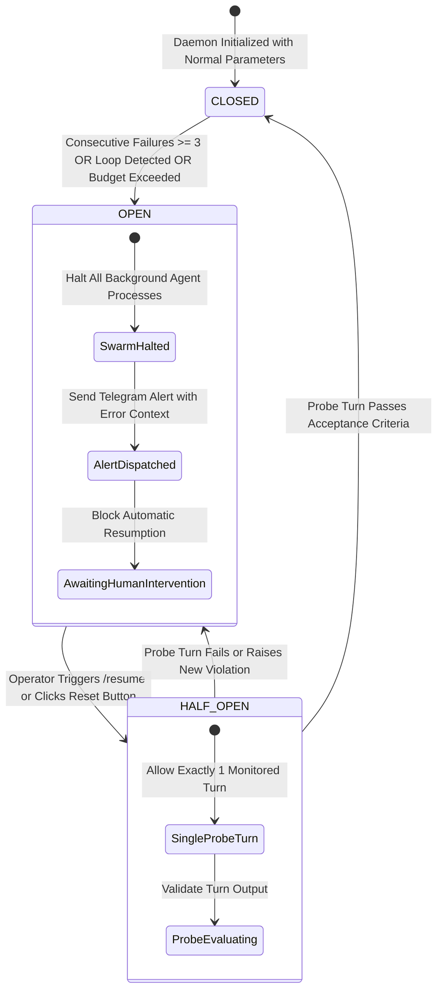
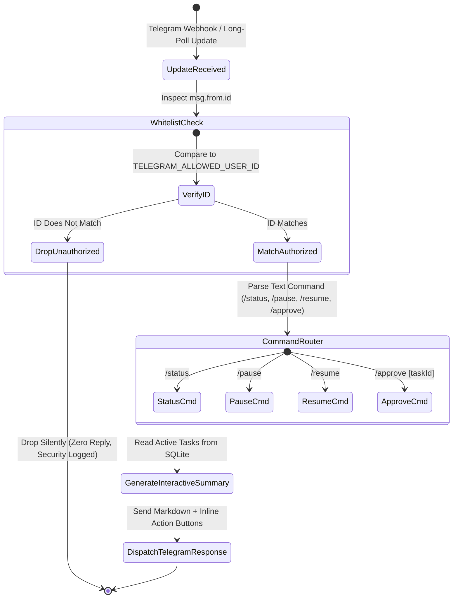

# 03 - Application Flow, State Machines & Routing Architecture (`03_APP_FLOW.md`)

> Document ID: `DOC-03-APP-FLOW-KALINAR`  
> Lead Agents: `@agent-design` + `@agent-orchestrator`  
> Co-Authors: `@human-developer`, `@agent-software-engineer`, `@agent-data`, `@agent-cybersecurity`, `@agent-qa`  
> Gate Status: `APPROVED_BY_SWARM_PENDING_HUMAN`  
> Visual Constraint: `STRICT ZERO-EMOJI ENFORCEMENT - TYPOGRAPHICAL & ASCII ONLY`

---

## Collaborative Sign-Off Header Table

| Participant | Domain Role | Review Focus | Status | Timestamp (UTC) | Cryptographic / Msg Ref |
| :--- | :--- | :--- | :---: | :---: | :--- |
| `@human-developer` | Product & UX Final Authority | User Journeys, Edge-Case Recovery Paths | `PENDING` | -- | `PO-APPROVAL-PENDING` |
| `@agent-design` | UI/UX & Design System Architect | State Machine Viewports, Screen Ergonomics | `APPROVED` | `2026-10-27T23:35:00Z` | `SIG-DSGN-FLO-001` |
| `@agent-orchestrator` | Swarm Facilitator & Product Lead | PRD Flow Coverage (`TRACE-01`), State Integrity | `APPROVED` | `2026-10-27T23:36:00Z` | `SIG-ORCH-FLO-001` |
| `@agent-software-engineer` | Full-Stack & TDD Architect | URL Routing Hierarchy, SSE Reconnection Flow | `APPROVED` | `2026-10-27T23:37:00Z` | `SIG-ENGR-FLO-001` |
| `@agent-data` | Decision Engine Specialist | Zen-Engine State Transitions, Metric Sync | `APPROVED` | `2026-10-27T23:38:00Z` | `SIG-DATA-FLO-001` |
| `@agent-cybersecurity` | Shift-Left DevSecOps Lead | Auth Guards, Error State Data Leak Prevention | `APPROVED` | `2026-10-27T23:39:00Z` | `SIG-CSEC-FLO-001` |
| `@agent-qa` | Test Architect & Quality Lead | Flow Testability, Race Condition Discovery | `APPROVED` | `2026-10-27T23:40:00Z` | `SIG-QATE-FLO-001` |

---

## 1. Route Hierarchy & Middleware Guard Matrix

| Route Path | Rendering Mode | Required Role / Guard | Unauthorized Behavior | Mapped PRD Stories |
| :--- | :--- | :--- | :--- | :--- |
| `/` | Dynamic RSC + SSE Hydration | Operator / Localhost Session | Local network access check; redirect to `/status` if headless | `US-005` |
| `/tasks` | Server Component + Client Filter | Operator / Localhost Session | Render masked read-only summary | `US-005`, `US-008` |
| `/tasks/[id]` | Dynamic RSC + Streaming Timeline | Operator / Localhost Session | 404 boundary if task does not exist | `US-001`, `US-006` |
| `/agents` | Static Shell + Live Presence SSE | Operator / Localhost Session | Render static agent capability cards | `US-005`, `US-006` |
| `/circuit-breaker` | Dynamic RSC + Manual Trip Action | Operator / Localhost Session | Read-only state display if unverified session | `US-002`, `US-004` |
| `/telemetry` | Dynamic RSC + Virtualized Table | Auditor / Operator Session | Restrict export buttons to authenticated operator | `US-007`, `US-008` |
| `/api/telemetry/sse` | Edge SSE Route Handler (`no-cache`) | Localhost / Token Bearer Guard | HTTP 401 Unauthorized (`Connection: close`) | `US-005` |
| `/api/tasks/[id]/action` | Next.js Server Action (`POST`) | Operator Mutex Lock | HTTP 403 Forbidden with security event logged | `US-002`, `US-004` |

---

## 2. Primary State Machines

### 2.1 Task Lifecycle & Autonomous Swarm Handoff (`STATE-TASK-01`)

### 2.2 Circuit Breaker Governance State Machine (`STATE-CB-01`)

### 2.3 Zero-Trust Telegram Control Bridge Flow (`FLOW-TG-01`)

---

## 3. Exhaustive UI State & Error Recovery Matrix

| Viewport / Component | Loading State (`STATE-LOADING`) | Empty State (`STATE-EMPTY`) | Error State (`STATE-ERROR`) | Recovery Action |
| :--- | :--- | :--- | :--- | :--- |
| **Task Dashboard (`/tasks`)** | Shimmer skeleton cards matching exact task card geometry (`44px` header, `20px` badge). | Centered industrial container: `[NO_ACTIVE_TASKS] All queues cleared. Swarm in standby.` | Crimson border banner: `[DB_READ_ERROR] SQLite journal locked or unreachable.` | Automatic retry with exponential backoff (`1s`, `2s`, `5s`). |
| **Live Timeline (`/tasks/[id]`)** | Vertical pulse timeline skeleton with 3 structural agent step nodes. | `[ZERO_TURNS_RECORDED] Task initialized. Awaiting initial turn dispatch.` | `[TIMELINE_STREAM_DISCONNECTED] SSE socket terminated.` | SSE client re-establishes socket with `Last-Event-ID` header. |
| **Circuit Breaker (`/circuit-breaker`)** | Dual radial gauge skeletons with pulse animation. | `[RULES_CLEAN] Zero active trips. All guardrails nominal.` | `[JDM_EVALUATION_FAILED] JSON Decision Model syntax or file missing.` | Fallback to hardcoded safe guardrails (`maxTurns: 50, maxFailures: 3`). |
| **Agent Swarm View (`/agents`)** | 7-slot grid skeleton with structural badges. | N/A (7 canonical swarm agents are always registered). | `[AGENT_DISCOVERY_ERROR] Agent registry corrupted or unreachable.` | Re-read `AGENTS.md` from filesystem root. |
| **Telemetry Ledger (`/telemetry`)** | Virtualized row skeletons with monospace numeric cells. | `[LEDGER_EMPTY] No telemetry recorded for selected filter.` | `[AUDIT_QUERY_TIMEOUT] Query exceeded 500ms threshold.` | Enforce indexed query constraint and paginate. |

---

## 4. Edge-Case Recovery Protocols

### 4.1 SQLite Process Crash Mid-Turn
* **Condition:** Process killed or power loss occurs while an agent turn is actively executing.
* **Invariant:** SQLite WAL mode guarantees atomic rollback of uncommitted transactions.
* **Recovery:** On reboot, daemon runs `PRAGMA integrity_check;`. If the active task has `status === 'RUNNING'`, daemon resets status to `PENDING` with an appended telemetry annotation `RECOVERED_FROM_DIRTY_SHUTDOWN`.

### 4.2 Network Interruption during Telegram Dispatch
* **Condition:** Telegram Bot API endpoint unreachable during critical circuit trip alert.
* **Recovery:** Alert is queued in an in-memory retry ring buffer with 5 attempts. If all fail, the alert is logged to `C:\Kalinar\logs\emergency-alerts.log` with a high-priority filesystem lock.
