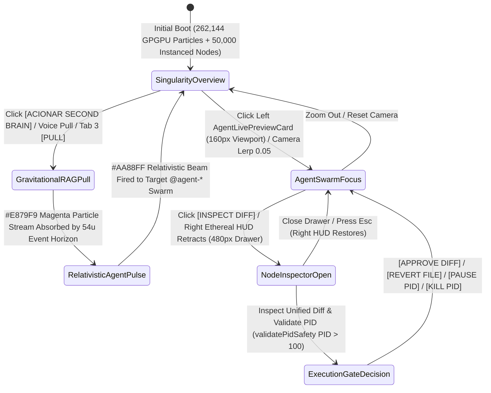
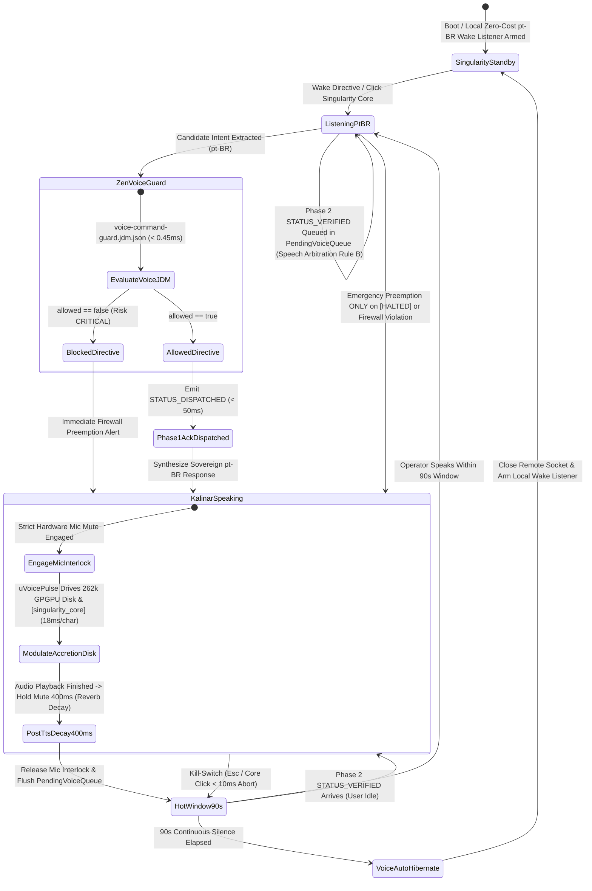
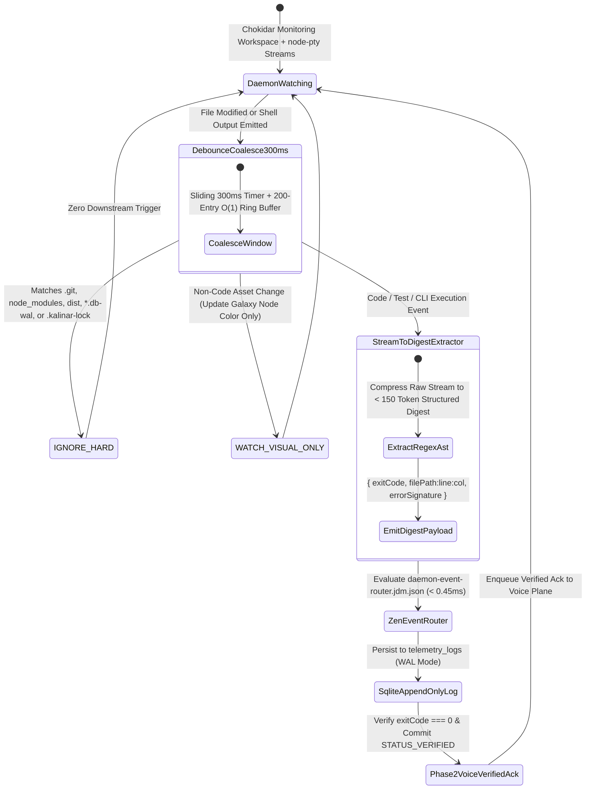
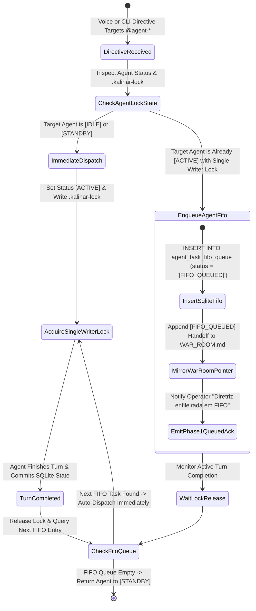
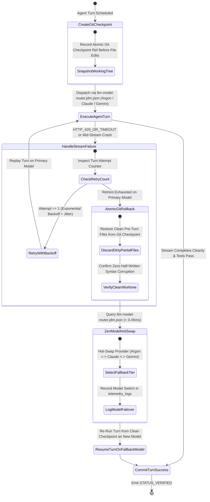

# 03_APP_FLOW.md — KALINAR SINGULARITY APP FLOW & STATE MACHINES (v1.1.0 LOCK)

> **Document ID:** `DOC-03-APP-FLOW-KALINAR-v1.1.0`  
> **Lead Architects:** `@agent-orchestrator` & `@agent-design`  
> **Co-Authors:** `@human-developer`, `@agent-software-engineer`, `@agent-data`, `@agent-cybersecurity`, `@agent-qa`  
> **Gate Status:** `APPROVED_BY_SWARM_LOCKED_V1_1_0`  
> **Visual Constraint:** `STRICT ZERO-EMOJI ENFORCEMENT — ASCII & MONOSPACE TELEMETRY ONLY`

---

## Collaborative Sign-Off Header Table

| Participant | Domain Role | Review Focus | Status | Timestamp (UTC) | Cryptographic / Msg Ref |
| :--- | :--- | :--- | :---: | :---: | :--- |
| `@human-developer` | Sovereign Principal Architect | Spatial Viewport, 5 State Machines, Release v1.1.0 Lock | `APPROVED` | `2026-11-03T19:05:00Z` | `PO-APPROVAL-FLO-110` |
| `@agent-design` | UI/UX & Design System Architect | 262k GPGPU Singularity, 160px Cards, Right HUD Retraction | `APPROVED` | `2026-11-03T19:05:10Z` | `SIG-DSGN-FLO-110` |
| `@agent-orchestrator` | Swarm Facilitator & Product Lead | `FLOW-AGENT-FIFO-01`, `FLOW-LLM-FAILOVER-01`, Two-Phase Ack | `APPROVED` | `2026-11-03T19:05:20Z` | `SIG-ORCH-FLO-110` |
| `@agent-software-engineer` | Full-Stack & TDD Architect | Atomic Git Rollback, Hot-Swap across Argon/Claude/Gemini | `APPROVED` | `2026-11-03T19:05:30Z` | `SIG-ENGR-FLO-110` |
| `@agent-data` | Decision Engine Specialist | Stream-to-Digest (`< 150 tokens`), 5 ZEN Graphs (`< 0.45ms`) | `APPROVED` | `2026-11-03T19:05:40Z` | `SIG-DATA-FLO-110` |
| `@agent-cybersecurity` | DevSecOps & PID Gatekeeper | `validatePidSafety` (`PID > 100`), Speech Preemption Guard | `APPROVED` | `2026-11-03T19:05:50Z` | `SIG-CSEC-FLO-110` |
| `@agent-qa` | QA & Traceability Auditor | 6-Column UI State & Recovery Matrix, E2E Determinism | `APPROVED` | `2026-11-03T19:06:00Z` | `SIG-QATE-FLO-110` |

---

## 1. Spatial Viewport Hierarchy (`100vw x 100vh`, `overflow: hidden`, `#000000`)

KALINAR executes as a single-window native Electron 33 Desktop OS with zero page scroll (`overflow: hidden`, pure void background `--ds-surface-singularity-void: #000000`), structured across two strictly decoupled spatial layers:

1. **Layer 0 — Singularity & Procedural Galaxy WebGL (`canvas#singularity-bg`, `z-index: 0`):**
   - **Event Horizon (`54u` Radius) & Fresnel Photon Ring:** Central pure black sphere surrounded by a relativistic Fresnel photon ring driven at `60 FPS` by the `uVoicePulse` uniform coupled to the Web Audio API `AnalyserNode` of KALINAR's voice.
   - **GPGPU Accretion Disk (`262,144` Desktop Particles / `65,536` Mobile Fallback):** `512x512` float RGBA buffer sculpted by twisted toroidal SDF + Bridson Curl Noise, blending stellar silver (`#DDDDDD`) with high-contrast Event Horizon Lavender sparks (`#AA88FF`, `pow(aRandom.z, 60.0)`), perturbed in real time by a 2D Navier-Stokes cursor fluid solver (`256x256` velocity / `512x512` density, `1.5s` decay).
   - **Procedural Galaxy (`50,000` Nodes via `THREE.InstancedMesh`):** Logarithmic spiral constellations (`01_PROJETOS` through `05_AGENTS`) with Spatial Octree LOD culling (`< 4ms`), orbital Arc Cyan (`#00F0FF`) agent swarms, and Amber (`#FBBF24`) artifact satellites.
2. **Layer 1 — Asymmetric Monospace Telemetry HUD (`.kalinar-hud`, `z-index: 1`):**
   - **Left Dynamic Column (`left: 24px`, `width: 320px`):** `40x40px` 8-point geometric SVG brand mark (`top: 24px`), domain filter chips (`top: 120px`), and a scrollable stack (`top: 250px`) of `AgentLivePreviewCard` components featuring an opaque **`160px`** (`min-h-[160px]`, `#0a0a0a`) live code/diff viewport (`data-slot="agent-card-viewport"`) and a 2-line `tabular-nums` metadata footer (`STEP X/Y`, `TOK/S`, `ETA`).
   - **Top-Right Counter & Second Brain Trigger (`top: 24px`, `right: 24px`):** `44x44px` circular active-agent badge paired with the `[ ACIONAR SECOND BRAIN ]` gravitational RAG button.
   - **Right Ethereal Column (`right: 48px`, `top: 50%`, `translateY(-50%)`, `width: 360px`):** Four stacked telemetry blocks rendered with `mix-blend-mode: plus-lighter` (`[singularity_core]`, `[active_directive]`, `[gravitational_rag]`, `[synaptic_feed]`). Live spoken transcripts stream at `18ms/char` in `#AA88FF` directly inside `[singularity_core]` (zero floating corner voice orbs). Smoothly retracts (`opacity: 0`, `pointer-events: none`) whenever the `480px` `NodeInspectorDrawer` opens.
   - **Retractable Bottom IDE Dock (`bottom: 0`):** Collapsed by default to a `36px` tactical bar (`data-slot="dock-status-bar"`) so the central Black Hole remains unobstructed; expands smoothly to `350px` or `75vh` exposing 4 tabs:
     - **Tab 1:** Step Division & PID Matrix (`TelemetryMatrixTable`).
     - **Tab 2:** Real-Time & `node:sqlite` Historical Evolution Charts (`EvolutionChartsView`).
     - **Tab 3:** Second Brain & GoRules ZEN Cortex (`CortexSecondBrainView`).
     - **Tab 4:** Antigravity CLI & `WAR_ROOM.md` Wiretap (`AntigravityCliTab`).

---

## 2. Five Canonical Mermaid State Machines

### 2.1 `FLOW-GALAXY-LOD-01`: Spatial Navigation, Gravitational RAG Pull & Diff Inspection

### 2.2 `FLOW-VOICE-KALINAR-01`: Sovereign Voice Lifecycle, 90s Hot Window & Speech Arbitration Rule B

> **Voice Persona & Arbitration Invariant:** KALINAR speaks in `pt-BR` with a sovereign, commanding Tauz-style tactical persona, addressing the operator as "Thiago". Outbound speech obeys **Speech Arbitration Rule B**: while in `ListeningPtBR`, standard Phase 2 `STATUS_VERIFIED` messages are queued in `PendingVoiceQueue` and spoken only after operator speech completes; immediate preemption is restricted strictly to `[HALTED]` circuit trips or `CRITICAL` firewall violations.

### 2.3 `FLOW-WATCHER-01`: Chokidar 300ms Debounce, Stream-to-Digest & Phase 2 Verified Ack

### 2.4 `FLOW-AGENT-FIFO-01`: Busy Agent Single-Writer Lock & Deterministic FIFO Queueing

### 2.5 `FLOW-LLM-FAILOVER-01`: Multi-Model Router (`Argon` / `Claude` / `Gemini`), Atomic Git Checkpoint & Hot-Swap

---

## 3. Exhaustive UI State & Recovery Matrix

| HUD Module / Viewport | `STATE-LOADING` | `STATE-EMPTY` | `STATE-ERROR` | `STATE-SANDBOX-BLOCKED` | `STATE-FIFO-QUEUED` | `STATE-MODEL-FAILOVER` |
| :--- | :--- | :--- | :--- | :--- | :--- | :--- |
| **Layer 0: Singularity & Galaxy (`canvas#singularity-bg`)** | `54u` dark core + `262,144` `#AA88FF` / `#DDDDDD` GPGPU particles spinning up. | `[SINGULARITY_STANDBY] Event Horizon stable at 60 FPS.` | `[WEBGL_CONTEXT_LOST] Auto-restoring Float32Array buffers.` | Amber `#FBBF24` containment ring around blocked orbital cluster. | Pulsing Lavender `#AA88FF` orbital waiting ring around busy `@agent-*`. | Relativistic color shift (`#AA88FF` -> `#00F0FF`) during provider hot-swap. |
| **Layer 1: Left Agent Cards (`AgentLivePreviewCard` `160px`)** | Opaque `#0a0a0a` `160px` skeleton with `tabular-nums` placeholder. | `[SWARM_IDLE] Zero active agent streams.` | `[IPC_STREAM_DROP] Re-establishing telemetry pipe.` | `[SANDBOX_HALT]` Crimson `#F87171` badge + blocked command diff. | `[FIFO_QUEUED #N]` Lavender badge + queued directive summary in `160px` viewport. | `[HOT_SWAP: ARGON -> CLAUDE]` badge + checkpoint rollback notice. |
| **Layer 1: Right Ethereal HUD (`[singularity_core]`)** | Radial `#AA88FF` pulse + `[CALIBRATING_ACOUSTICS]`. | `[STANDBY] Local pt-BR wake listener active.` | `[MIC_UNAVAILABLE] Fallback to Tab 4 CLI input.` | `[FIREWALL_VETO]` Immediate spoken + `#F87171` transcript alert. | `[PENDING_VOICE_QUEUE]` Holds Phase 2 TTS while user is in `ListeningPtBR`. | `[MODEL_SWITCH_ACTIVE]` Streams failover status at `18ms/char` in `#AA88FF`. |
| **Slide-Over Diff Drawer (`NodeInspectorDrawer` `480px`)** | Monospace unified diff skeleton (`Right HUD opacity: 0`). | `[CLEAN_WORKTREE] Zero uncommitted file mutations.` | `[PID_UNREACHABLE] Refreshing OS process table.` | `[GATE_LOCKED] Requires explicit operator [APPROVE DIFF] or PID > 100 check.` | Displays active turn diff + read-only list of queued FIFO tasks. | `[GIT_ROLLBACK_VERIFIED] Dirty partial files restored to checkpoint.` |
| **Dock Tab 1: Step Matrix (`TelemetryMatrixTable`)** | `tabular-nums` row shimmer across `STEP X/Y` cells. | `[NO_RUNNING_STEPS] All agent queues nominal.` | `[SQLITE_READ_RETRY] Re-querying WAL store.` | Row highlighted in `#F87171` with `[BLOCKED_BY_ZEN_JDM]`. | Row displays `[FIFO_WAIT]` status with queue position and target agent lock. | Displays active model badge (`[ARGON]` / `[CLAUDE]` / `[GEMINI]`) and retry count. |
| **Dock Tab 2: Evolution Charts (`EvolutionChartsView`)** | 3-column SVG grid skeleton on `#07080a`. | `[AWAITING_SAMPLES] Zero historical turns in SQLite.` | `[WAL_BUSY_TIMEOUT] Retrying getHistoricalTelemetry.` | Spike marker on firewall rejection counter. | Displays queued vs. completed step throughput curve. | Annotates latency chart with checkpoint rollback & hot-swap timestamp. |
| **Dock Tab 3: ZEN Cortex (`CortexSecondBrainView`)** | Loading 5 pre-warmed JDM graphs into `jdmBufferCache`. | `[COFRES_SYNCED] Zero pending Obsidian diffs.` | `[LOCK_COLLISION] Enforcing .kalinar-lock single-writer.` | Displays triggered JDM rule row (`riskLevel: CRITICAL`, `< 0.45ms`). | Shows `WAR_ROOM.md` pointer queue (capped at max 2 `[[Wikilinks]]`). | Highlights `llm-model-router.jdm.json` active failover path. |
| **Dock Tab 4: Native CLI (`AntigravityCliTab`)** | `kalinar@singularity:~$` prompt initializing IPC bridge. | `[READY] Protected by os-execution-firewall.jdm.json.` | `[SHELL_SPAWN_ERROR] Fallback to sandboxed evaluator.` | `[FIREWALL_HALT] Command rejected in < 0.45ms (exitCode: 1).` | Prints `[FIFO_ENQUEUED] Task scheduled after active @agent-* lock release.` | Prints `[CHECKPOINT_RESTORED] Switched LLM provider and resumed turn.` |
