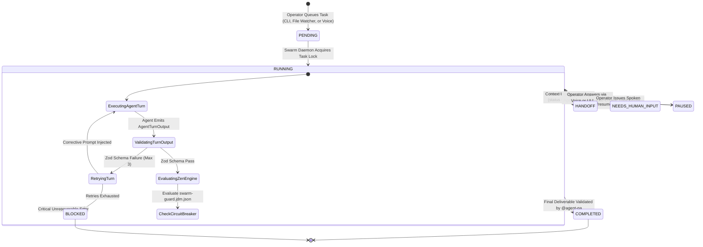
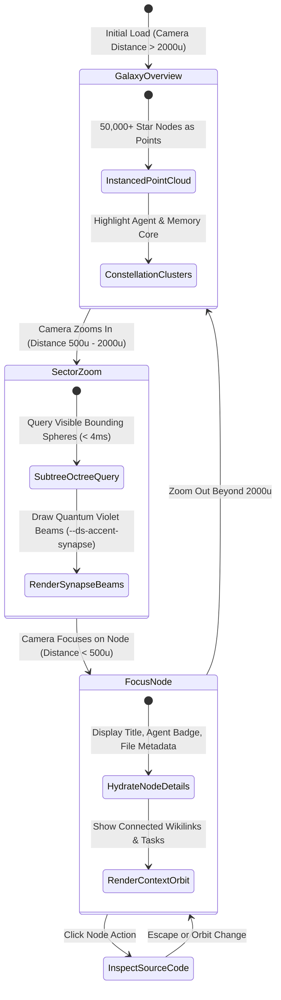
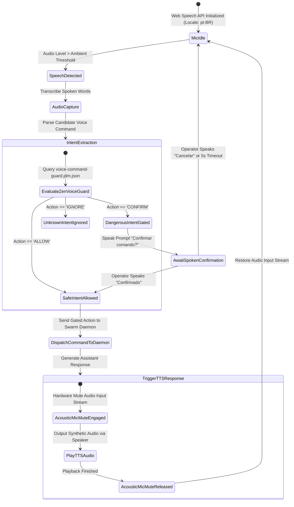
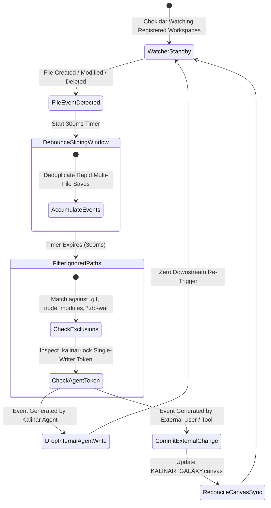

# 03 - Application Flow, State Machines & Routing Architecture (`03_APP_FLOW.md`)

> Document ID: `DOC-03-APP-FLOW-KALINAR`  
> Lead Agents: `@agent-design` + `@agent-orchestrator`  
> Co-Authors: `@human-developer`, `@agent-software-engineer`, `@agent-data`, `@agent-cybersecurity`, `@agent-qa`  
> Gate Status: `APPROVED_BY_SWARM_PENDING_HUMAN`  
> Visual Constraint: `STRICT ZERO-EMOJI ENFORCEMENT - TYPOGRAPHICAL & ASCII ONLY`

---

## Collaborative Sign-Off Header Table

| Participant | Domain Role | Review Focus | Status | Timestamp (UTC) | Cryptographic / Msg Ref |
| :--- | :--- | :--- | :---: | :---: | :--- |
| `@human-developer` | Product & UX Final Authority | User Journeys, Edge-Case Recovery Paths | `PENDING` | -- | `PO-APPROVAL-PENDING` |
| `@agent-design` | UI/UX & Design System Architect | 3D Galaxy Navigation, Voice State HUD, Screen Ergonomics | `APPROVED` | `2026-10-28T10:55:00Z` | `SIG-DSGN-FLO-002` |
| `@agent-orchestrator` | Swarm Facilitator & Product Lead | PRD Flow Coverage (`TRACE-01`), State Integrity | `APPROVED` | `2026-10-28T10:56:00Z` | `SIG-ORCH-FLO-002` |
| `@agent-software-engineer` | Full-Stack & TDD Architect | Electron Navigation, IPC Channels, WebGL Pipeline | `APPROVED` | `2026-10-28T10:57:00Z` | `SIG-ENGR-FLO-002` |
| `@agent-data` | Decision Engine Specialist | Zen-Engine Voice Guard, Canvas Coordinate Sync | `APPROVED` | `2026-10-28T10:58:00Z` | `SIG-DATA-FLO-002` |
| `@agent-cybersecurity` | Shift-Left DevSecOps Lead | IPC Whitelist Guard, Voice Execution Authorization | `APPROVED` | `2026-10-28T10:59:00Z` | `SIG-CSEC-FLO-002` |
| `@agent-qa` | Test Architect & Quality Lead | Flow Testability, Race Condition & WebGL Discovery | `APPROVED` | `2026-10-28T11:00:00Z` | `SIG-QATE-FLO-002` |

---

## 1. Route Hierarchy & Desktop OS Navigation Matrix

| Route Path | Rendering Mode | Required Role / Guard | Unauthorized Behavior | Mapped Features |
| :--- | :--- | :--- | :--- | :--- |
| `/` | Dynamic RSC + Desktop Shell | Operator Local Session | Standard desktop shell initialization | Dashboard & Telemetry |
| `/galaxy` | Client R3F 3D Canvas + Octree LOD | Operator Local Session | WebGL fallback notification if hardware acceleration unavailable | 3D Galaxy Knowledge Graph |
| `/tasks` | Server Component + Client Filter | Operator Local Session | Render masked read-only summary | Task Queue Management |
| `/tasks/[id]` | Dynamic RSC + Streaming Timeline | Operator Local Session | 404 boundary if task does not exist | Live Task Execution Inspection |
| `/terminal` | Client Canvas + `node-pty` IPC | Operator Local Session | Deny terminal access if IPC bridge unverified | Embedded Native Terminal |
| `/circuit-breaker` | Dynamic RSC + Manual Trip Action | Operator Local Session | Read-only state display if unverified session | Swarm Safety Controls |
| `/telemetry` | Dynamic RSC + Virtualized Table | Auditor / Operator Session | Restrict export buttons to authenticated operator | Append-Only Telemetry Ledger |
| `/api/telemetry/sse` | Edge SSE Route Handler (`no-cache`) | Localhost IPC Bearer Guard | HTTP 401 Unauthorized (`Connection: close`) | Real-Time Telemetry Push |

---

## 2. Primary State Machines

### 2.1 Task Lifecycle & Autonomous Swarm Handoff (`STATE-TASK-01`)

### 2.2 3D Galaxy Engine Octree LOD & Zoom State Machine (`FLOW-GALAXY-LOD-01`)

### 2.3 Voice Core & Acoustic Mic-Muting Interlock (`FLOW-VOICE-JARVIS-01`)

### 2.4 Multi-Workspace File Watcher Loop Prevention (`FLOW-WATCHER-01`)

---

## 3. Exhaustive UI State & Error Recovery Matrix

| Viewport / Component | Loading State (`STATE-LOADING`) | Empty State (`STATE-EMPTY`) | Error State (`STATE-ERROR`) | Recovery Action |
| :--- | :--- | :--- | :--- | :--- |
| **3D Galaxy Canvas (`/galaxy`)** | Rotating particle ring with loading telemetry badge. | `[GALAXY_EMPTY] Zero nodes in knowledge graph. Awaiting workspace scan.` | `[WEBGL_CONTEXT_LOST] GPU driver reset or context exhausted.` | Automatically recreate canvas context and re-upload instanced buffer. |
| **Voice Core HUD Overlay** | Radial pulse ring in neutral cyan (`--ds-primitive-cyan-500`). | `[VOICE_IDLE] Listening for operator command (pt-BR)...` | `[MIC_STREAM_BLOCKED] Audio permission denied or input device unavailable.` | Render visual mic prompt with device selector dropdown. |
| **Task Dashboard (`/tasks`)** | Shimmer skeleton cards matching exact task card geometry (`44px` header, `20px` badge). | Centered industrial container: `[NO_ACTIVE_TASKS] All queues cleared. Swarm in standby.` | Crimson border banner: `[DB_READ_ERROR] SQLite journal locked or unreachable.` | Automatic retry with exponential backoff (`1s`, `2s`, `5s`). |
| **Live Timeline (`/tasks/[id]`)** | Vertical pulse timeline skeleton with 3 structural agent step nodes. | `[ZERO_TURNS_RECORDED] Task initialized. Awaiting initial turn dispatch.` | `[TIMELINE_STREAM_DISCONNECTED] SSE socket terminated.` | SSE client re-establishes socket with `Last-Event-ID` header. |
| **Circuit Breaker (`/circuit-breaker`)** | Dual radial gauge skeletons with pulse animation. | `[RULES_CLEAN] Zero active trips. All guardrails nominal.` | `[JDM_EVALUATION_FAILED] JSON Decision Model syntax or file missing.` | Fallback to hardcoded safe guardrails (`maxTurns: 50, maxFailures: 3`). |
| **Embedded Terminal (`/terminal`)** | Monospace terminal skeleton with blinking cursor block. | Terminal prompt ready: `kalinar-os:~$` | `[PTY_SPAWN_FAILED] Native shell binary failed to launch.` | Fallback to standard system PowerShell/Bash process. |
| **Telemetry Ledger (`/telemetry`)** | Virtualized row skeletons with monospace numeric cells. | `[LEDGER_EMPTY] No telemetry recorded for selected filter.` | `[AUDIT_QUERY_TIMEOUT] Query exceeded 500ms threshold.` | Enforce indexed query constraint and paginate. |

---

## 4. Edge-Case Recovery Protocols

### 4.1 Voice Acoustic Loop Interruption
* **Condition:** Operator ambient environment creates accidental audio reflections causing false command loops.
* **Invariant:** Acoustic interlock enforces zero microphone audio capture whenever TTS audio is rendering.
* **Recovery:** If self-reinforcing audio is detected, Voice Core triggers a `500ms` acoustic deadband and drops input gain by `-12dB`.

### 4.2 WebGL Context Restoration in 3D Galaxy
* **Condition:** OS graphics driver restarts or power saving suspends GPU context.
* **Invariant:** All 50,000+ procedural node positions are preserved in CPU memory typed arrays (`Float32Array`).
* **Recovery:** Catch `webglcontextlost`, call `event.preventDefault()`, and listen for `webglcontextrestored` to reload shaders and rebind instanced buffers without re-querying SQLite.
