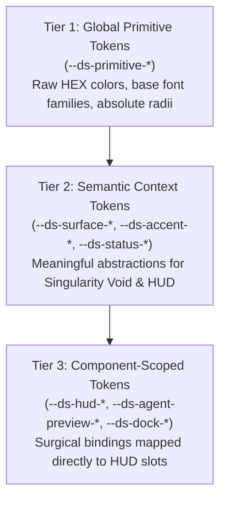

# 04 - Visual Briefing & Design System Architecture (`04_BRIEFING_AND_DESIGN_SYSTEM.md`)

> Document ID: `DOC-04-DESIGN-SYSTEM-KALINAR`  
> Lead Agent: `@agent-design`  
> Co-Authors: `@human-developer`, `@agent-software-engineer`, `@agent-cybersecurity`, `@agent-orchestrator`, `@agent-qa`  
> Gate Status: `APPROVED_BY_SWARM_PENDING_HUMAN`  
> Visual Philosophy: `KALINAR Singularity & Gravitational Telemetry`  
> Visual Constraint: `STRICT ZERO-EMOJI ENFORCEMENT - TYPOGRAPHICAL & ASCII ONLY`

---

## Collaborative Sign-Off Header Table

| Participant | Domain Role | Review Focus | Status | Timestamp (UTC) | Cryptographic / Msg Ref |
| :--- | :--- | :--- | :---: | :---: | :--- |
| `@human-developer` | Brand & UX Final Authority | Singularity Core, Event Horizon Lavender, HUD Ergonomics | `PENDING` | -- | `PO-APPROVAL-PENDING` |
| `@agent-design` | UI/UX & Design System Architect | 3-Tier Tokens, Singularity Shaders, WCAG AAA | `APPROVED` | `2026-10-30T16:00:00Z` | `SIG-DSGN-SYS-003` |
| `@agent-software-engineer` | Full-Stack & TDD Architect | GPGPU Particle Performance, HUD Component Slots | `APPROVED` | `2026-10-30T16:05:00Z` | `SIG-ENGR-SYS-003` |
| `@agent-cybersecurity` | Shift-Left DevSecOps Lead | Visual Deception Prevention, Secret Masking Tokens | `APPROVED` | `2026-10-30T16:10:00Z` | `SIG-CSEC-SYS-003` |
| `@agent-orchestrator` | Swarm Facilitator & Product Lead | Alignment with PRD (`TRACE-02`), Information Hierarchy | `APPROVED` | `2026-10-30T16:15:00Z` | `SIG-ORCH-SYS-003` |
| `@agent-qa` | Test Architect & Quality Lead | Token Contrast Verifiability, Hit Target Compliance | `APPROVED` | `2026-10-30T16:20:00Z` | `SIG-QATE-SYS-003` |

---

## 1. Aesthetic Direction & Brand Briefing

### 1.1 Visual Persona & Anti-Slop Philosophy
Kalinar embodies **KALINAR Singularity & Gravitational Telemetry**. It rejects generic dashboard aesthetics, unnecessary gradients, rounded pill buttons, and cartoon iconography. The interface is engineered as high-precision mission telemetry organized into a strict two-layer spatial architecture:

* **Layer 0 (`canvas#singularity-bg`):** Central **KALINAR Black Hole Singularity** (Event Horizon dark core with `#AA88FF` / `#DDDDDD` GPGPU particle accretion disk stirred by cursor Navier-Stokes fluid and modulated by Kalinar's voice waveform). Surrounding the Black Hole are the orbital particle swarms of `agent.md` stars and `Second Brain` constellations.
* **Layer 1 (`.kalinar-hud`):** Tactical telemetry interface composed of three spatial zones:
  * **Left Dynamic Column (`left: 24px, width: 320px`):** Brand mark (`40x40` SVG), filter chips (`top: 120px`), and scrollable list (`top: 250px`) of opaque `160px` `AgentLivePreviewCard` components showing live visual previews of each active agent's work plus 2-line `tabular-nums` metadata (`STEP X/Y`, tokens, ETA).
  * **Right Ethereal Column (`right: 48px, top: 50%, translateY(-50%), width: 360px`):** Text blocks using `mix-blend-mode: plus-lighter` (`[singularity_core]`, `[active_directive]`, `[gravitational_rag]`, `[synaptic_feed]`). Live voice transcription renders directly inside `[singularity_core]` in `#AA88FF`. Retracts smoothly when `NodeInspectorDrawer` (`480px`) opens.
  * **Retractable Bottom IDE Dock (`bottom: 0`):** Collapsed by default to a `36px` tactical bar to keep the Black Hole unobstructed; expands to `350px` (or up to `75vh`) on click or voice command.

### 1.2 Functional Luminance & Palette
* **Pure Void Base (`#000000`):** Total black void (`--ds-surface-singularity-void: #000000`) eliminating light bleed and maximizing dynamic contrast.
* **Event Horizon Lavender (`#AA88FF`):** Singularity accent (`--ds-accent-singularity: #AA88FF`), live voice transcription, and gravitational center.
* **Arc Cyan (`#00F0FF`):** Active `agent.md` stars (`--ds-accent-agent: #00F0FF`) and executing tasks.
* **Neural Magenta (`#E879F9`):** Second Brain memory nodes (`--ds-accent-memory: #E879F9`) and context graph constellations.
* **Emerald (`#34D399`):** Verified execution and completed steps (`--ds-status-active-fg: #34D399`).
* **Amber (`#FBBF24`):** Running step warnings, retries, and locks (`--ds-status-warn-fg: #FBBF24`).
* **Crimson (`#F87171`):** Tripped circuit breakers, blocked tasks, and fatal errors (`--ds-status-halt-fg: #F87171`).
* **Calibrated Muted Text (`#9A9A9A`):** Secondary text (`--ds-text-secondary: #9A9A9A`) achieving `7.45:1` AAA contrast on `#000000`.
* **Zero-Emoji Enforcement:** 100% prohibited. Status is communicated using ASCII badges (`[ACTIVE]`, `[IDLE]`, `[HALTED]`, `[PAUSED]`, `[RUNNING]`, `[VERIFIED]`, `[WARN]`, `[ERROR]`, `[STREAM]`) and geometric SVG vectors.

### 1.3 Typography Scale & Font Stack

| Hierarchy Level | Font Family | Size | Weight | Line Height | Tracking | Application Context |
| :--- | :--- | :--- | :--- | :--- | :--- | :--- |
| **Display Header** | `Geist Sans`, system-ui | `24px` (`1.5rem`) | `600` | `1.2` | `-0.025em` | Structural header: `[KALINAR_SINGULARITY_CORE]` |
| **Section Header** | `Geist Sans`, system-ui | `16px` (`1.0rem`) | `600` | `1.3` | `-0.015em` | Structural header; uppercase section labels |
| **UI Body** | `Geist Sans`, system-ui | `14px` (`0.875rem`) | `400` | `1.5` | `0.000em` | Explanatory labels, parameter descriptions |
| **Telemetry Mono** | `Geist Mono` / `SF Mono`, monospace | `13px` (`0.8125rem`) | `500` | `1.35` | `0.020em` | Uppercase monospace, `tabular-nums` mandatory |
| **Micro Mono** | `Geist Mono` / `SF Mono`, monospace | `11px` (`0.6875rem`) | `400` | `1.35` | `0.020em` | Timestamps, hash prefixes, latency (`tabular-nums`) |

### 1.4 Spatial Grid & Hit Target Standards
* **Grid Increment:** Strict `4px` base module (`0.25rem`). Layout spacing values: `4px`, `8px`, `12px`, `16px`, `24px`, `32px`, `48px`.
* **Touch & Click Target:** All interactive controls enforce a minimum hit box of `44px x 44px` per WCAG 2.2 Success Criterion 2.5.8.

---

## 2. Three-Tier Design Token Taxonomy



### 2.1 CSS Custom Properties (Production Specification)

```css
:root {
  /* =====================================================================
     TIER 1: GLOBAL PRIMITIVE TOKENS
     ===================================================================== */
  --ds-primitive-void: #000000;
  --ds-primitive-slate-900: #0d0f14;
  --ds-primitive-slate-850: #12151d;
  --ds-primitive-slate-800: #1a1d26;
  --ds-primitive-slate-700: #262b38;
  --ds-primitive-slate-500: #64748b;
  --ds-primitive-slate-400: #9a9a9a;
  --ds-primitive-slate-200: #e2e8f0;
  --ds-primitive-slate-50:  #f8fafc;

  --ds-primitive-lavender-500: #aa88ff;
  --ds-primitive-lavender-400: #c4b5fd;
  --ds-primitive-lavender-950: #2e1065;

  --ds-primitive-emerald-500: #10b981;
  --ds-primitive-emerald-400: #34d399;
  --ds-primitive-emerald-950: #022c22;

  --ds-primitive-amber-500: #f59e0b;
  --ds-primitive-amber-400: #fbbf24;
  --ds-primitive-amber-950: #451a03;

  --ds-primitive-crimson-500: #ef4444;
  --ds-primitive-crimson-400: #f87171;
  --ds-primitive-crimson-950: #450a0a;

  --ds-primitive-cyan-500: #00f0ff;
  --ds-primitive-cyan-400: #38bdf8;
  --ds-primitive-cyan-950: #083344;

  --ds-primitive-magenta-500: #e879f9;
  --ds-primitive-violet-500:  #8b5cf6;
  --ds-primitive-white-500:   #dddddd;

  --ds-primitive-font-sans: 'Geist Sans', -apple-system, BlinkMacSystemFont, 'Segoe UI', Roboto, sans-serif;
  --ds-primitive-font-mono: 'Geist Mono', 'SF Mono', Menlo, Monaco, Consolas, monospace;

  /* =====================================================================
     TIER 2: SEMANTIC CONTEXT TOKENS (SINGULARITY VOID & HUD)
     ===================================================================== */
  /* Surface Layers */
  --ds-surface-singularity-void: #000000;
  --ds-surface-canvas: var(--ds-surface-singularity-void);
  --ds-surface-card: var(--ds-primitive-slate-900);
  --ds-surface-overlay: var(--ds-primitive-slate-850);
  --ds-surface-muted: var(--ds-primitive-slate-800);

  /* Border & Structure */
  --ds-border-subtle: #1a1d26;
  --ds-border-bold: var(--ds-primitive-slate-700);
  --ds-border-focus: var(--ds-accent-singularity);

  /* Text & Foreground */
  --ds-text-primary: var(--ds-primitive-slate-50);
  --ds-text-secondary: #9A9A9A; /* 7.45:1 contrast on #000000 (WCAG AAA) */
  --ds-text-muted: var(--ds-primitive-slate-500);

  /* Singularity & Knowledge Graph Semantic Tokens */
  --ds-accent-singularity: #AA88FF; /* Event Horizon Lavender */
  --ds-accent-agent: #00F0FF;       /* Arc Cyan for active agent.md stars */
  --ds-accent-memory: #E879F9;      /* Neural Magenta for Second Brain nodes */
  --ds-accent-synapse: #8B5CF6;     /* Quantum Violet for Graph Pointer beams */

  /* Operational Status Semantics */
  --ds-status-active-fg: #34D399;   /* Emerald */
  --ds-status-active-bg: var(--ds-primitive-emerald-950);
  --ds-status-active-border: var(--ds-primitive-emerald-500);

  --ds-status-warn-fg: #FBBF24;     /* Amber */
  --ds-status-warn-bg: var(--ds-primitive-amber-950);
  --ds-status-warn-border: var(--ds-primitive-amber-500);

  --ds-status-halt-fg: #F87171;     /* Crimson */
  --ds-status-halt-bg: var(--ds-primitive-crimson-950);
  --ds-status-halt-border: var(--ds-primitive-crimson-500);

  --ds-status-neutral-fg: var(--ds-primitive-cyan-500);
  --ds-status-neutral-bg: var(--ds-primitive-cyan-950);
  --ds-status-neutral-border: var(--ds-primitive-cyan-500);

  /* =====================================================================
     TIER 3: COMPONENT-SCOPED TOKENS & HUD SPATIAL BINDINGS
     ===================================================================== */
  /* Layer 0: Singularity Background Canvas */
  --ds-singularity-core-radius: 48px;
  --ds-singularity-accretion-inner: #AA88FF;
  --ds-singularity-accretion-outer: #DDDDDD;
  --ds-singularity-particle-count: 65536;

  /* Layer 1: Left Dynamic Column */
  --ds-hud-left-offset: 24px;
  --ds-hud-left-width: 320px;
  --ds-hud-brand-size: 40px;
  --ds-hud-chips-top: 120px;
  --ds-hud-preview-list-top: 250px;
  --ds-agent-preview-card-height: 160px;
  --ds-agent-preview-card-bg: rgba(13, 15, 20, 0.95);
  --ds-agent-preview-card-border: var(--ds-border-subtle);

  /* Layer 1: Right Ethereal Column */
  --ds-hud-right-offset: 48px;
  --ds-hud-right-width: 360px;
  --ds-hud-ethereal-blend: plus-lighter;
  --ds-hud-drawer-width: 480px;

  /* Layer 1: Retractable Bottom IDE Dock */
  --ds-dock-collapsed-height: 36px;
  --ds-dock-expanded-height: 350px;
  --ds-dock-max-height: 75vh;
  --ds-dock-bg: rgba(7, 8, 10, 0.96);
  --ds-dock-border: var(--ds-border-subtle);

  /* Circuit Breaker Gauge */
  --ds-gauge-size: 140px;
  --ds-gauge-track-color: var(--ds-primitive-slate-800);
  --ds-gauge-fill-nominal: var(--ds-status-active-fg);
  --ds-gauge-fill-tripped: var(--ds-status-halt-fg);

  /* Timeline Stream */
  --ds-timeline-stem-width: 2px;
  --ds-timeline-stem-color: var(--ds-border-subtle);
  --ds-timeline-node-size: 32px;
}
```

---

## 3. React 19 & R3F Component Slot Specifications

### 3.1 `<SingularityViewport>` Compound Component (Layer 0)

```tsx
<SingularityViewport.Root className="fixed inset-0 w-full h-full bg-[var(--ds-surface-singularity-void)]">
  <SingularityViewport.Canvas camera={{ position: [0, 0, 1500], fov: 60 }}>
    <SingularityViewport.BlackHoleCore coreRadius="var(--ds-singularity-core-radius)" />
    <SingularityViewport.AccretionDiskGPGPU 
      colorInner="var(--ds-singularity-accretion-inner)" 
      colorOuter="var(--ds-singularity-accretion-outer)" 
    />
    <SingularityViewport.OrbitalAgentStars count={50000} />
    <SingularityViewport.SecondBrainConstellations beamColor="var(--ds-accent-synapse)" />
    <SingularityViewport.FluidInteractionController />
  </SingularityViewport.Canvas>
</SingularityViewport.Root>
```

### 3.2 `<KalinarHUD>` Compound Component (Layer 1)

```tsx
<KalinarHUD.Root className="fixed inset-0 pointer-events-none z-10 font-mono">
  {/* Left Dynamic Column */}
  <KalinarHUD.LeftColumn className="absolute left-[24px] top-0 bottom-0 w-[320px] pointer-events-auto">
    <KalinarHUD.BrandMark className="w-[40px] h-[40px]" />
    <KalinarHUD.FilterChips className="absolute top-[120px] w-full" />
    <KalinarHUD.AgentLivePreviewList className="absolute top-[250px] bottom-[48px] w-full overflow-y-auto">
      <AgentLivePreviewCard height={160} />
    </KalinarHUD.AgentLivePreviewList>
  </KalinarHUD.LeftColumn>

  {/* Right Ethereal Column */}
  <KalinarHUD.RightColumn className="absolute right-[48px] top-1/2 -translate-y-1/2 w-[360px] mix-blend-plus-lighter pointer-events-auto">
    <KalinarHUD.SingularityCoreLiveTranscription color="var(--ds-accent-singularity)" />
    <KalinarHUD.ActiveDirectiveBlock />
    <KalinarHUD.GravitationalRAGBlock />
    <KalinarHUD.SynapticFeedBlock />
  </KalinarHUD.RightColumn>

  {/* Retractable Bottom IDE Dock */}
  <KalinarHUD.BottomDock 
    collapsedHeight={36} 
    expandedHeight={350} 
    className="absolute bottom-0 inset-x-0 pointer-events-auto"
  >
    <KalinarHUD.DockTacticalBar />
    <KalinarHUD.DockExpandedWorkspace />
  </KalinarHUD.BottomDock>
</KalinarHUD.Root>
```

---

## 4. Accessibility & Contrast Compliance (WCAG 2.2 Level AAA)

All color combinations in Kalinar strictly comply with WCAG 2.2 Level AAA requirements against the Pure Void Base (`#000000`):

| Color Pair (Foreground on Background) | Contrast Ratio | WCAG 2.2 AAA Target | Compliance Status |
| :--- | :--- | :--- | :---: |
| `--ds-primitive-slate-50` (`#F8FAFC`) on `#000000` | `19.4 : 1` | `> 7.0 : 1` | `PASS (EXCEEDS)` |
| `--ds-text-secondary` (`#9A9A9A`) on `#000000` | `7.45 : 1` | `> 7.0 : 1` | `PASS (CALIBRATED AAA)` |
| `--ds-accent-singularity` (`#AA88FF`) on `#000000` | `8.65 : 1` | `> 7.0 : 1` | `PASS` |
| `--ds-accent-agent` (`#00F0FF`) on `#000000` | `16.6 : 1` | `> 7.0 : 1` | `PASS (EXCEEDS)` |
| `--ds-accent-memory` (`#E879F9`) on `#000000` | `10.8 : 1` | `> 7.0 : 1` | `PASS` |
| `--ds-status-active-fg` (`#34D399`) on `#000000` | `11.5 : 1` | `> 7.0 : 1` | `PASS` |
| `--ds-status-warn-fg` (`#FBBF24`) on `#000000` | `12.3 : 1` | `> 7.0 : 1` | `PASS` |
| `--ds-status-halt-fg` (`#F87171`) on `#000000` | `7.85 : 1` | `> 7.0 : 1` | `PASS` |
| Interactive Hit Target Minimum Box | `44px x 44px` | `44px x 44px` | `PASS` |

* Focus states render an unmistakable `2px solid var(--ds-border-focus)` with `2px` offset.
* Full support for `prefers-reduced-motion` eliminating GPGPU accretion stirring and fluid simulations.
