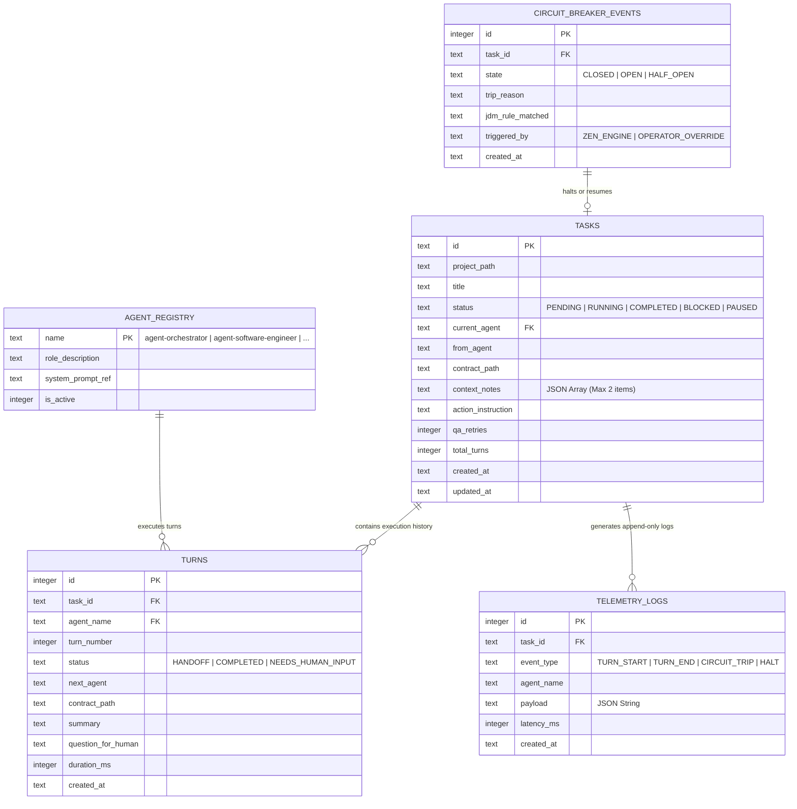

# 05 - Back-End Schema, API Contracts & Security Policies (`05_BACKEND_SCHEMA.md`)

> Document ID: `DOC-05-BACKEND-SCHEMA-KALINAR`  
> Lead Agents: `@agent-software-engineer` + `@agent-cybersecurity`  
> Co-Authors: `@human-developer`, `@agent-data`, `@agent-design`, `@agent-orchestrator`, `@agent-qa`  
> Gate Status: `APPROVED_BY_SWARM_PENDING_HUMAN`  
> Visual Constraint: `STRICT ZERO-EMOJI ENFORCEMENT - TYPOGRAPHICAL & ASCII ONLY`

---

## Collaborative Sign-Off Header Table

| Participant | Domain Role | Review Focus | Status | Timestamp (UTC) | Cryptographic / Msg Ref |
| :--- | :--- | :--- | :---: | :---: | :--- |
| `@human-developer` | Data & Security Final Authority | Schema Ownership, DDL Invariants, STRIDE Matrix | `PENDING` | -- | `PO-APPROVAL-PENDING` |
| `@agent-software-engineer` | Full-Stack & TDD Architect | SQLite DDL, WAL Indexes, Node 24 Type Alignment | `APPROVED` | `2026-10-27T23:52:00Z` | `SIG-ENGR-SCH-001` |
| `@agent-cybersecurity` | Shift-Left DevSecOps Lead | Append-Only Triggers, Parameter Injection, STRIDE | `APPROVED` | `2026-10-27T23:53:00Z` | `SIG-CSEC-SCH-001` |
| `@agent-data` | Decision Engine Specialist | Zen-Engine Rule Engine JDM Schema, Metric DTOs | `APPROVED` | `2026-10-27T23:54:00Z` | `SIG-DATA-SCH-001` |
| `@agent-design` | UI/UX & Design System Architect | DTO Serialization for UI Timelines & Cards | `APPROVED` | `2026-10-27T23:55:00Z` | `SIG-DSGN-SCH-001` |
| `@agent-orchestrator` | Swarm Facilitator & Product Lead | PRD Traceability (`TRACE-03`), State Completeness | `APPROVED` | `2026-10-27T23:56:00Z` | `SIG-ORCH-SCH-001` |
| `@agent-qa` | Test Architect & Quality Lead | SQL Migration Rollback & Concurrency Testability | `APPROVED` | `2026-10-27T23:57:00Z` | `SIG-QATE-SCH-001` |

---

## 1. Entity-Relationship Diagram (Mermaid ERD)



---

## 2. Production Database DDL (SQLite `node:sqlite` Native Specification)

```sql
-- SQLite Performance Pragmas
PRAGMA journal_mode = WAL;
PRAGMA synchronous = NORMAL;
PRAGMA foreign_keys = ON;
PRAGMA busy_timeout = 5000;

-- 1. Agent Registry Table
CREATE TABLE IF NOT EXISTS agent_registry (
    name TEXT PRIMARY KEY NOT NULL,
    role_description TEXT NOT NULL,
    system_prompt_ref TEXT NOT NULL,
    is_active INTEGER NOT NULL DEFAULT 1 CHECK (is_active IN (0, 1))
);

-- Seed Canonical 7 Agents
INSERT OR IGNORE INTO agent_registry (name, role_description, system_prompt_ref) VALUES
('agent-orchestrator', 'Swarm Facilitator, PM, and Queue Controller', '05_AGENTS/agent-orchestrator.md'),
('agent-software-engineer', 'Principal Full-Stack & Contract-First Architect', '05_AGENTS/agent-software-engineer.md'),
('agent-design', 'UI/UX, 3-Tier CSS Tokens, WCAG AAA Architect', '05_AGENTS/agent-design.md'),
('agent-data', 'Decision Engine Specialist, Zen-Engine, Telemetry', '05_AGENTS/agent-data.md'),
('agent-cybersecurity', 'Zero-Trust Auditor, STRIDE Modeling, Security Lead', '05_AGENTS/agent-cybersecurity.md'),
('agent-qa', 'Test Architect, Vitest, Playwright, DAST Lead', '05_AGENTS/agent-qa.md'),
('agent-content', 'Technical Documentation and Developer Writing Lead', '05_AGENTS/agent-content.md');

-- 2. Tasks Table
CREATE TABLE IF NOT EXISTS tasks (
    id TEXT PRIMARY KEY NOT NULL,
    project_path TEXT NOT NULL,
    title TEXT NOT NULL,
    status TEXT NOT NULL CHECK (status IN ('PENDING', 'RUNNING', 'COMPLETED', 'BLOCKED', 'PAUSED')),
    current_agent TEXT NOT NULL REFERENCES agent_registry(name),
    from_agent TEXT,
    contract_path TEXT,
    context_notes TEXT NOT NULL DEFAULT '[]',
    action_instruction TEXT,
    qa_retries INTEGER NOT NULL DEFAULT 0,
    total_turns INTEGER NOT NULL DEFAULT 0,
    created_at TEXT NOT NULL DEFAULT (strftime('%Y-%m-%dT%H:%M:%fZ', 'now')),
    updated_at TEXT NOT NULL DEFAULT (strftime('%Y-%m-%dT%H:%M:%fZ', 'now'))
);

CREATE INDEX IF NOT EXISTS idx_tasks_status ON tasks(status);
CREATE INDEX IF NOT EXISTS idx_tasks_updated_at ON tasks(updated_at DESC);

-- 3. Turns Table
CREATE TABLE IF NOT EXISTS turns (
    id INTEGER PRIMARY KEY AUTOINCREMENT,
    task_id TEXT NOT NULL REFERENCES tasks(id) ON DELETE CASCADE,
    agent_name TEXT NOT NULL REFERENCES agent_registry(name),
    turn_number INTEGER NOT NULL,
    status TEXT NOT NULL CHECK (status IN ('HANDOFF', 'COMPLETED', 'NEEDS_HUMAN_INPUT')),
    next_agent TEXT,
    contract_path TEXT NOT NULL,
    summary TEXT NOT NULL,
    question_for_human TEXT,
    duration_ms INTEGER NOT NULL DEFAULT 0,
    created_at TEXT NOT NULL DEFAULT (strftime('%Y-%m-%dT%H:%M:%fZ', 'now'))
);

CREATE INDEX IF NOT EXISTS idx_turns_task_id ON turns(task_id, turn_number);

-- 4. Telemetry Logs Table (Append-Only)
CREATE TABLE IF NOT EXISTS telemetry_logs (
    id INTEGER PRIMARY KEY AUTOINCREMENT,
    task_id TEXT NOT NULL REFERENCES tasks(id) ON DELETE CASCADE,
    event_type TEXT NOT NULL,
    agent_name TEXT NOT NULL,
    payload TEXT NOT NULL,
    latency_ms INTEGER NOT NULL DEFAULT 0,
    created_at TEXT NOT NULL DEFAULT (strftime('%Y-%m-%dT%H:%M:%fZ', 'now'))
);

CREATE INDEX IF NOT EXISTS idx_telemetry_task_created ON telemetry_logs(task_id, created_at DESC);

-- Invariant Enforcement: Prevent UPDATE and DELETE on telemetry_logs
CREATE TRIGGER IF NOT EXISTS trg_prevent_telemetry_update
BEFORE UPDATE ON telemetry_logs
BEGIN
    SELECT RAISE(ABORT, 'SECURITY_VIOLATION: telemetry_logs table is strictly append-only. UPDATE prohibited.');
END;

CREATE TRIGGER IF NOT EXISTS trg_prevent_telemetry_delete
BEFORE DELETE ON telemetry_logs
BEGIN
    SELECT RAISE(ABORT, 'SECURITY_VIOLATION: telemetry_logs table is strictly append-only. DELETE prohibited.');
END;

-- 5. Circuit Breaker Events Table
CREATE TABLE IF NOT EXISTS circuit_breaker_events (
    id INTEGER PRIMARY KEY AUTOINCREMENT,
    task_id TEXT NOT NULL REFERENCES tasks(id) ON DELETE CASCADE,
    state TEXT NOT NULL CHECK (state IN ('CLOSED', 'OPEN', 'HALF_OPEN')),
    trip_reason TEXT NOT NULL,
    jdm_rule_matched TEXT,
    triggered_by TEXT NOT NULL CHECK (triggered_by IN ('ZEN_ENGINE', 'OPERATOR_OVERRIDE')),
    created_at TEXT NOT NULL DEFAULT (strftime('%Y-%m-%dT%H:%M:%fZ', 'now'))
);

CREATE INDEX IF NOT EXISTS idx_cb_task_id ON circuit_breaker_events(task_id);
```

---

## 3. Zod API Contracts & Runtime Validation Schemas

```typescript
import { z } from 'zod';

export const VALID_AGENTS = [
  'agent-orchestrator',
  'agent-software-engineer',
  'agent-design',
  'agent-data',
  'agent-cybersecurity',
  'agent-qa',
  'agent-content'
] as const;

export type ValidAgent = (typeof VALID_AGENTS)[number];

// Contract: Turn Output Emitted by Any Swarm Agent
export const AgentTurnOutputSchema = z.object({
  status: z.enum(['HANDOFF', 'COMPLETED', 'NEEDS_HUMAN_INPUT']),
  nextAgent: z.enum(VALID_AGENTS).nullable(),
  contractPath: z.string().min(1, 'contractPath cannot be empty'),
  contextNotes: z.array(z.string()).max(2, 'Strict cap: max 2 context notes allowed'),
  actionInstruction: z.string().min(1, 'actionInstruction cannot be empty'),
  summary: z.string().min(1, 'summary cannot be empty'),
  questionForHuman: z.string().optional()
});

export type AgentTurnOutput = z.infer<typeof AgentTurnOutputSchema>;

// Contract: Task Creation Request
export const CreateTaskInputSchema = z.object({
  title: z.string().min(3).max(120),
  projectPath: z.string().min(1),
  initialAgent: z.enum(VALID_AGENTS).default('agent-orchestrator'),
  actionInstruction: z.string().min(5),
  contextNotes: z.array(z.string()).max(2).default([])
});

// Contract: Telegram Ingress Command
export const TelegramCommandSchema = z.object({
  fromUserId: z.number().int().positive(),
  chatType: z.literal('private'),
  command: z.enum(['/status', '/pause', '/resume', '/approve', '/reject', '/cancel']),
  targetTaskId: z.string().optional(),
  payload: z.string().optional()
});
```

---

## 4. GoRules Zen-Engine Decision Table Specification (`swarm-guard.jdm.json`)

The circuit breaker enforces the following declarative rules:

```json
{
  "nodes": [
    {
      "id": "decisionTable",
      "type": "decisionTable",
      "content": {
        "hitPolicy": "first",
        "inputs": [
          { "field": "consecutiveFailures", "type": "number" },
          { "field": "totalTurns", "type": "number" },
          { "field": "turnDurationMs", "type": "number" },
          { "field": "loopDetected", "type": "boolean" }
        ],
        "outputs": [
          { "field": "action", "type": "string" },
          { "field": "reason", "type": "string" }
        ],
        "rules": [
          {
            "inputs": [">= 3", "-", "-", "-"],
            "outputs": ["PAUSE", "CONSECUTIVE_FAILURES_EXCEEDED"]
          },
          {
            "inputs": ["-", ">= 50", "-", "-"],
            "outputs": ["PAUSE", "MAX_TURNS_PER_TASK_EXCEEDED"]
          },
          {
            "inputs": ["-", "-", "> 600000", "-"],
            "outputs": ["PAUSE", "TURN_DURATION_TIMEOUT_EXCEEDED"]
          },
          {
            "inputs": ["-", "-", "-", "true"],
            "outputs": ["PAUSE", "CYCLIC_LOOP_DETECTED"]
          },
          {
            "inputs": ["-", "-", "-", "-"],
            "outputs": ["ALLOW", "ALL_GUARDRAILS_NOMINAL"]
          }
        ]
      }
    }
  ]
}
```

---

## 5. STRIDE Threat Model Matrix

| Threat Category | Specific Kalinar Vector | Impact & Severity | Cryptographic / Technical Mitigation |
| :--- | :--- | :--- | :--- |
| **Spoofing** | Attacker crafts spoofed Telegram messages claiming to be operator ID. | **CRITICAL** - Unauthorized task execution or release approval. | Grammy middleware strictly checks `ctx.from.id === ALLOWED_USER_ID` via verified Telegram MTProto session. Nonce verification on callbacks. |
| **Tampering** | Rogue worker process attempts modifying historical turn summaries or audit logs in SQLite. | **HIGH** - Obfuscated failure modes or corrupted compliance history. | Database triggers `trg_prevent_telemetry_update` and `trg_prevent_telemetry_delete` reject mutations at SQLite engine level. |
| **Repudiation** | Operator or agent denies executing an emergency halt or task cancellation. | **MEDIUM** - Disputed operational timeline. | All state transitions record `triggered_by`, timestamp, and are written append-only to `telemetry_logs`. |
| **Information Disclosure** | Stack traces or local file paths exposed via SSE telemetry to unauthorized observers. | **HIGH** - Localhost environment recon by local malware. | Sanitization middleware scrubs user home paths (`C:\Users\thiag\`) before serializing SSE payloads. Localhost-only bind. |
| **Denial of Service** | Agent enters infinite handoff loop, spamming LLM API and generating 10,000 DB rows. | **CRITICAL** - Financial exhaustion and disk saturation. | GoRules Zen-Engine JDM rule evaluates loop detection and caps total turns at 50, instantly halting execution. |
| **Elevation of Privilege** | Read-only auditor session invokes `/api/tasks/[id]/action` to force-trip circuit breaker. | **HIGH** - Disruptive denial of service by non-authorized viewer. | Server Action enforces strict operator mutex verification before executing state mutations. |
