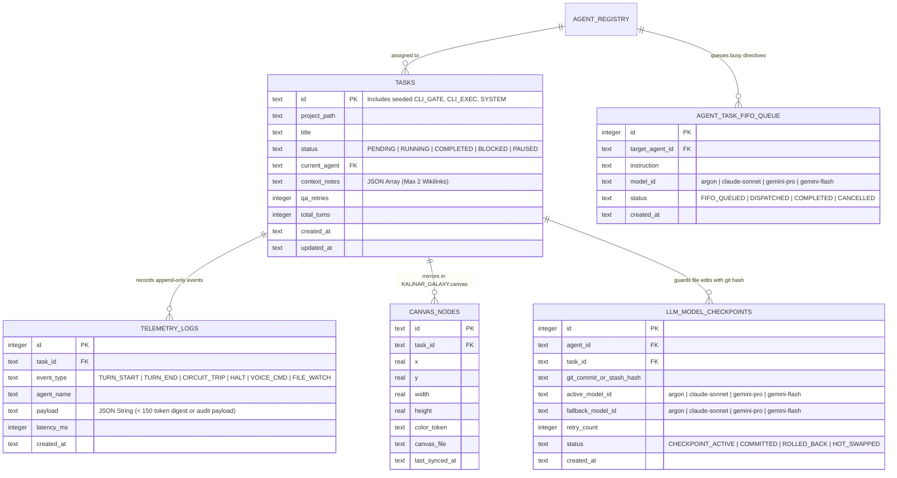

# 05_BACKEND_SCHEMA.md — KALINAR SINGULARITY BACKEND SCHEMA, JDM GRAPHS & SECURITY (v1.1.0 LOCK)

> **Document ID:** `DOC-05-BACKEND-SCHEMA-KALINAR-v1.1.0`  
> **Lead Agents:** `@agent-software-engineer` + `@agent-cybersecurity` + `@agent-data`  
> **Co-Authors:** `@human-developer`, `@agent-design`, `@agent-orchestrator`, `@agent-qa`  
> **Gate Status:** `APPROVED_BY_SWARM_LOCKED_V1_1_0`  
> **Visual Constraint:** `STRICT ZERO-EMOJI ENFORCEMENT — ASCII & MONOSPACE TELEMETRY ONLY`

---

## Collaborative Sign-Off Header Table

| Participant | Domain Role | Review Focus | Status | Timestamp (UTC) | Cryptographic / Msg Ref |
| :--- | :--- | :--- | :---: | :---: | :--- |
| `@human-developer` | Sovereign Principal Architect | WAL DDL, 5 JDM Graphs, Multi-Model Checkpoints, v1.1.0 Lock | `APPROVED` | `2026-11-03T19:09:00Z` | `PO-APPROVAL-SCH-110` |
| `@agent-software-engineer` | Full-Stack & TDD Architect | `node:sqlite` WAL DDL, FIFO Queue & Git Checkpoint Tables | `APPROVED` | `2026-11-03T19:09:10Z` | `SIG-ENGR-SCH-110` |
| `@agent-cybersecurity` | DevSecOps & PID Gatekeeper | Append-Only Triggers, `PID > 100` Gate, STRIDE Threat Matrix | `APPROVED` | `2026-11-03T19:09:20Z` | `SIG-CSEC-SCH-110` |
| `@agent-data` | Decision Engine Specialist | 5 GoRules ZEN Graphs (`< 0.45ms`), `< 150 token` StreamDigest | `APPROVED` | `2026-11-03T19:09:30Z` | `SIG-DATA-SCH-110` |
| `@agent-orchestrator` | Swarm Facilitator & Product Lead | Two-Phase Voice Ack, Speech Arbitration Rule B, FIFO Routing | `APPROVED` | `2026-11-03T19:09:40Z` | `SIG-ORCH-SCH-110` |
| `@agent-qa` | QA & Traceability Auditor | Foreign Key Seed Integrity (`CLI_GATE`, `CLI_EXEC`, `SYSTEM`) | `APPROVED` | `2026-11-03T19:09:50Z` | `SIG-QATE-SCH-110` |

---

## 1. Production `node:sqlite` WAL DDL & Seeded Integrity (`electron/db/sqliteStore.ts`)

### 1.1 Entity-Relationship Diagram (Mermaid ERD)



### 1.2 Canonical SQLite WAL Schema & Append-Only Triggers

```sql
-- 1. Performance & Integrity Pragmas
PRAGMA journal_mode = WAL;
PRAGMA synchronous = NORMAL;
PRAGMA foreign_keys = ON;
PRAGMA busy_timeout = 5000;

-- 2. Agent Registry Table
CREATE TABLE IF NOT EXISTS agent_registry (
  name TEXT PRIMARY KEY NOT NULL,
  role_description TEXT NOT NULL,
  system_prompt_ref TEXT NOT NULL,
  is_active INTEGER NOT NULL DEFAULT 1 CHECK (is_active IN (0, 1))
);

INSERT OR IGNORE INTO agent_registry (name, role_description, system_prompt_ref) VALUES
('agent-orchestrator', 'Swarm Facilitator, PM, and Queue Controller', '05_AGENTS/agent-orchestrator.md'),
('agent-software-engineer', 'Principal Full-Stack & Contract-First Architect', '05_AGENTS/agent-software-engineer.md'),
('agent-design', 'UI/UX, 3-Tier CSS Tokens, 3D Galaxy Architect', '05_AGENTS/agent-design.md'),
('agent-data', 'Decision Engine Specialist, Zen-Engine, Telemetry', '05_AGENTS/agent-data.md'),
('agent-cybersecurity', 'Zero-Trust Auditor, STRIDE Modeling, Security Lead', '05_AGENTS/agent-cybersecurity.md'),
('agent-qa', 'Test Architect, Vitest, Playwright, DAST Lead', '05_AGENTS/agent-qa.md'),
('agent-content', 'Technical Documentation and Developer Writing Lead', '05_AGENTS/agent-content.md');

-- 3. Tasks Table + Seeded System Keys for Foreign-Key Integrity
CREATE TABLE IF NOT EXISTS tasks (
  id TEXT PRIMARY KEY NOT NULL,
  project_path TEXT NOT NULL,
  title TEXT NOT NULL,
  status TEXT NOT NULL CHECK (status IN ('PENDING', 'RUNNING', 'COMPLETED', 'BLOCKED', 'PAUSED')),
  current_agent TEXT NOT NULL REFERENCES agent_registry(name),
  from_agent TEXT,
  contract_path TEXT,
  context_notes TEXT NOT NULL DEFAULT '[]',
  action_instruction TEXT,
  qa_retries INTEGER NOT NULL DEFAULT 0,
  total_turns INTEGER NOT NULL DEFAULT 0,
  created_at TEXT NOT NULL DEFAULT (strftime('%Y-%m-%dT%H:%M:%fZ', 'now')),
  updated_at TEXT NOT NULL DEFAULT (strftime('%Y-%m-%dT%H:%M:%fZ', 'now'))
);

INSERT OR IGNORE INTO tasks (id, project_path, title, status, current_agent) VALUES
('SYSTEM', 'c:/Kalinar', 'System Daemon', 'COMPLETED', 'agent-orchestrator'),
('CLI_GATE', 'c:/Kalinar', 'GoRules Zen Firewall Gate', 'COMPLETED', 'agent-cybersecurity'),
('CLI_EXEC', 'c:/Kalinar', 'Native Shell Execution', 'COMPLETED', 'agent-software-engineer');

-- 4. Append-Only Telemetry Logs Table & Mutation-Blocking Triggers
CREATE TABLE IF NOT EXISTS telemetry_logs (
  id INTEGER PRIMARY KEY AUTOINCREMENT,
  task_id TEXT NOT NULL REFERENCES tasks(id) ON DELETE CASCADE,
  event_type TEXT NOT NULL,
  agent_name TEXT NOT NULL,
  payload TEXT NOT NULL,
  latency_ms INTEGER NOT NULL DEFAULT 0,
  created_at TEXT NOT NULL DEFAULT (strftime('%Y-%m-%dT%H:%M:%fZ', 'now'))
);

CREATE TRIGGER IF NOT EXISTS trg_telemetry_no_update
BEFORE UPDATE ON telemetry_logs
BEGIN
  SELECT RAISE(ABORT, 'TELEMETRY_IMMUTABLE: UPDATE operations are strictly forbidden on telemetry_logs');
END;

CREATE TRIGGER IF NOT EXISTS trg_telemetry_no_delete
BEFORE DELETE ON telemetry_logs
BEGIN
  SELECT RAISE(ABORT, 'TELEMETRY_IMMUTABLE: DELETE operations are strictly forbidden on telemetry_logs');
END;

-- 5. Canvas Nodes Table (Bidirectional Sync with KALINAR_GALAXY.canvas)
CREATE TABLE IF NOT EXISTS canvas_nodes (
  id TEXT PRIMARY KEY NOT NULL,
  task_id TEXT NOT NULL,
  x REAL NOT NULL DEFAULT 0,
  y REAL NOT NULL DEFAULT 0,
  width REAL NOT NULL DEFAULT 320,
  height REAL NOT NULL DEFAULT 160,
  color_token TEXT NOT NULL DEFAULT '#00F0FF',
  canvas_file TEXT NOT NULL,
  last_synced_at TEXT NOT NULL DEFAULT (strftime('%Y-%m-%dT%H:%M:%fZ', 'now'))
);

-- 6. Busy Agent FIFO Task Queue Table (FLOW-AGENT-FIFO-01)
CREATE TABLE IF NOT EXISTS agent_task_fifo_queue (
  id INTEGER PRIMARY KEY AUTOINCREMENT,
  target_agent_id TEXT NOT NULL REFERENCES agent_registry(name),
  instruction TEXT NOT NULL,
  model_id TEXT NOT NULL CHECK (model_id IN ('argon', 'claude-sonnet', 'gemini-pro', 'gemini-flash')),
  status TEXT NOT NULL DEFAULT 'FIFO_QUEUED' CHECK (status IN ('FIFO_QUEUED', 'DISPATCHED', 'COMPLETED', 'CANCELLED')),
  created_at TEXT NOT NULL DEFAULT (strftime('%Y-%m-%dT%H:%M:%fZ', 'now'))
);

-- 7. Multi-Model LLM Atomic Git Checkpoints Table (FLOW-LLM-FAILOVER-01)
CREATE TABLE IF NOT EXISTS llm_model_checkpoints (
  id INTEGER PRIMARY KEY AUTOINCREMENT,
  agent_id TEXT NOT NULL REFERENCES agent_registry(name),
  task_id TEXT NOT NULL REFERENCES tasks(id) ON DELETE CASCADE,
  git_commit_or_stash_hash TEXT NOT NULL,
  active_model_id TEXT NOT NULL CHECK (active_model_id IN ('argon', 'claude-sonnet', 'gemini-pro', 'gemini-flash')),
  fallback_model_id TEXT NOT NULL CHECK (fallback_model_id IN ('argon', 'claude-sonnet', 'gemini-pro', 'gemini-flash')),
  retry_count INTEGER NOT NULL DEFAULT 0,
  status TEXT NOT NULL CHECK (status IN ('CHECKPOINT_ACTIVE', 'COMMITTED', 'ROLLED_BACK', 'HOT_SWAPPED')),
  created_at TEXT NOT NULL DEFAULT (strftime('%Y-%m-%dT%H:%M:%fZ', 'now'))
);
```

### 1.3 Canonical `KalinarSqliteStore` Repository Methods
* `getHistoricalTelemetry(limit = 100)`: Returns `SELECT id, task_id, event_type, agent_name, payload, latency_ms, created_at as timestamp FROM telemetry_logs ORDER BY id DESC LIMIT ?` to hydrate Tab 2 `EvolutionChartsView`.
* `getEvolutionSummary()`: Returns `{ totalEvents, avgLatencyMs, agentDistribution }` aggregated across `telemetry_logs`.
* `enqueueAgentTaskFifo({ targetAgentId, instruction, modelId })`: Inserts a `FIFO_QUEUED` record into `agent_task_fifo_queue` when the target agent holds `.kalinar-lock` (`[ACTIVE]`) and mirrors the pointer to `WAR_ROOM.md`.
* `recordModelCheckpoint({ agentId, taskId, gitCommitOrStashHash, activeModelId, fallbackModelId, retryCount, status })`: Persists pre-edit Git hashes and tracks automatic model hot-swaps across **Argon**, **Claude**, and **Gemini**.

---

## 2. Five GoRules ZEN Engine Deterministic JDM Graphs (`< 0.45ms` Evaluation)

All 5 graphs reside in `src/rules/*.jdm.json` and are pre-loaded into `ZenFirewall.jdmBufferCache` at startup:

### 2.1 `daemon-event-router.jdm.json`
* **Purpose:** Evaluates `< 150 token` `StreamDigest` payloads and Chokidar `300ms` debounced events, enforces loop suppression and `maxAuditCycles = 2` (`auditCycle >= 3` -> `HALT_AUDIT_CYCLE_CAP`), computes deterministic `baseEtaSeconds`, and maps file paths to Second Brain `[[Wikilinks]]` (strictly capped at max 2 per handoff).
* **Outputs:** `{ action: 'DROP_LOOP_SUPPRESSED' | 'IGNORE_HARD' | 'WATCH_VISUAL_ONLY' | 'HALT_AUDIT_CYCLE_CAP' | 'DISPATCH_AGENT' | 'RECONCILE_WORKSPACE', secondBrainTag, auditAllowed, baseEtaSeconds }`.

### 2.2 `os-execution-firewall.jdm.json`
* **Purpose:** Gates every `kalinar:execute_shell_command` (`powershell.exe -NoProfile`) and `node-pty` command in `< 0.45ms` prior to process creation.
* **Verdict Policies:**
  - `HARD_BLOCK` (`allowed: false`, `riskLevel: 'CRITICAL'`): Rejects recursive deletion (`rm -rf /`, `del /f /s /q`), disk formatting (`Format-Volume`), or raw secret exfiltration.
  - `REQUIRE_APPROVAL` (`allowed: false`, `riskLevel: 'HIGH'`): Holds non-sandboxed network/system mutations for operator approval.
  - `AUTO_ALLOW` (`allowed: true`, `riskLevel: 'LOW'`): Permits safe workspace inspection, `git status`, `vitest`, and `tsc` runs.

### 2.3 `voice-command-guard.jdm.json`
* **Purpose:** Validates spoken `pt-BR` intents and enforces **Speech Arbitration Rule B**.
* **Arbitration Invariant:** When `voiceState === '[LISTENING PT-BR]'`, standard Phase 2 `STATUS_VERIFIED` messages are routed to `PendingVoiceQueue` (`deliveryMode: 'QUEUE_UNTIL_SILENCE'`). Immediate audio preemption (`deliveryMode: 'PREEMPT_IMMEDIATE'`) is permitted **exclusively** when `swarmStatus === '[HALTED]'` or `firewallVerdict === 'HARD_BLOCK'`.

### 2.4 `execution-gate.jdm.json`
* **Purpose:** Enforces `AUTO_PILOT`, `STEP_BY_STEP_GATE`, and `SANDBOX_DRY_RUN` modes, verifies Single-Writer Lock ownership (`.kalinar-lock`), and enforces `validatePidSafety(pid)` (`Number.isInteger(pid) && pid > 100`) before any OS signal (`SIGSTOP`, `SIGCONT`, `SIGTERM`, `taskkill`).

### 2.5 `llm-model-router.jdm.json`
* **Purpose:** Selects the optimal primary and fallback LLM engine (**Argon**, **Claude**, or **Gemini**) per task domain and triggers automatic hot-swap + Atomic Git Rollback on `HTTP_429` or `TIMEOUT`:

```json
{
  "nodes": [
    {
      "id": "llmRouterTable",
      "type": "decisionTableNode",
      "content": {
        "hitPolicy": "first",
        "inputs": [
          { "field": "taskDomain", "name": "Task Domain" },
          { "field": "errorType", "name": "Provider Error Signal" },
          { "field": "retryCount", "name": "Current Retry Count" }
        ],
        "outputs": [
          { "field": "activeModelId", "name": "Selected Model ID" },
          { "field": "fallbackModelId", "name": "Fallback Model ID" },
          { "field": "recoveryAction", "name": "Checkpoint Action" }
        ],
        "rules": [
          {
            "taskDomain": "any",
            "errorType": "'HTTP_429' | 'TIMEOUT'",
            "retryCount": ">= 1",
            "activeModelId": "'claude-sonnet'",
            "fallbackModelId": "'gemini-pro'",
            "recoveryAction": "'ATOMIC_GIT_ROLLBACK_AND_HOTSWAP'"
          },
          {
            "taskDomain": "'ARCHITECTURE' | 'FULLSTACK_CODE' | 'BLUEPRINT'",
            "errorType": "'NONE'",
            "retryCount": "0",
            "activeModelId": "'argon'",
            "fallbackModelId": "'claude-sonnet'",
            "recoveryAction": "'CREATE_GIT_CHECKPOINT'"
          },
          {
            "taskDomain": "'UI_SHADER' | 'SECURITY_AUDIT'",
            "errorType": "'NONE'",
            "retryCount": "0",
            "activeModelId": "'claude-sonnet'",
            "fallbackModelId": "'argon'",
            "recoveryAction": "'CREATE_GIT_CHECKPOINT'"
          },
          {
            "taskDomain": "'FAST_TRIAGE' | 'VOICE_INTENT'",
            "errorType": "'NONE'",
            "retryCount": "0",
            "activeModelId": "'gemini-flash'",
            "fallbackModelId": "'gemini-pro'",
            "recoveryAction": "'NONE'"
          }
        ]
      }
    }
  ]
}
```

---

## 3. Zod Runtime Contracts & STRIDE Threat Matrix

### 3.1 Canonical Zod Schemas (`src/types/kalinar.ts`)

```typescript
import { z } from 'zod';

// 1. Deterministic 2-Stage Log Triage Digest (< 150 Tokens Hard Cap)
export const StreamDigestSchema = z.object({
  taskId: z.string().min(1),
  agentId: z.string().min(1),
  exitCode: z.number().int(),
  filePath: z.string().optional(),
  line: z.number().int().positive().optional(),
  col: z.number().int().positive().optional(),
  errorSignature: z.string().max(160).optional(),
  digestSummary: z.string().max(420), // Enforces < 150 tokens ceiling
  estimatedTokens: z.number().int().max(150),
});

// 2. Two-Phase Truthful Voice Ack Contract (US-009)
export const TwoPhaseVoiceAckSchema = z.object({
  directiveId: z.string().uuid(),
  ackPhase: z.enum(['STATUS_DISPATCHED', 'STATUS_VERIFIED']),
  voiceState: z.enum([
    '[SINGULARITY: STANDBY]',
    '[LISTENING PT-BR]',
    '[GRAVITY_INGESTION]',
    '[KALINAR_SPEAKING]',
    '[VOICE_HIBERNATE]',
  ]),
  deliveryMode: z.enum(['SPEAK_NOW', 'QUEUE_UNTIL_SILENCE', 'PREEMPT_IMMEDIATE']),
  sqliteVerified: z.boolean(),
  exitCodeVerified: z.number().int().nullable(),
  spokenPhrasePtBr: z.string().min(1),
});

// 3. Busy Agent FIFO Queue Contract (FLOW-AGENT-FIFO-01)
export const FifoQueueItemSchema = z.object({
  id: z.number().int().positive().optional(),
  targetAgentId: z.string().min(1),
  instruction: z.string().min(1),
  contextWikilinks: z.array(z.string()).max(2),
  modelId: z.enum(['argon', 'claude-sonnet', 'gemini-pro', 'gemini-flash']),
  status: z.enum(['FIFO_QUEUED', 'DISPATCHED', 'COMPLETED', 'CANCELLED']),
});

// 4. Multi-Model LLM Router & Atomic Git Checkpoint Contract (US-010)
export const LlmModelRouteSchema = z.object({
  agentId: z.string().min(1),
  taskId: z.string().min(1),
  gitCommitOrStashHash: z.string().min(7),
  activeModelId: z.enum(['argon', 'claude-sonnet', 'gemini-pro', 'gemini-flash']),
  fallbackModelId: z.enum(['argon', 'claude-sonnet', 'gemini-pro', 'gemini-flash']),
  retryCount: z.number().int().min(0).max(3),
  recoveryAction: z.enum([
    'CREATE_GIT_CHECKPOINT',
    'RETRY_WITH_BACKOFF',
    'ATOMIC_GIT_ROLLBACK_AND_HOTSWAP',
    'NONE',
  ]),
});
```

### 3.2 STRIDE Threat Matrix (`@agent-cybersecurity`)

| STRIDE Category | Specific KALINAR Attack Vector | Severity | Deterministic Mitigation & Verification Gate |
| :--- | :--- | :---: | :--- |
| **Spoofing** | Renderer script attempts invoking unwhitelisted IPC channels or spoofing PID `0`/`1` to kill OS kernel processes. | `CRITICAL` | Strict `ELECTRON_IPC_CHANNELS` whitelist in `preload.ts` + `validatePidSafety(pid)` enforcing integer `PID > 100`. |
| **Tampering** | Compromised process attempts `UPDATE` or `DELETE` on `telemetry_logs`, or leaves half-written corrupt code after LLM stream drop. | `CRITICAL` | SQLite triggers `trg_telemetry_no_update` / `trg_telemetry_no_delete` (`RAISE(ABORT)`) + Atomic Git Checkpoints rolling back dirty partial files prior to hot-swap. |
| **Repudiation** | Agent claims task completion via voice before command finishes or when build exits with non-zero code. | `HIGH` | Two-Phase Voice Ack (`TwoPhaseVoiceAckSchema`): `STATUS_VERIFIED` requires `exitCode === 0` and committed SQLite row. |
| **Information Disclosure** | Raw 50MB terminal dump containing env vars or secrets forwarded to conversational voice plane. | `HIGH` | Layer 3 `Stream-to-Digest` Ring Buffer strips secrets and compresses logs into `< 150 tokens` (`StreamDigestSchema`). |
| **Denial of Service** | Chokidar self-write infinite loop, unbounded agent audit loop, or HTTP 429 provider lockup. | `CRITICAL` | `.kalinar-lock` single-writer token, `maxAuditCycles = 2` in `daemon-event-router.jdm.json`, and automatic failover across **Argon**, **Claude**, and **Gemini**. |
| **Elevation of Privilege** | Destructive shell command (`rm -rf /`, `Format-Volume`) injected via Tab 4 CLI or acoustic voice echo loop. | `CRITICAL` | `os-execution-firewall.jdm.json` (`< 0.45ms` `HARD_BLOCK`) + `EngageMicInterlock` hardware mute + `400ms` post-TTS decay. |
