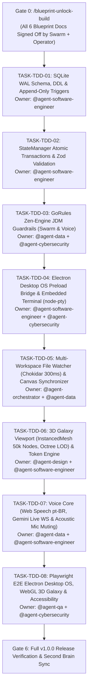

# 06 - Master Execution & Phased TDD Implementation Plan (`06_IMPLEMENTATION_PLAN.md`)

> Document ID: `DOC-06-IMPLEMENTATION-PLAN-KALINAR`  
> Lead Agents: `@agent-orchestrator` + `@agent-software-engineer`  
> Co-Authors: `@human-developer`, `@agent-design`, `@agent-cybersecurity`, `@agent-data`, `@agent-qa`  
> Gate Status: `APPROVED_BY_SWARM_PENDING_HUMAN`  
> Visual Constraint: `STRICT ZERO-EMOJI ENFORCEMENT - TYPOGRAPHICAL & ASCII ONLY`

---

## Collaborative Sign-Off Header Table

| Participant | Domain Role | Review Focus | Status | Timestamp (UTC) | Cryptographic / Msg Ref |
| :--- | :--- | :--- | :---: | :---: | :--- |
| `@human-developer` | Execution Gatekeeper & Final Authority | Milestone Order, Scope Lock, Build Unlock | `PENDING` | -- | `PO-APPROVAL-PENDING` |
| `@agent-orchestrator` | Swarm Facilitator & Product Lead | Dispatch Topology, Traceability (`TRACE-05`) | `APPROVED` | `2026-10-28T11:30:00Z` | `SIG-ORCH-PLN-002` |
| `@agent-software-engineer` | Full-Stack & TDD Architect | Electron TDD, WebGL Mesh Tests, SQLite WAL | `APPROVED` | `2026-10-28T11:31:00Z` | `SIG-ENGR-PLN-002` |
| `@agent-cybersecurity` | Shift-Left DevSecOps Lead | IPC Security, Voice Audio Injection Gates | `APPROVED` | `2026-10-28T11:32:00Z` | `SIG-CSEC-PLN-002` |
| `@agent-design` | UI/UX & Design System Architect | Playwright Visual QA, 3D Galaxy 60 FPS Gate | `APPROVED` | `2026-10-28T11:33:00Z` | `SIG-DSGN-PLN-002` |
| `@agent-data` | Decision Engine Specialist | Zen-Engine Test Matrices & Canvas Reconciliation | `APPROVED` | `2026-10-28T11:34:00Z` | `SIG-DATA-PLN-002` |
| `@agent-qa` | Test Architect & Quality Lead | Vitest Coverage (100% Core), Zero Flake Gates | `APPROVED` | `2026-10-28T11:35:00Z` | `SIG-QATE-PLN-002` |

---

## 1. End-to-End Requirement Traceability Matrix (`TRACE-01` to `TRACE-05`)

| PRD Story ID | TRD Invariant | App Flow State | Design System Slot / Token | Backend Schema / Table | TDD Task ID |
| :--- | :--- | :--- | :--- | :--- | :--- |
| `US-001` (Atomic SQLite Turn) | Node 24 `DatabaseSync`, WAL Mode | `STATE-TASK-01` (`ExecutingAgentTurn`) | `<SwarmDashboard.LiveIndicator>` | `tasks`, `turns`, `BEGIN IMMEDIATE` | `TASK-TDD-01`, `TASK-TDD-02` |
| `US-002` (Zen-Engine Circuit Breaker) | JDM Rule Engine, `p95 < 1ms` | `STATE-CB-01` (`CLOSED` -> `OPEN`) | `<CircuitBreakerPanel.Gauge>` | `circuit_breaker_events`, JDM rule | `TASK-TDD-03` |
| `US-003` (Voice Core & Mic Mute) | Web Speech API + Gemini Live WS | `FLOW-VOICE-JARVIS-01` (`TriggerTTSResponse`) | Voice Pulse HUD, Mic Mute Interlock | `VoiceCommandIntentSchema`, Voice JDM | `TASK-TDD-07` |
| `US-004` (Multi-Workspace Watcher) | Chokidar `300ms` Debounce + Loop Guard | `FLOW-WATCHER-01` (`FilterIgnoredPaths`) | Single-Writer Token Badge | `tasks`, `KALINAR_GALAXY.canvas` | `TASK-TDD-05` |
| `US-005` (Electron Desktop OS & Terminal) | `contextIsolation: true`, `node-pty` | `/terminal` Embedded Viewport | Monospace Terminal Viewport | `ELECTRON_IPC_CHANNELS` | `TASK-TDD-04` |
| `US-006` (3D Galaxy 50k Nodes 60 FPS) | `THREE.InstancedMesh` + Spatial Octree | `FLOW-GALAXY-LOD-01` (`SectorZoom`) | `<Galaxy3DViewport.Canvas>`, `--ds-accent-*` | `canvas_nodes`, InstancedBuffer | `TASK-TDD-06` |
| `US-007` (Append-Only Audit Ledger) | SQLite Trigger Abort on UPDATE/DELETE | Audit Log Viewport | Monospace Tabular Rows | `telemetry_logs`, triggers | `TASK-TDD-01` |
| `US-008` (Bidirectional Canvas Sync) | Atomic File Rewrite (`fs.rename`) | Canvas Sync Reconciler | `--ds-accent-memory`, `--ds-accent-agent` | `canvas_nodes`, `tasks` | `TASK-TDD-05`, `TASK-TDD-06` |

---

## 2. Dependency-Ordered TDD Execution Graph

---

## 3. Atomic TDD Work Packages (`Red -> Green -> Refactor`)

### `TASK-TDD-01`: SQLite WAL Schema, DDL & Append-Only Trigger Tests
* **Assigned Pair:** `@agent-software-engineer` + `@agent-cybersecurity`
* **Red Phase (Failing Tests):**
  1. Test asserting `telemetry_logs` rejects `UPDATE` queries with SQLite error code `RAISE(ABORT)`.
  2. Test asserting `telemetry_logs` rejects `DELETE` queries with SQLite error code `RAISE(ABORT)`.
  3. Test asserting `PRAGMA journal_mode` resolves to `wal`.
* **Green Phase (Implementation):** Create migration and database initializer using native `node:sqlite`.
* **Verification Gate:** `npx vitest run tests/db-schema.test.ts` (`100% PASS`).

### `TASK-TDD-02`: StateManager Atomic Transactions & Zod Validation
* **Assigned Pair:** `@agent-software-engineer` + `@agent-data`
* **Red Phase (Failing Tests):**
  1. Test asserting `AgentTurnOutputSchema` rejects payloads with more than 2 `contextNotes`.
  2. Test asserting `AgentTurnOutputSchema` rejects empty `contractPath` or invalid `status`.
  3. Test asserting concurrent writes to `recordTurn()` execute atomically without dirty reads.
* **Green Phase (Implementation):** Implement `StateManager` class with `node:sqlite` statements and transactions.
* **Verification Gate:** `npx vitest run tests/state.test.ts` (`100% PASS`).

### `TASK-TDD-03`: GoRules Zen-Engine JDM Guardrails (Swarm & Voice)
* **Assigned Pair:** `@agent-data` + `@agent-cybersecurity`
* **Red Phase (Failing Tests):**
  1. Test asserting 3 consecutive failures immediately trips circuit breaker to `OPEN`.
  2. Test asserting task with 50 turns trips circuit breaker with `MAX_TURNS_PER_TASK_EXCEEDED`.
  3. Test asserting `voice-command-guard.jdm.json` drops voice input when `isAcousticMuted === true`.
  4. Test asserting critical voice commands require spoken confirmation.
* **Green Phase (Implementation):** Configure `rules/swarm-guard.jdm.json`, `rules/voice-command-guard.jdm.json`, and `SwarmCircuitBreaker` class.
* **Verification Gate:** `npx vitest run tests/circuit-breaker.test.ts` (`100% PASS`).

### `TASK-TDD-04`: Electron Desktop OS Preload Bridge & Embedded Terminal (`node-pty`)
* **Assigned Pair:** `@agent-software-engineer` + `@agent-cybersecurity`
* **Red Phase (Failing Tests):**
  1. Test asserting unauthorized IPC channel invocations are rejected by preload bridge.
  2. Test asserting renderer cannot access Node.js globals (`process.env`, `require`, `fs`).
  3. Test asserting `node-pty` native shell spawns and exchanges data over whitelisted IPC.
* **Green Phase (Implementation):** Implement `main.ts`, `preload.ts` with `contextBridge`, and terminal IPC handler.
* **Verification Gate:** `npx vitest run tests/electron-ipc.test.ts` (`100% PASS`).

### `TASK-TDD-05`: Multi-Workspace File Watcher & Canvas Synchronizer
* **Assigned Pair:** `@agent-orchestrator` + `@agent-data`
* **Red Phase (Failing Tests):**
  1. Test asserting file changes within `300ms` window collapse to a single debounced callback.
  2. Test asserting writes with `.kalinar-lock` token are suppressed (loop prevention).
  3. Test asserting task status change synchronizes node color in `KALINAR_GALAXY.canvas`.
* **Green Phase (Implementation):** Implement `chokidar` workspace watcher and canvas JSON delta synchronizer.
* **Verification Gate:** `npx vitest run tests/file-watcher.test.ts` (`100% PASS`).

### `TASK-TDD-06`: 3D Galaxy Viewport (`THREE.InstancedMesh` 50k Nodes) & Token Engine
* **Assigned Pair:** `@agent-design` + `@agent-software-engineer`
* **Red Phase (Failing Tests):**
  1. Test asserting 50,000 nodes generate exactly 1 draw call per archetype via `THREE.InstancedMesh`.
  2. Test asserting Spatial Octree frustum culling suppresses distant point rendering.
  3. Test asserting all CSS custom properties from `DESIGN.md` resolve to valid colors.
* **Green Phase (Implementation):** Implement R3F canvas components, shader materials, and octree LOD manager.
* **Verification Gate:** `npx vitest run tests/galaxy-3d.test.ts` (`100% PASS`).

### `TASK-TDD-07`: Voice Core State Machine & Acoustic Mic Muting Interlock
* **Assigned Pair:** `@agent-data` + `@agent-software-engineer`
* **Red Phase (Failing Tests):**
  1. Test asserting microphone audio stream is muted during synthetic TTS playback.
  2. Test asserting Gemini Live WebSocket client parses streaming `pt-BR` audio chunks.
  3. Test asserting voice intent dispatch executes task status transition.
* **Green Phase (Implementation):** Implement Voice Core controller with hardware-level audio muting interlock.
* **Verification Gate:** `npx vitest run tests/voice-core.test.ts` (`100% PASS`).

### `TASK-TDD-08`: Playwright E2E Electron Desktop OS, WebGL 3D Galaxy & Accessibility
* **Assigned Pair:** `@agent-qa` + `@agent-cybersecurity`
* **Red Phase (Failing Tests):**
  1. Playwright Electron test launching desktop app, asserting 3D Galaxy renders at 60 FPS.
  2. Playwright accessibility audit asserting zero WCAG 2.2 AAA contrast violations.
  3. Security DAST assertion verifying no local paths leak into DOM or IPC logs.
* **Green Phase (Implementation):** Fix any discovered contrast, accessibility, or telemetry leaks.
* **Verification Gate:** `npx playwright test` (`100% PASS`).
