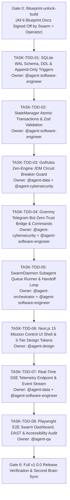

# 06 - Master Execution & Phased TDD Implementation Plan (`06_IMPLEMENTATION_PLAN.md`)

> Document ID: `DOC-06-IMPLEMENTATION-PLAN-KALINAR`  
> Lead Agents: `@agent-orchestrator` + `@agent-software-engineer`  
> Co-Authors: `@human-developer`, `@agent-design`, `@agent-cybersecurity`, `@agent-data`, `@agent-qa`  
> Gate Status: `APPROVED_BY_SWARM_PENDING_HUMAN`  
> Visual Constraint: `STRICT ZERO-EMOJI ENFORCEMENT - TYPOGRAPHICAL & ASCII ONLY`

---

## Collaborative Sign-Off Header Table

| Participant | Domain Role | Review Focus | Status | Timestamp (UTC) | Cryptographic / Msg Ref |
| :--- | :--- | :--- | :---: | :---: | :--- |
| `@human-developer` | Execution Gatekeeper & Final Authority | Milestone Order, Scope Lock, Build Unlock | `PENDING` | -- | `PO-APPROVAL-PENDING` |
| `@agent-orchestrator` | Swarm Facilitator & Product Lead | Dispatch Topology, Traceability (`TRACE-05`) | `APPROVED` | `2026-10-27T23:58:00Z` | `SIG-ORCH-PLN-001` |
| `@agent-software-engineer` | Full-Stack & TDD Architect | Red-Green-Refactor Flow, SQLite Concurrency | `APPROVED` | `2026-10-27T23:59:00Z` | `SIG-ENGR-PLN-001` |
| `@agent-cybersecurity` | Shift-Left DevSecOps Lead | DAST Checkpoints, Negative Security Tests | `APPROVED` | `2026-10-28T00:00:00Z` | `SIG-CSEC-PLN-001` |
| `@agent-design` | UI/UX & Design System Architect | Playwright Visual QA & WCAG AAA Verification | `APPROVED` | `2026-10-28T00:01:00Z` | `SIG-DSGN-PLN-001` |
| `@agent-data` | Decision Engine Specialist | Zen-Engine Test Matrices & Telemetry Assertions | `APPROVED` | `2026-10-28T00:02:00Z` | `SIG-DATA-PLN-001` |
| `@agent-qa` | Test Architect & Quality Lead | Vitest Coverage (100% Core), Zero Flake Gates | `APPROVED` | `2026-10-28T00:03:00Z` | `SIG-QATE-PLN-001` |

---

## 1. End-to-End Requirement Traceability Matrix (`TRACE-01` to `TRACE-05`)

| PRD Story ID | TRD Invariant | App Flow State | Design System Slot / Token | Backend Schema / Table | TDD Task ID |
| :--- | :--- | :--- | :--- | :--- | :--- |
| `US-001` (Atomic SQLite Turn) | Node 24 `DatabaseSync`, WAL Mode | `STATE-TASK-01` (`ExecutingAgentTurn`) | `<SwarmDashboard.LiveIndicator>` | `tasks`, `turns`, `BEGIN IMMEDIATE` | `TASK-TDD-01`, `TASK-TDD-02` |
| `US-002` (Zen-Engine Circuit Breaker) | JDM Rule Engine, `p95 < 1ms` | `STATE-CB-01` (`CLOSED` -> `OPEN`) | `<CircuitBreakerPanel.Gauge>` | `circuit_breaker_events`, JDM rule | `TASK-TDD-03` |
| `US-003` (Telegram Zero-Trust Auth) | Grammy `from.id` Whitelist Guard | `FLOW-TG-01` (`WhitelistCheck`) | Typographical Status Alerts | `TelegramCommandSchema` | `TASK-TDD-04` |
| `US-004` (Telegram Remote Controls) | Inline Keyboard Nonce Validation | `FLOW-TG-01` (`CommandRouter`) | Telegram Monospace Code Blocks | `tasks.status` Mutation | `TASK-TDD-04`, `TASK-TDD-05` |
| `US-005` (Next.js 15 SSE Telemetry) | Edge SSE Stream, First Load `< 75kB` | `STATE-LOADING` -> Dynamic Stream | `<SwarmDashboard.RealtimeTimeline>` | `telemetry_logs`, SSE Route | `TASK-TDD-06`, `TASK-TDD-07` |
| `US-006` (DAG Agent Handoff Graph) | SVG/Canvas Directed Graph | `STATE-TASK-01` (`HANDOFF`) | `<SwarmDashboard.AgentSwarmGrid>` | `turns.agent_name`, `next_agent` | `TASK-TDD-06` |
| `US-007` (Append-Only Audit Ledger) | SQLite Trigger Abort on UPDATE/DELETE | Audit Log Viewport | Monospace Tabular Rows | `telemetry_logs`, triggers | `TASK-TDD-01` |
| `US-008` (Indexed Telemetry Search) | Covered B-Tree Indexes on `created_at` | Filtered Telemetry View | Monospace Search Input | `idx_telemetry_task_created` | `TASK-TDD-01`, `TASK-TDD-07` |

---

## 2. Dependency-Ordered TDD Execution Graph

---

## 3. Atomic TDD Work Packages (`Red -> Green -> Refactor`)

### `TASK-TDD-01`: SQLite WAL Schema, DDL & Append-Only Trigger Tests
* **Assigned Pair:** `@agent-software-engineer` + `@agent-cybersecurity`
* **Red Phase (Failing Tests):**
  1. Test asserting `telemetry_logs` rejects `UPDATE` queries with SQLite error code `RAISE(ABORT)`.
  2. Test asserting `telemetry_logs` rejects `DELETE` queries with SQLite error code `RAISE(ABORT)`.
  3. Test asserting `PRAGMA journal_mode` resolves to `wal`.
* **Green Phase (Implementation):** Create migration and database initializer using native `node:sqlite`.
* **Verification Gate:** `npx vitest run tests/db-schema.test.ts` (`100% PASS`).

### `TASK-TDD-02`: StateManager Atomic Transactions & Zod Validation
* **Assigned Pair:** `@agent-software-engineer` + `@agent-data`
* **Red Phase (Failing Tests):**
  1. Test asserting `AgentTurnOutputSchema` rejects payloads with more than 2 `contextNotes`.
  2. Test asserting `AgentTurnOutputSchema` rejects empty `contractPath` or invalid `status`.
  3. Test asserting concurrent writes to `recordTurn()` execute atomically without dirty reads.
* **Green Phase (Implementation):** Implement `StateManager` class with `node:sqlite` statements and transactions.
* **Verification Gate:** `npx vitest run tests/state.test.ts` (`100% PASS`).

### `TASK-TDD-03`: GoRules Zen-Engine JDM Circuit Breaker Guard
* **Assigned Pair:** `@agent-data` + `@agent-cybersecurity`
* **Red Phase (Failing Tests):**
  1. Test asserting 3 consecutive failures immediately trips circuit breaker to `OPEN`.
  2. Test asserting task with 50 turns trips circuit breaker with `MAX_TURNS_PER_TASK_EXCEEDED`.
  3. Test asserting cyclic handoff between identical agents trips circuit breaker.
  4. Test asserting nominal turn produces `ALLOW` action.
* **Green Phase (Implementation):** Configure `rules/swarm-guard.jdm.json` and `SwarmCircuitBreaker` class.
* **Verification Gate:** `npx vitest run tests/circuit-breaker.test.ts` (`100% PASS`).

### `TASK-TDD-04`: Grammy Telegram Bot Zero-Trust Bridge & Commands
* **Assigned Pair:** `@agent-cybersecurity` + `@agent-software-engineer`
* **Red Phase (Failing Tests):**
  1. Test asserting incoming message from unauthorized user ID is silently dropped (zero bot response).
  2. Test asserting authorized `/status` returns active task summary and inline keyboard.
  3. Test asserting `/pause` command transitions active task to `PAUSED`.
  4. Test asserting `/resume` command transitions active task to `RUNNING`.
* **Green Phase (Implementation):** Implement Grammy bot instance with strict whitelist middleware.
* **Verification Gate:** `npx vitest run tests/telegram-bridge.test.ts` (`100% PASS`).

### `TASK-TDD-05`: SwarmDaemon Subagent Queue Runner & Handoff Loop
* **Assigned Pair:** `@agent-orchestrator` + `@agent-software-engineer`
* **Red Phase (Failing Tests):**
  1. Test asserting queue runner dispatches tasks sequentially based on `TASK_LOCK.json`.
  2. Test asserting handoff context transfers faithfully between Agent A and Agent B.
  3. Test asserting daemon halts gracefully when circuit breaker trips.
* **Green Phase (Implementation):** Implement `SwarmDaemon` execution loop and task locking engine.
* **Verification Gate:** `npx vitest run tests/daemon.test.ts` (`100% PASS`).

### `TASK-TDD-06`: Next.js 15 Mission Control UI Shell & 3-Tier Design Tokens
* **Assigned Pair:** `@agent-design` + `@agent-software-engineer`
* **Red Phase (Failing Tests):**
  1. Test asserting all CSS custom properties from `04_BRIEFING_AND_DESIGN_SYSTEM.md` exist and resolve.
  2. Test asserting `<SwarmDashboard.Root>` renders with proper HTML semantics and zero layout shift.
  3. Test asserting all interactive buttons meet `44px x 44px` hit target requirements.
* **Green Phase (Implementation):** Implement Next.js 15 layout, Tailwind CSS v4 token configuration, and compound components.
* **Verification Gate:** `npx vitest run tests/ui-components.test.ts` (`100% PASS`).

### `TASK-TDD-07`: Real-Time SSE Telemetry Endpoint & Event Stream
* **Assigned Pair:** `@agent-data` + `@agent-software-engineer`
* **Red Phase (Failing Tests):**
  1. Test asserting GET `/api/telemetry/sse` returns `Content-Type: text/event-stream`.
  2. Test asserting committing a new turn outputs a formatted SSE data frame within `< 25ms`.
  3. Test asserting unauthorized clients receive HTTP 401.
* **Green Phase (Implementation):** Implement Next.js SSE Route Handler reading from SQLite WAL changes.
* **Verification Gate:** `npx vitest run tests/telemetry-sse.test.ts` (`100% PASS`).

### `TASK-TDD-08`: Playwright E2E Swarm Dashboard, DAST & Accessibility Audit
* **Assigned Pair:** `@agent-qa` + `@agent-cybersecurity`
* **Red Phase (Failing Tests):**
  1. Playwright E2E test launching dashboard, asserting live updates reflect without page refresh.
  2. Playwright accessibility audit asserting zero WCAG 2.2 AAA contrast violations.
  3. Security DAST assertion verifying no PII or raw filesystem paths leak in the DOM.
* **Green Phase (Implementation):** Fix any discovered contrast, accessibility, or telemetry leaks.
* **Verification Gate:** `npx playwright test` (`100% PASS`).
