# 06_IMPLEMENTATION_PLAN.md — KALINAR SINGULARITY IMPLEMENTATION PLAN & TRACEABILITY (v1.3.0 LOCK)

> **Document ID:** `DOC-06-IMPLEMENTATION-PLAN-KALINAR-v1.3.0`  
> **Lead Agents:** `@agent-orchestrator` + `@agent-software-engineer` + `@agent-qa`  
> **Co-Authors:** `@human-developer`, `@agent-design`, `@agent-cybersecurity`, `@agent-data`, `@agent-content`  
> **Gate Status:** `APPROVED_BY_SWARM_LOCKED_V1_3_0`  
> **Visual Constraint:** `STRICT ZERO-EMOJI ENFORCEMENT — ASCII & MONOSPACE TELEMETRY ONLY`

---

## Collaborative Sign-Off Header Table

| Participant | Domain Role | Review Focus | Status | Timestamp (UTC) | Cryptographic / Msg Ref |
| :--- | :--- | :--- | :---: | :---: | :--- |
| `@human-developer` | Sovereign Principal Architect | `TRACE-01`..`TRACE-08`, 12 Test Suites, Release v1.3.0 Lock | `APPROVED` | `2026-11-06T16:35:00Z` | `PO-APPROVAL-PLN-130` |
| `@agent-orchestrator` | Swarm Facilitator & Product Lead | End-to-End Traceability (`US-001`..`US-011`), Task 10 Deliverables | `APPROVED` | `2026-11-06T16:35:10Z` | `SIG-ORCH-PLN-130` |
| `@agent-software-engineer` | Full-Stack & TDD Architect | Obsidian Canvas 1.0 JSON Sync, Second Brain RAG, SQLite Generic Ref | `APPROVED` | `2026-11-06T16:35:20Z` | `SIG-ENGR-PLN-130` |
| `@agent-cybersecurity` | DevSecOps & PID Gatekeeper | Path Traversal Sanitization (../), Whitelist IPC, Loop Suppression | `APPROVED` | `2026-11-06T16:35:30Z` | `SIG-CSEC-PLN-130` |
| `@agent-design` | UI/UX & Design System Architect | Monospace DSP Tabular-Nums Readout, WCAG AAA, 3D Node Spawning | `APPROVED` | `2026-11-06T16:35:40Z` | `SIG-DSGN-PLN-130` |
| `@agent-data` | Decision Engine Specialist | 5 GoRules ZEN Graphs (< 0.45ms), Cortex Evaluator, Wikilink Cap | `APPROVED` | `2026-11-06T16:35:50Z` | `SIG-DATA-PLN-130` |
| `@agent-qa` | QA & Traceability Auditor | `vitest run` 100% Pass Invariant (12 Suites), Anti-Emoji Invariant | `APPROVED` | `2026-11-06T16:36:00Z` | `SIG-QATE-PLN-130` |

---

## 1. End-to-End Traceability Matrix (`TRACE-01` to `TRACE-08`)

> **Traceability Invariant:** Every user requirement in `01_PRD.md` (`US-001` through `US-011`) is mapped with zero orphans across `02_TRD.md`, `03_APP_FLOW.md`, `04_BRIEFING_AND_DESIGN_SYSTEM.md`, `05_BACKEND_SCHEMA.md`, and verified by deterministic Vitest suites.

| Trace ID | PRD User Story (`01_PRD.md`) | TRD Architecture Module (`02_TRD.md`) | App Flow State Machine (`03_APP_FLOW.md`) | Design System Slot / Token (`04_DESIGN_SYSTEM.md`) | Backend Table / JDM Graph (`05_BACKEND_SCHEMA.md`) | Automated Vitest Gate (`tests/*.test.ts`) |
| :--- | :--- | :--- | :--- | :--- | :--- | :--- |
| `TRACE-01` | `US-001` (262,144 GPGPU Singularity + Navier-Stokes + 50k Galaxy) & `US-002` (Gravitational Second Brain RAG Pull) | `KalinarSingularityCore.tsx`, `singularityShaders.ts`, `NavierStokesSolver.ts`, `SpatialOctree.ts` | `FLOW-GALAXY-LOD-01` (`SingularityOverview` <-> `GravitationalRAGPull` <-> `RelativisticAgentPulse`) | `canvas#singularity-bg`, `--ds-surface-singularity-void: #000000`, `--ds-accent-singularity: #aa88ff`, `--ds-accent-memory: #e879f9` | `canvas_nodes`, `tasks` (`KALINAR_GALAXY.canvas` sync) | `tests/task-2-singularity.test.ts`, `tests/task-7-remediation-v1-0-1.test.ts` |
| `TRACE-02` | `US-003` (Asymmetric HUD, 160px Preview Cards & Live `#AA88FF` Transcript in `[singularity_core]`) | `LeftAgentCardsColumn.tsx`, `RightSingularityHudColumn.tsx`, `AgentLivePreviewCard.tsx` | `FLOW-GALAXY-LOD-01` (`AgentSwarmFocus`), `FLOW-VOICE-KALINAR-01` (`KalinarSpeaking`) | `data-slot="agent-card-viewport"` (`min-h-[160px]`), `data-slot="singularity-hud-root"` (`plus-lighter`), `tabular-nums` | `telemetry_logs`, `--ds-text-secondary: #9a9a9a` (`7.45:1` AAA) | `tests/cycle-2-audit.test.ts`, `tests/task-3-connectors.test.ts`, `tests/task-7-remediation-v1-0-1.test.ts` |
| `TRACE-03` | `US-004` (Universal Agent SDK `IKalinarAgentConnector`, `PID > 100` OS Gate & `480px` Diff Drawer) | `AgentConnectorRegistry.ts`, `OsProcessController.ts`, `NodeInspectorDrawer.tsx`, `kalinar:control_process_pid` | `FLOW-GALAXY-LOD-01` (`NodeInspectorOpen` -> `ExecutionGateDecision`) | `--ds-inspector-drawer-w: 480px`, `[PAUSED]`, `[HALTED]`, `--ds-hit-target-min: 44px` | `execution-gate.jdm.json`, `tasks`, `telemetry_logs` | `tests/task-3-connectors.test.ts` |
| `TRACE-04` | `US-005` (Retractable Bottom IDE Dock `36px -> 350px/75vh`, Step Matrix & SQLite Charts) & `US-006` (Real IPC Shell + ZEN Firewall) | `KalinarBottomDock.tsx`, `TelemetryMatrixTable.tsx`, `EvolutionChartsView.tsx`, `AntigravityCliTab.tsx`, `electron/main.ts` | `FLOW-WATCHER-01` (`SqliteAppendOnlyLog`), `kalinar:execute_shell_command`, `kalinar:get_historical_telemetry` | `data-slot="dock-status-bar"` (`36px`), `data-slot="dock-viewport"` (`350px`/`75vh`), `data-slot="step-fraction"` | `os-execution-firewall.jdm.json` (`< 0.45ms`), `telemetry_logs` (`CLI_GATE`, `CLI_EXEC`, `SYSTEM`) | `tests/kalinar-core.test.ts`, `tests/task-5-dock.test.ts`, `tests/task-6-singularity-v1.test.ts`, `tests/task-7-remediation-v1-0-1.test.ts` |
| `TRACE-05` | `US-007` (Sovereign Voice Lifecycle: `EngageMicInterlock`, `400ms` Decay, `< 10ms` `Esc` Kill-Switch & 90s Hot Window) | `kalinarSingularityBrain.ts`, `kalinarVoiceService.ts`, `ZenFirewall.ts` (`Layer 1` & `Layer 2`) | `FLOW-VOICE-KALINAR-01` (`EngageMicInterlock` -> `PostTtsDecay400ms` -> `HotWindow90s` -> `VoiceAutoHibernate`) | `[SINGULARITY: STANDBY]`, `[LISTENING PT-BR]`, `[KALINAR_SPEAKING]`, `[VOICE_HIBERNATE]`, `data-slot="singularity-voice-transcript"` | `voice-command-guard.jdm.json` (`< 0.45ms`), `telemetry_logs` (`VOICE_CMD`) | `tests/task-4-voice-core.test.ts`, `tests/task-8-voice-multimodel-laws.test.ts` |
| `TRACE-06` | `US-008` (2-Stage `Stream-to-Digest` `< 150 tokens`) & `US-009` (Two-Phase Voice Ack, Speech Arbitration Rule B & Busy Agent FIFO Queue) | `KalinarDaemon.ts` (200-entry Ring Buffer + Regex/AST Extractor), `kalinar:enqueue_agent_fifo` (`Layer 3`) | `FLOW-WATCHER-01` (`StreamToDigestExtractor` -> `Phase2VoiceVerifiedAck`), `FLOW-AGENT-FIFO-01` (`EnqueueAgentFifo`) | `[ACK_DISPATCHED]`, `[ACK_VERIFIED]`, `[FIFO_QUEUED]`, `[STREAM]` | `daemon-event-router.jdm.json`, `agent_task_fifo_queue`, `StreamDigestSchema`, `TwoPhaseVoiceAckSchema`, `FifoQueueItemSchema` | `tests/task-8-voice-multimodel-laws.test.ts` |
| `TRACE-07` | `US-010` (Multi-Model LLM Router across **Argon**, **Claude**, **Gemini** + Atomic Git Checkpoint & Dirty-File Rollback) | `ZenFirewall.ts` (`evaluateLlmModelRouter`), `kalinar:switch_llm_model` (`Layer 4`) | `FLOW-LLM-FAILOVER-01` (`CreateGitCheckpoint` -> `AtomicGitRollback` -> `ZenModelHotSwap` -> `ResumeTurnOnFallbackModel`) | `[MODEL_HOTSWAP]`, `[WARN]`, `[ERROR]` | `llm-model-router.jdm.json`, `llm_model_checkpoints`, `LlmModelRouteSchema` | `tests/task-8-voice-multimodel-laws.test.ts` |
| `TRACE-08` | `US-011` (Bidirectional Obsidian Canvas 1.0 JSON Sync, Live Second Brain Vault RAG & Cortex 5-Graph Evaluator) | `AgentConnectorRegistry.ts`, `sqliteStore.ts`, `SecondBrainCortexTab.tsx`, `kalinarSingularityBrain.ts` | `FLOW-CANVAS-SYNC-01` (`CanvasSync` <-> `VaultRAGQuery` <-> `CortexJDMEval` <-> `TauzVoiceDirectives`) | `data-slot="singularity-acoustic-telemetry"`, `tabular-nums`, `color tokens 5, 6, 3` | `canvas_nodes`, `second_brain_notes`, `daemon-event-router.jdm.json`, `voice-command-guard.jdm.json` | `tests/task-10-canvas-sync-live-cortex.test.ts` |

---

## 2. Verification & TDD Test Suites (`npx vitest run`)

```mermaid
flowchart LR
    S1["1. kalinar-core.test.ts & cycle-2-audit.test.ts<br/>(SQLite WAL, JDM < 0.45ms, WCAG AAA, Zero-Emoji)"]
    S2["2. task-2-singularity.test.ts<br/>(262k GPGPU Disk, Navier-Stokes, 50k InstancedMesh)"]
    S3["3. task-3-connectors.test.ts<br/>(IKalinarAgentConnector, 160px Viewport, PID > 100)"]
    S4["4. task-4-voice-core.test.ts<br/>(Sovereign pt-BR Persona, uVoicePulse, 400ms Decay)"]
    S5["5. task-5-dock.test.ts & task-6-singularity-v1.test.ts<br/>(36px->350px/75vh Dock, SQLite Charts, IPC Shell)"]
    S6["6. task-7-remediation-v1-0-1.test.ts<br/>(v1.0.1 Regression Guards: 262k, 160px, SQLite)"]
    S7["7. task-8-voice-multimodel-laws.test.ts<br/>(7 Voice & Multi-Model Laws: Argon/Claude/Gemini)"]

    S1 --> S2 --> S3 --> S4 --> S5 --> S6 --> S7
```

### 2.1 `tests/kalinar-core.test.ts` & `tests/cycle-2-audit.test.ts`
* **Scope:** Core `KalinarSqliteStore` WAL initialization, `trg_telemetry_no_update` / `trg_telemetry_no_delete` append-only triggers, `< 0.45ms` GoRules ZEN evaluation, WCAG 2.2 AAA contrast compliance ($\ge 7.0:1$ on `#000000`), and 100% zero-emoji / zero-prohibited-persona enforcement.

### 2.2 `tests/task-2-singularity.test.ts`
* **Scope:** Verifies `KalinarSingularityCore` (`262,144` GPGPU accretion disk particles on desktop `512x512` buffer, `pow(aRandom.z, 60.0)` `#AA88FF` sparks), 2D Navier-Stokes cursor fluid solver (`256x256` velocity / `512x512` density), and `50,000` `THREE.InstancedMesh` nodes with Spatial Octree frustum culling (`< 4ms`).

### 2.3 `tests/task-3-connectors.test.ts`
* **Scope:** Verifies Universal Agent Plugin SDK (`IKalinarAgentConnector`), `AgentLivePreviewCard` (`data-slot="agent-card-viewport"`, `min-h-[160px]`), `480px` `NodeInspectorDrawer` live diff inspection, and `OsProcessController.validatePidSafety` (`PID > 100` zero-trust check).

### 2.4 `tests/task-4-voice-core.test.ts`
* **Scope:** Verifies Tauz-style sovereign `pt-BR` persona in `kalinarSingularityBrain.ts`, Web Audio API `AnalyserNode` -> `uVoicePulse` uniform coupling, `18ms/char` `#AA88FF` live transcript streaming inside `[singularity_core]`, `EngageMicInterlock`, and `400ms` post-TTS reverb decay.

### 2.5 `tests/task-5-dock.test.ts` & `tests/task-6-singularity-v1.test.ts`
* **Scope:** Verifies Retractable Bottom IDE Dock (`36px` collapsed -> `350px` / `75vh` expanded), `React.memo` component isolation across all 4 tabs, `TelemetryMatrixTable` (`StepDivisionCell` slots), `node:sqlite` historical `EvolutionChartsView`, real IPC shell (`kalinar:execute_shell_command`), and `electron-builder.yml` packaging.

### 2.6 `tests/task-7-remediation-v1-0-1.test.ts`
* **Scope:** Regression guards locking `262,144` GPGPU desktop particle density, `min-h-[160px]` `AgentLivePreviewCard.LiveViewport`, `< 0.45ms` `os-execution-firewall.jdm.json` blocking of destructive shell commands, and `getHistoricalTelemetry` / `getEvolutionSummary` persistence in `node:sqlite`.

### 2.7 `tests/task-8-voice-multimodel-laws.test.ts`
* **Scope:** Verifies the **7 Sovereign Voice & Multi-Model Laws** introduced in `v1.1.0`:
  1. **Law 1 (`< 10ms` Hardware Kill-Switch):** Pressing `Esc` or clicking the Singularity Core aborts TTS playback and flushes the audio buffer in `< 10ms`.
  2. **Law 2 (`< 150 Token` Stream-to-Digest):** 200-entry O(1) Ring Buffer + regex/AST extractor compresses raw logs into a valid `StreamDigestSchema` payload strictly $\le 150\text{ tokens}$.
  3. **Law 3 (`90s` Hot Window & Auto-Hibernate):** Voice session stays hot for `90s` and automatically transitions to `[VOICE_HIBERNATE]` / local wake listener after `90s` of silence.
  4. **Law 4 (Two-Phase Truthful Voice Ack):** Distinguishes `STATUS_DISPATCHED` (`< 50ms`) from `STATUS_VERIFIED` (emitted strictly after `exitCode === 0` and SQLite commit).
  5. **Law 5 (Speech Arbitration Rule B):** Queues standard `STATUS_VERIFIED` speech in `PendingVoiceQueue` while `voiceState === '[LISTENING PT-BR]'`, preempting exclusively on `[HALTED]` or `HARD_BLOCK`.
  6. **Law 6 (Busy Agent FIFO Queue):** Enqueues directives into `agent_task_fifo_queue` and `WAR_ROOM.md` (`[FIFO_QUEUED]`) when target `@agent-*` holds `.kalinar-lock`, auto-dispatching upon lock release.
  7. **Law 7 (Multi-Model Router & Atomic Git Rollback):** Evaluates `llm-model-router.jdm.json` across **Argon**, **Claude**, and **Gemini**, creates pre-edit Atomic Git Checkpoints (`llm_model_checkpoints`), rolls back dirty partial files on `HTTP_429`/`TIMEOUT`, and hot-swaps to the fallback model.

### 2.8 `tests/task-9-tauz-dsp-live-connectors.test.ts`
* **Scope:** Verifies Task 9 (`v1.2.0`) Tauz Acoustic Web Audio DSP pipeline (`lowshelf` `110Hz` `+7.5dB`, `peaking` `2400Hz` `Q: 1.2` `+3.5dB`, `DynamicsCompressorNode`, `AnalyserNode` `fftSize: 256` -> `getRealtimeFrequencyBands()` normalized in `[0.0, 1.0]`), 60 FPS `uSubBass` and `uCompositePulse` modulation on the `262,144` GPGPU accretion disk, real Git/file diff streaming (`kalinar:get_live_git_diff`, `kalinar:approve_or_revert_diff`, `kalinar:scan_workspace_nodes`) with `../` traversal sanitization, colored `+` `#34D399` / `-` `#F87171` 160px card viewports, and interactive Multi-Model Hot-Swap (`[ ARGON ]`, `[ CLAUDE-3.7-SONNET ]`, `[ GEMINI-2.5-PRO ]`, `[ GEMINI-2.5-FLASH ]`) + FIFO queue promotion/clearing in `NodeInspectorDrawer` and `AntigravityCliTab`.

### 2.9 `tests/task-10-canvas-sync-live-cortex.test.ts`
* **Scope:** Verifies Task 10 (`v1.3.0`) Obsidian Canvas 1.0 JSON format serialization/deserialization, 3D [x, y, z] to 2D (x*4, z*4) coordinate transformation, node colors ("5" Cyan, "6" Purple, "3" Amber), loop suppression via `.kalinar-lock` and `WATCH_VISUAL_ONLY` in `daemon-event-router.jdm.json`, SQLite `canvas_nodes` generic reference without FK constraint to `tasks(id)`, `second_brain_notes` table CRUD operations, zero-trust path-traversal sanitization (`../`), frontmatter extraction, max 2 `[[Wikilinks]]` cap, excerpt < 250 characters, sub-millisecond evaluation (< 1ms, < 0.45ms benchmark) of all 5 production JDM graphs, monospace tabular-nums DSP acoustic telemetry strip (SUB-110HZ, PRES-2.4KHZ, PULSE) from `kalinarVoiceService.getRealtimeFrequencyBands()`, sovereign pt-BR voice directives with tactical Tauz confirmations, strictly 0 emojis across all files, and 0 occurrences of prohibited terms ("J.A.R.V.I.S.", "corner orb").

---

## 3. Release Quality Gate Checklist

1. **Frontend TypeScript Gate:** `npx tsc --noEmit` (`0 errors`).
2. **Electron Main/Preload TypeScript Gate:** `npx tsc -p tsconfig.electron.json --noEmit` (`0 errors`).
3. **Full Vitest Verification Suite:** `npx vitest run` (`100% pass` across all test files).
4. **Production Desktop Build Gate:** `npm run desktop:build` (`Vite bundle + Electron build` exit code `0`).
5. **Second Brain Audit Log & Sync:** `second-brain-cli.ps1 log` + `second-brain-cli.ps1 sync`.
