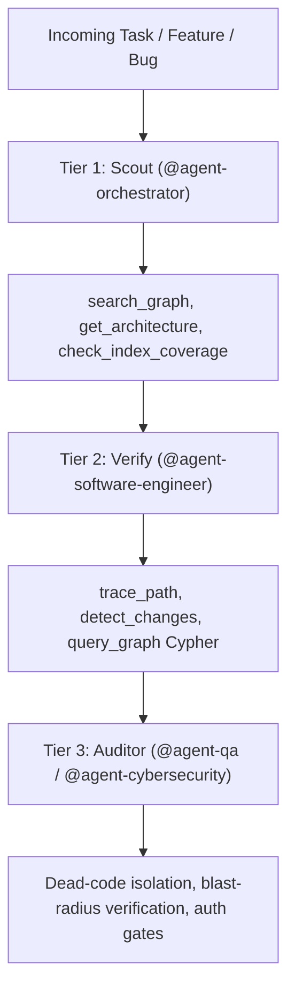

# Master Capability Matrix: Skills, MCPs & Autonomous Swarm

> **Purpose:** Canonical Map of Content (MOC) centralizing all installed agent capabilities, MCP servers, evaluation scripts, and multi-agent governance protocols across workstation (`C:\Users\thiag`) and cloud runtime environments.

---

## Root Architecture & Search Precedence

1. **Workspace Swarm (`.antigravity\`)** -> Project-level A2A governance, Blueprint Lock, and workspace rules.
2. **Global Gemini (`C:\Users\thiag\.gemini\config\skills\`)** -> Machine-level skills discovered by Antigravity runtime.
3. **Agentes CLI (`C:\Users\thiag\.agents\skills\`)** -> Skills accessible via `skills.sh` CLI (`caveman`, `surgical-patch`, `grill-me`, `design-taste-frontend`).
4. **Global Claude (`C:\Users\thiag\.claude\skills\`)** -> Machine-level Claude Code skills.
5. **Built-in Antigravity (`...\builtin\skills\`)** -> Native IDE capabilities (`agy-customizations`, `automation`, `generative_ui`).

---

## 1. Web Engineering, React 19, Next.js 15/16 & Vercel Runtime

### `vercel-react-best-practices`
- **Path:** `C:\Users\thiag\.gemini\config\skills\vercel-react-best-practices\SKILL.md`
- **Trigger:** React 19 component creation, refactoring, or Next.js route construction.
- **Execution Contract:** Eliminates sequential data waterfalls via `Promise.all`, enforces strict Server/Client component boundaries (RSC), and eliminates client bundle bloat.

### `vercel-composition-patterns`
- **Path:** `C:\Users\thiag\.gemini\config\skills\vercel-composition-patterns\SKILL.md`
- **Trigger:** Components with excessive boolean props or tightly coupled UI markup.
- **Execution Contract:** Implements Compound Components, clean slot injection, and React 19 `use()` promise resolution.

### `vercel-react-view-transitions`
- **Path:** `C:\Users\thiag\.gemini\config\skills\vercel-react-view-transitions\SKILL.md`
- **Trigger:** Route transitions and animated layout state changes.
- **Execution Contract:** Implements native browser CSS View Transitions API wrapped in `<ViewTransition>` components.

### `vercel-react-native-skills`
- **Path:** `C:\Users\thiag\.gemini\config\skills\vercel-react-native-skills\SKILL.md`
- **Trigger:** Mobile development with React Native and Expo.
- **Execution Contract:** 60/120fps list rendering, native navigation pipelines, and mobile memory budgeting.

### `next-best-practices`
- **Path:** `C:\Users\thiag\.gemini\config\skills\next-best-practices\SKILL.md`
- **Trigger:** Next.js App Router layout structuring, Server Actions, Route Handlers, and cache architecture.
- **Execution Contract:** Async request APIs (`params`, `cookies`, `headers`), SEO metadata generation, and server action mutation security.
- **On-Demand Sub-References (Cache & Prefetching):** Groups `next-cache-components` (`next-cache-components-adoption`, `next-cache-components-optimizer`) for `'use cache'`, `cacheLife`, and `cacheTag` invalidation; and `next-partial-prefetching` (`next-partial-prefetching-adoption`, `next-partial-prefetching-optimizer`) for route preloading. Invocable strictly on demand; never scanned in general triage.

### `next-bundle-optimizer`
- **Path:** `C:\Users\thiag\.gemini\config\skills\next-bundle-optimizer\SKILL.md`
- **Trigger:** Oversized initial client bundle, high LCP/INP scores, or duplicate browser dependencies.
- **Execution Contract:** Analyzes imports, configures `next/dynamic` chunking, tree-shaking, and isolates server-only modules.

### `next-dev-loop`
- **Path:** `C:\Users\thiag\.gemini\config\skills\next-dev-loop\SKILL.md`
- **Trigger:** Real-time local debugging during Next.js development.
- **Execution Contract:** Couples the Next.js `/_next/mcp` endpoint to `agent-browser` to validate server logs, hydration state, and visual DOM simultaneously.

### `next-upgrade`
- **Path:** `C:\Users\thiag\.gemini\config\skills\next-upgrade\SKILL.md`
- **Trigger:** Next.js major/minor version migration.
- **Execution Contract:** Runs official automated codemods and updates deprecated routing APIs.

### `vercel-optimize`
- **Path:** `C:\Users\thiag\.gemini\config\skills\vercel-optimize\SKILL.md`
- **Trigger:** High compute billing, slow serverless cold starts, or edge function optimization.
- **Execution Contract:** Tunes Fluid Compute limits, CDN caching headers, and serverless execution timeouts.

### `deploy-to-vercel` & `vercel-cli-with-tokens`
- **Trigger:** Production and preview deployments via Vercel CLI.
- **Execution Contract:** Non-interactive deployment scripting with secure token authentication.

### `turborepo`
- **Path:** `C:\Users\thiag\.gemini\config\skills\turborepo\SKILL.md`
- **Trigger:** Monorepo package management, task pipelines, and caching.
- **Execution Contract:** Configures `turbo.json`, local/remote build caching, package boundaries, and CI parallelism.

---

## 2. `@json-render` Generative UI & Multi-Target Rendering

### Core Engine & Code Generation
- **`@json-render/core` (`core`):** Schema catalog parser converting JSON specifications into dynamic component ASTs.
- **`@json-render/codegen` (`codegen`):** Static code generator exporting JSX/TSX from declarative JSON UI specs.
- **`directives`:** Inline data transformations via `$format`, `$math`, and `$t` internationalization directives.
- **`yaml` (`@json-render/yaml`):** Streaming YAML specification parser with AI SDK schema transforms.
- **`mcp` (`@json-render/mcp`):** Model Context Protocol server exposing interactive UI rendering inside agent chat interfaces.

### Supported Web, Mobile & Design System Targets
- **Web & Mobile Frameworks:** `react`, `next`, `tanstack-start`, `react-native`. (Legacy/unused frameworks `vue`, `svelte`, `solid` pruned from active routing).
- **UI Kits:** `shadcn` (React primitives). (`shadcn-svelte` pruned).

### Media, 3D, Document & Terminal Renderers
- **`react-three-fiber`:** Declarative Three.js 3D scenes, camera rigs, lighting, and WebGL shaders from JSON specs.
- **`image`:** Dynamic OpenGraph (OG) image, SVG, and PNG generation via Satori.
- **`react-pdf`:** High-precision paged PDF document compiler from structured JSON layouts.
- **`react-email`:** Client-resilient transactional and marketing email template generation.
- **`ink`:** Interactive terminal user interfaces (TUI) rendered using React in CLI environments.
- **Programmatic Video Note:** `remotion` pruned from active triage; all video production consolidated under `hyperframes`.

### DevTools & State Management
- **Inspectors:** `devtools`, `devtools-react`. (`devtools-vue`, `devtools-svelte`, `devtools-solid` pruned).
- **State Stores:** Native integration with `zustand` and `xstate` finite state machines. (`jotai` and `redux` pruned).

---

## 3. Structural Code Graph Engine (`codebase-memory-mcp` v0.12.1)

[RULE: MANDATORY 3-TIER GRAPH WORKFLOW BEFORE GREP/GLOB]
Before running raw text searches (`grep`, `Select-String`, `rg`) across unknown architectures, agents MUST query `codebase-memory-mcp` (`C:\Users\thiag\AppData\Local\Programs\codebase-memory-mcp\codebase-memory-mcp.exe`):

### 1. Tier 1: Scout (`@agent-orchestrator`)
- `search_graph`: Discovers semantic symbols and structural relationships.
- `get_architecture`: Retrieves high-level architectural layering and module topology.
- `check_index_coverage`: Verifies repository AST indexing completeness before dispatch.

### 2. Tier 2: Verify (`@agent-software-engineer`)
- `trace_path`: Maps upstream callers and downstream callees across function boundaries.
- `detect_changes`: Evaluates AST impact and breaking changes from a git diff before editing.
- `query_graph`: Executes Cypher queries for deep structural assertions.

### 3. Tier 3: Auditor (`@agent-qa` / `@agent-cybersecurity`)
- Validates blast radius of pull requests.
- Identifies dead or orphan functions.
- Verifies that all mutations flow through authenticated session gates (ADR-001).

---

## 4. Engineering & TDD Workflows (`superpowers` v7.0.1)

Plugin installed at `C:\Users\thiag\.gemini\config\plugins\superpowers` and `C:\Users\thiag\.claude\plugins\superpowers`. Provides 15 structured engineering skills mapped directly to the 7 Core Agents:

| Skill | Primary Agent | Workflow Description |
| :--- | :--- | :--- |
| `brainstorming` | `@agent-orchestrator` | Socratic discovery of requirements and architecture before coding. |
| `writing-plans` | `@agent-orchestrator` | Granular work-package breakdown with atomic verifiable steps. |
| `executing-plans` | `@agent-software-engineer` | Inline implementation of approved implementation plans. |
| `subagent-driven-development` | `@agent-orchestrator` | Parallel task dispatch across isolated subagents. |
| `dispatching-parallel-agents` | `@agent-orchestrator` | Concurrent execution of 2+ independent, non-overlapping tasks. |
| `test-driven-development` | `@agent-software-engineer` | Strict RED-GREEN-REFACTOR cycle: tests written and failing before code. |
| `systematic-debugging` | `@agent-software-engineer` | 4-phase root-cause investigation: observe, isolate, hypothesize, verify. |
| `verification-before-completion` | `@agent-qa` | Verifies tests, lint, builds, and runtime logs before delivery sign-off. |
| `requesting-code-review` | `@agent-software-engineer` | Prepares structured PR summaries highlighting security and latency. |
| `receiving-code-review` | `@agent-software-engineer` | Evaluates adversarial code feedback and applies minimal diffs. |
| `using-git-worktrees` | `@agent-software-engineer` | Isolates feature development in clean worktrees to prevent stash conflicts. |
| `finishing-a-development-branch` | `@agent-orchestrator` | Verification, squashing, merging, and worktree cleanup. |
| `writing-skills` | `@agent-orchestrator` | Authors standard `SKILL.md` packages with triggers and instructions. |
| `using-superpowers` | All Core Agents | Bootstraps skill lookup and enforces workflow discipline. |
| `diagnosing-superpowers` | `@agent-orchestrator` | Audits and repairs superpower plugin registration and tool hooks. |

---

## 5. Specialist Subagent Delegation (`agency-agents` - 267 Specialists)

- **Source Repository:** `C:\Users\thiag\.gemini\antigravity\scratch\agency-agents` (`msitarzewski/agency-agents`).
- **Installed Skills:** `C:\Users\thiag\.gemini\config\skills\agency-<slug>\SKILL.md` (267 skills).
- **Claude Code Personas:** `C:\Users\thiag\.claude\agents\<division>-<slug>.md` (267 personas).
- **Desktop Controller App:** `Agency_Agents_0.3.2_x64-setup.exe` (Tauri x64).

### Delegation Protocol
Any of the 7 Core Agent Hubs may spawn specialized sub-personas for deep domain execution while retaining architectural authority:
- `@agent-software-engineer` -> Spawns `agency-database-optimizer`, `agency-api-platform-engineer`, `agency-rust-refactoring-specialist`.
- `@agent-design` -> Spawns `agency-cartography-designer`, `agency-inclusive-visuals-specialist`, `agency-3d-scene-developer`.
- `@agent-content` -> Spawns `agency-technical-writer`, `agency-instagram-curator`, `agency-podcast-strategist`.
- `@agent-cybersecurity` -> Spawns `agency-penetration-tester`, `agency-cloud-security-architect`, `agency-threat-detection-engineer`.
- `@agent-qa` -> Spawns `agency-test-automation-engineer`, `agency-api-tester`, `agency-reality-checker`.
- Governance: All subagent findings must be summarized and reported back through `WAR_ROOM.md` with max 2 `[[Wikilinks]]`.

---

## 6. Content, Social, Brand & Video Pipeline (`@agent-content`)

### Brand Identity & Geometric Logo Design (`logo-design`)
- **Paths:** `C:\Users\thiag\.gemini\config\plugins\logo-design` | `C:\Users\thiag\.gemini\config\skills\logo-design\SKILL.md`
- **Second Brain Note:** [[logo-design]]
- **Trigger:** Creation, critique, optical correction, or export of vector logos, marks, and favicons.
- **CLI Tool Suite:**
  - `python search_library.py "<query>"` -> Searches library of 1,400+ categorized vector logos.
  - `python svg_audit.py icon.svg` -> Audits geometry, bezier node density, and scale compliance.
  - `python concept_sheet.py` / `preview_sheet.py` -> Renders responsive test sheets down to 16px.
  - `python presentation_board.py` -> Generates sector-aligned brand presentation mockups.
  - `python export_variants.py` -> Exports full production packages (dark, light, monochrome SVG/PNG/ICO).

### Instagram Content & Reels Automation (`instagram-agent-skill` / `ig-reel`)
- **Suite Composition (13 Skills):** `ig-reel`, `ig-human`, `ig-carousel`, `ig-caption`, `ig-story`, `ig-viral`, `ig-audit`, `ig-profile`, `ig-plan`, `ig-repurpose`, `ig-comment`, `ig-reply`, `ig-dm`.
- **Second Brain Notes:** [[instagram-agent-skill]], [[ig-reel]]
- **Execution Pipeline:**
  1. Hook Scoring (`hookscore.py`): Scores 26 formulas from `hooks.json` across 5 heuristics (`LENGTH`, `SPECIFICITY`, `STAKES`, `FRONTLOAD`, `ADDRESS`) and eliminates dealbreakers (greetings, preambles, hashtags).
  2. Timed Beat Sheet (`beats.py`): Estimates line delivery at `165 wpm`. Flags hooks > 3.0s, static beats > 4.0s, runs of abstract beats, and ensures loop back to beat 1.
  3. Safe-Zone Formatting: Coordinates for 1080x1920 frames: text restricted to `y=230..1440` with right margin of `230px` clear of Instagram UI rails.
  4. Humanizer & AI Detection (`humanize.py` + `detect.py`): Strips invisible zero-width unicode characters, em dashes, and AI vocabulary. Requires `PASS` (`score >= 70`, no metric `< 55`) across burstiness, specificity, slop density, typographic fingerprint, and voice.
  5. Handoff to Video: Clean `REEL READY` scripts feed directly into `[[hyperframes]]` / `[[motion-graphics]]` for programmatic MP4 rendering.

### Copywriting vs. Humanizer
- **Paths:** `C:\Users\thiag\.gemini\config\skills\copywriting\SKILL.md` | `C:\Users\thiag\.gemini\config\skills\humanizer\SKILL.md`
- **Second Brain Notes:** [[copywritingskill]], [[humanizerskill]]
- [RULE: MUTUAL EXCLUSION] Never load `copywritingskill` and `humanizerskill` in the same turn. Use `copywritingskill` for drafting high-converting landing pages, headlines, and CTAs. Use `humanizerskill` strictly for post-draft prose editing and removing AI tells. (`writing-guidelines` pruned).

### Video Engine Router (`hyperframes`)
- **Path:** `C:\Users\thiag\.gemini\config\skills\hyperframes\SKILL.md`
- **Second Brain Note:** [[hyperframes]]
- [RULE: MANDATORY ENTRY ROUTER (70K TOKEN FIX)] `@agent-content` loads `hyperframes.md` as the single active entry point. The 9 sub-skills (`hyperframes-core`, `hyperframes-animation`, `hyperframes-audio`, `hyperframes-cli`, `hyperframes-creative`, `hyperframes-keyframes`, `hyperframes-registry`, `hyperframes-studio`, `media-use`, `motion-graphics`) are strictly lazy-loaded on demand (maximum 1-2 per turn according to pipeline phase). `remotion` and `motionmaxxing` are pruned from active routing.
- **Capabilities:** GSAP seek-safe timelines, deterministic `shot-plan.json`, beat-synchronized audio mixing, and headless cloud rendering (`npx hyperframes cloud render`, `cloudrun render`, `lambda render`).

---

## 7. Data, Rules, Legal & Cloud Infrastructure (`@agent-data`)

### Deterministic Business Rules (`zen-engine`)
- **Path:** `C:\Users\thiag\.gemini\config\skills\zen-engine\SKILL.md`
- **Second Brain Note:** [[zen-engine]]
- **Capabilities:** Rust-powered in-process business rules engine (`<1ms` evaluation) supporting JSON Decision Models (JDM) across Node.js/TypeScript (`@gorules/zen-engine`), C# (`GoRules.ZenEngine`), and Python. Includes `@gorules/jdm-editor` React visual canvas and `trace: true` execution debugging. Eliminates LLM hallucinations in financial calculators, credit scoring, and tool-call guardrails.

### Brazilian Legal Corpus RAG Pipeline (`leis-brazil`)
- **Dataset Path:** `C:\Users\thiag\Downloads\leis-main\leis-main`
- **Second Brain Note:** [[leis-brazil]]
- **Corpus Size:** 1,113,033 official legal documents in Markdown with YAML frontmatter.
- **Search Pipeline:** Ultra-fast ripgrep regex queries targeting article blocks (`Art. X`) within regulatory folders (`bcb`, `cvm`, `rfb`, `stf`, `stj`, `federal`).

### Google Cloud Platform (GCP) & BigQuery Guardrails
- **`accidental-data-loss-prevention`:** Enforces **STOP AND VERIFY** confirmation before running destructive queries (`DROP`, `TRUNCATE`, `DELETE` without `WHERE`, `gcloud rm`).
- **`google-cloud-auth-verification`:** Step 0 credential and ADC validation.
- **`enforcing-resource-attribution`:** Injects cost-center tracking labels on all `bq` queries and resources.
- **`managing-python-dependencies`:** Prohibits global `pip install`; mandates virtual environment isolation via `uv` or `venv`.
- **Pipelines & Analytics:** `bigquery-sql` optimization, `dbt-bigquery`, `dataform-bigquery`, `gcp-dataflow` (Apache Beam), `gcp-spark` on Dataproc Serverless, and `building-data-apps` dashboards.

---

## 8. Browser Automation, Testing & Security Verification (`@agent-qa` / `@agent-cybersecurity`)

### DOM Automation & Cloud Sandbox (`agent-browser` + `next-dev-loop`)
- **Paths:** `C:\Users\thiag\.gemini\config\skills\agent-browser\SKILL.md` | `next-dev-loop\SKILL.md`
- **Second Brain Note:** [[agent-browser]]
- **Capabilities:** Rust CDP headless/headful browser automation for interactive DOM traversal, form interaction, visual regression snapshots, and cloud verification (`vercel-sandbox`, `agentcore`). Deprecated scratch paths (`playwright-cli`, `playwright-component`, `playwright-trace`) pruned from active inventory.

### UI Art Direction Authority (`design-taste-frontend`)
- **Paths:** `C:\Users\thiag\.gemini\config\skills\design-taste-frontend\SKILL.md` | `C:\Users\thiag\.agents\skills\design-taste-frontend\SKILL.md`
- **Second Brain Note:** [[design-taste-frontend]]
- [RULE: SINGLE AUTHORITATIVE DESIGN ENGINE] Mandatory anti-slop art direction engine derived from 247 award-winning websites. Generates directions via `scripts/draw.mjs`, enforces typography/color tokens, and validates visual appeal in real browsers via `scripts/inspect.mjs`. Conflicting skills (`yoursite-design`, `web-design-guidelines`) pruned.

### Reverse Engineering Architecture (`reverse-engineer-anything` / `rea`)
- **Server:** Model Context Protocol `rea` server.
- **Capabilities:** Static and dynamic inspection of compiled binaries, Mach-O, PE resources, Electron application bundles, APKs/IPAs, and minified JS bundles to reconstruct clean architectural specifications.

---

## 9. Surgical Engineering & Token Economy Tools

### `surgical-patch`
- **Path:** `C:\Users\thiag\.agents\skills\surgical-patch\SKILL.md`
- **Rule:** Forbids full-file rewrites during bug fixes or feature additions. Demands minimal, localized diff blocks preserving surrounding code and indentation.

### `caveman`, `caveman-commit`, `caveman-review`
- **Paths:** `C:\Users\thiag\.agents\skills\caveman*\SKILL.md`
- **Rule:** Eliminates conversational fluff. Enforces ultra-concise, technical responses, conventional semantic commit messages, and high-impact code reviews focused strictly on bugs, latency, and security.

> **Second Brain Graph:** [[00_INDEX]] | [[04_STACK_E_SKILLS_INDEX]] | [[skills]] | #skill #stack
